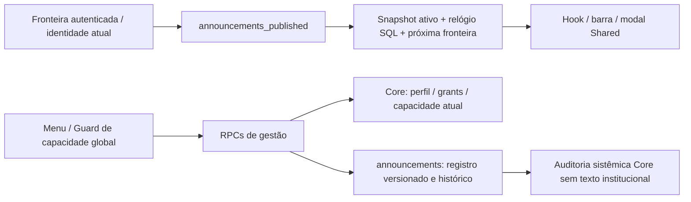
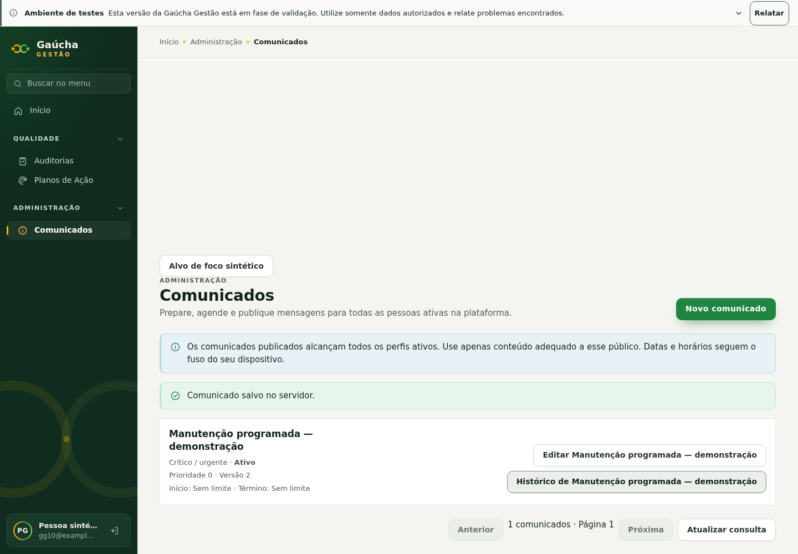
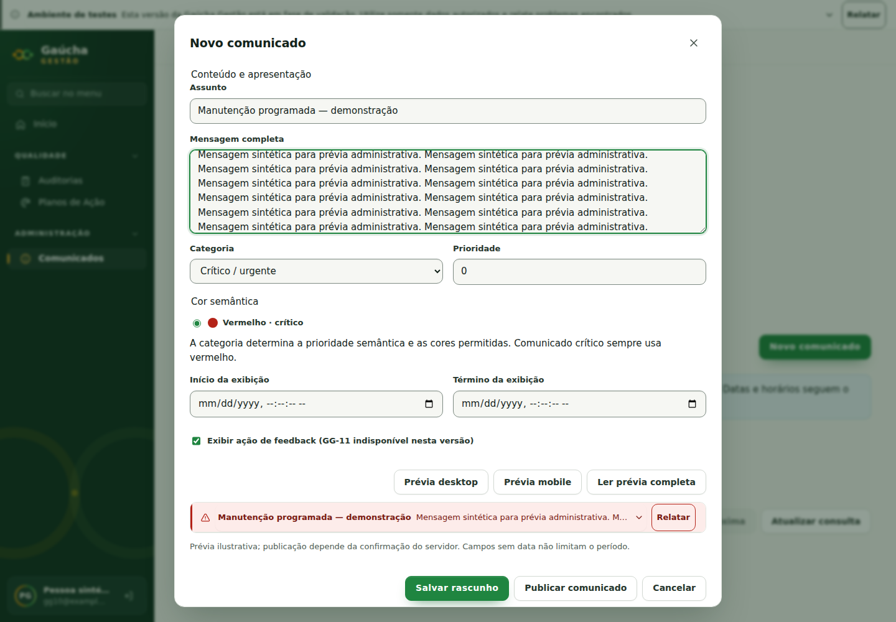
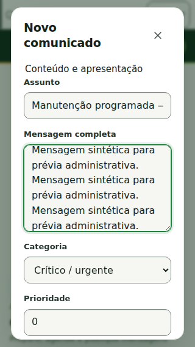
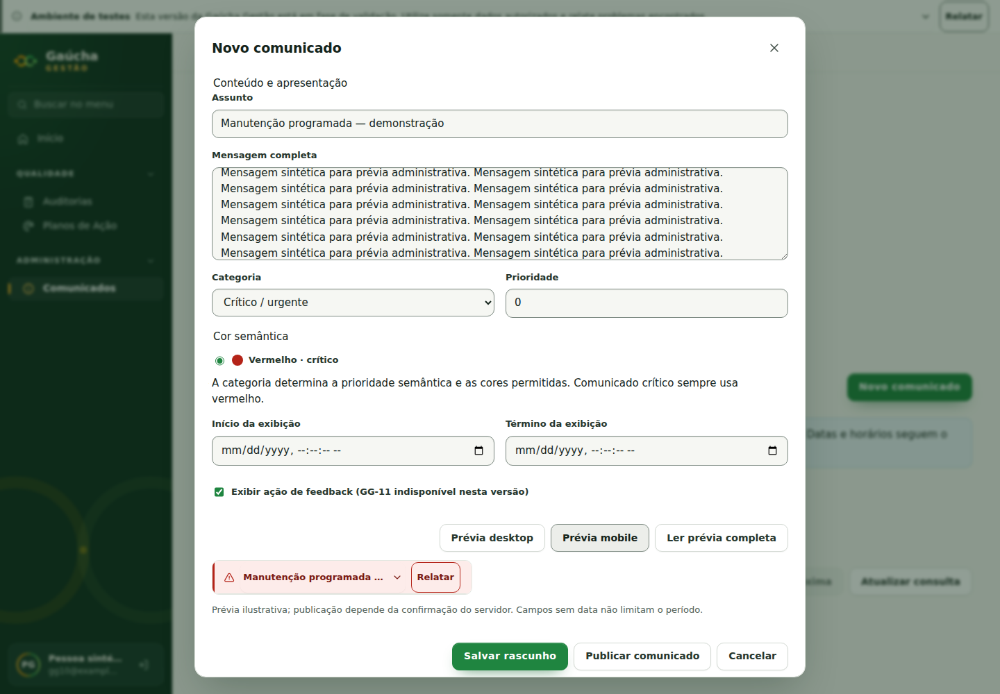

# GG-10 — Proposta técnica e contrato administrativo v1

## Estado local atual — 05/11/2026

O mantenedor autorizou posteriormente desenvolvimento real e aplicação incremental
no `gaucha-gestao-local`. A migration GG-10 foi aplicada (31→32 migrations), o
comunicado sintético foi criado/publicado pela UI e barra/administração passaram
com persistência real. [Relatório, evidências e limites](LOCAL_VALIDATION_20261105.md).
As restrições de aplicação persistente descritas no registro inicial abaixo
refletem a autorização anterior; a nova autorização é exclusiva deste localhost.
C30/STAGING/PROD, merge e deploy permanecem sem autorização.

## Proposta anterior à alteração de schema — 05/11/2026

Fonte: brief atual do mantenedor, Entrega B. Branch própria
`codex/gg-10-announcements-admin`, derivada de `origin/main` e dependente da Entrega A
`716417e` (PR #102). PR empilhada contra a branch visual até sua integração humana.
Core preserva identidade, catálogo, atribuições e auditoria; `modules/announcements`
é dono dos registros e consome Core/Shared. Shared não importa domínio/Core.
ADRs aceitos 001/005 e padrões VEN-02/04B governam a implementação.

Não foi identificado conflito com contrato aceito que exija substituir ADR.
O pedido atual autoriza explicitamente nova capacidade, composição institucional,
persistência e proposta de migration em código. Não autoriza aplicação persistente,
identidade privilegiada, retenção/purge, merge ou deploy.

## Modelo e autorização propostos

- Tabelas `announcements.notices` e `announcements.notice_history`, schema não
  exposto, RLS restritiva e sem USAGE/DML dos clientes. Helpers privados em
  `announcements_private`, RPCs pontuais no `public` conforme o padrão de Vendas.
- `announcements.notice.manage`, checada por `private.has_global_permission`.
  Perfil, papel, permissão e atribuição precisam permanecer ativos. Escritas
  bloqueiam/revalidam as referências Core e a linha até o commit.
- Relação explícita no papel protegido `platform_administrator`; novo papel
  protegido/global-only `announcement_manager` — Gestor de Comunicados — recebe
  somente essa capacidade. Nenhuma atribuição a pessoa. Colisões/divergências
  interrompem migration; nenhuma concessão `room_booking.manage` (D5-B).
- Usuário comum ativo consulta somente comunicados publicados e dentro do período
  global autorizado; não recebe rascunhos, futuros, autoria ou histórico. Não há
  comunicação restrita a unidades/setores nesta versão. Não usar texto confidencial
  destinado a subconjunto menor que todos os perfis ativos da plataforma.
- Gerenciamento inclui listar/paginar, criar, editar, publicar, desativar, arquivar
  e histórico; UUID + versão esperada com bloqueio de linha negam edição obsoleta.
  Arquivado é terminal; não há DELETE. Rascunho pode ser incompleto? **Não:**
  título/texto obrigatórios também no rascunho, para um único contrato validado.
- Estados persistidos: draft/published/inactive/archived. Status de apresentação
  deriva do relógio SQL: rascunho/agendado/ativo/expirado/inativo/arquivado.
- Datas finitas com timezone, precisão de milissegundos, início inclusivo/fim exclusivo, fim > início.
  Título ≤120, mensagem ≤1600, prioridade inteira −10000..10000. HTML e tags são
  rejeitados no backend; UI usa somente texto React. Sem CSS/HTML ou URL livre.
- Categorias operacionais testing/maintenance/information/critical/success/general;
  aparência independente por presets neutral/warning/info/danger/success.
  Crítico somente danger, manutenção somente warning, positivo somente success;
  informação/general/testes podem usar info ou neutral. Nenhuma prioridade
  reduzida por troca de cor. Ordem: crítico > manutenção > informação > positivo >
  geral > testes; depois maior prioridade e menor UUID lexical.
- Histórico de negócio guarda snapshots/autor/versão sem acesso de clientes comuns;
  evento sistêmico Core guarda ação/id/versão/status, sem duplicar mensagem.
  Histórico não é apagado nem editado por RPC. Retenção/purge produtiva continua
  decisão humana futura; não introduzir job/serviço/limpeza nesta entrega.

## Fonte única e sessão

A Entrega B troca **a composição da aplicação** para loader autenticado RPC.
O JSON público v1 permanece referência histórica sem consumo/fallback na aplicação;
nenhum registro, rascunho ou histórico é exportado para ele. Não há dual-write,
importação automática nem fallback público em falha de backend. Sem migration,
a barra fica ausente e a administração mostra erro real, sem simular salvamento.
Shared continua reutilizável/injetável e seus testes de JSON permanecem válidos.

RPC de leitura devolve somente registros efetivamente ativos + horário do servidor
e próxima fronteira de agendamento (sem conteúdo dos futuros). Hook sincroniza
relógio/timer e mantém refresh de 60s/foco/visibilidade. Logout/troca de identidade
invalidam dados e abortam pedidos; respostas antigas são descartadas. Salvar exige
resposta de sucesso e recarrega a lista; conflito preserva o formulário para revisão.

## Migration, dependências e operação futura

Migration append-only posterior a `20261104122256` da main. PR #101 possui
`20261104171756` e `20261104192428`; a migration de comunicados é posterior a ambas,
mas não depende de suas tabelas, buckets ou runtime. Testar main+A+B e repetir após
integração da #101, sem copiar suas migrations nem usar seu GO C. Arquivos de
schema/Core/CI têm um único escritor nesta tarefa. Conflitos documentais em
AUTHORIZATION/SECURITY/mapa/roadmap devem preservar as duas mudanças na integração.

Validação de SQL primeiro em PGlite em memória; integração real somente em runtime
autorizado/isolado. Nenhum novo container/porta/volume ou reset. Docker inacessível
no inventário inicial; não há autorização de operação persistente nesta entrega.
Implantação futura: inventário+backup recuperável, revisão do diff e negativas, GO
explícito, migration incremental, smoke RPC/ACL/RLS e frontend após backend.
Reversão não destrutiva: retirar UI/rota da versão publicada e desativar avisos por
RPC autorizada; preservar tabelas/histórico. Correção por nova migration. Não voltar
a JSON com conteúdo interno, excluir histórico nem reaplicar migration histórica.

## Decisões pendentes para liberação

Mantenedor aceita composição do novo perfil, audiência de todos os perfis ativos,
experiência, risco residual de revisão individual e futura janela de aplicação.
Retenção/expurgo e eventuais avisos segmentados dependem de escopo/decisão posterior.
GG-11 continua indisponível; ADR-007 permanece fora do escopo. PROD NO-GO.

Referências externas consultadas: [funções PostgreSQL no Supabase](https://supabase.com/docs/guides/database/functions),
[RLS](https://supabase.com/docs/guides/database/postgres/row-level-security) e changelog
de 05/11 (CLI 3 local por padrão; nenhuma atualização de runtime efetuada).

## Fluxo implementado

A lista administrativa é paginada (20 por página), mostra status calculado no SQL,
prioridade/versão/período e abre edição/histórico sob demanda. Novo comunicado
permanece desabilitado se a consulta real falhar. Formulário usa componentes Elo,
prévia desktop/mobile e leitura integral; datas locais são convertidas para ISO
com timezone no transporte. Salvar alterações preserva o estado anterior;
Publicar/Desativar são ações explícitas. Arquivar exige confirmação e é terminal.
Conflito preserva o texto e bloqueia reenvio da versão obsoleta; copiar alterações,
fechar e atualizar a consulta antes de reabrir a versão atual.

## Evidência e limites

Proposta anterior: commit `4588732`. Migration gerada pela CLI **3.0.0**:
`20261105131548_announcements_administration.sql`; execução somente no PGlite
em memória durante o desenvolvimento. Sem banco Docker/compartilhado/host alterado.
No CI, a migration será aplicada somente pelo bootstrap já existente do runner
isolado; `announcements-security.mjs` usa esse mesmo stack e exige CI hospedado.

PASS local: testes focados de UI/SQL/API/hook; Chromium com transporte sintético,
lista/criação/publicação/histórico, formulários sem overflow em 1440/1024/768/375/320;
barra também 360; seis categorias e contrastes de texto/CTA ≥4,5:1. O transporte
interceptado testa UI e não comprova persistência real. Contrastes discretos
15,44:1 e crítico 9,25:1. Preservados geometria sticky, modais/drawers, CSS de
Auditoria, foco/teclado, logout, reflow/texto 200% e refresh/falhas.

NOT EXECUTED localmente: API/JWT/PostgreSQL real e duas sessões (prova adicionada
ao CI), leitor de tela, zoom nativo e dispositivos físicos. BLOCKED: aplicação
persistente, homologação e deploy, que não foram autorizados. Não equivalem a
falhas de testes. Nenhuma segunda revisão humana ocorreu.

Auditoria estática: sem USAGE/DML nas tabelas, sem EXECUTE de PUBLIC/anon nos quatro
endpoints e helpers, search_path fixo, sem segredo no bundle e sem alterações nas
migrations históricas. Não foi executado advisor contra banco persistente.
Auditoria de tráfego/capacidade e aceites produtivos permanecem fora desta prova.

Rodada local de 05/11: `npm test -- --maxWorkers=2` terminou com **73 arquivos /
1.035 PASS**. `typecheck`, `lint`, build e `verify:build`: PASS; dependências
inalteradas e audit moderate com zero vulnerabilidades na rodada. Teste legado do
Core atualizado de 32 para 33 capacidades do administrador, com assert explícito
da nova capacidade e preservação de D5-B. A primeira rodada falhou apenas nessa
contagem; resolvida. Fixtures browser de Vendas receberam resposta vazia da nova
RPC global (sem alterar cenários de exportação/dashboard).

O `Modal` Shared captura o acionador antes de `showModal`, foca o controle Fechar
após abrir e restaura foco explicitamente no cleanup, inclusive quando React já
retirou o dialog. O autofocus no commit React antecipava a captura do acionador.
Revalidados testes de administração e Chromium (incluindo retorno do histórico),
e o browser de exportação de Vendas nas quatro larguras. Não altera drawers,
rotas ou permissões de outras áreas. Resultado do CI do SHA final e a matriz real
JWT/API/concorrência devem ser consultados na PR #103; resultados antigos não
comprovam SHA posterior.

Conflitos potenciais confirmados com a PR #101: `.github/workflows/validate.yml`,
`docs/README.md`, `docs/architecture/IMPLEMENTATION_MAP.md` e
`docs/architecture/SECURITY.md`. Preservar os passos/capacidades das duas frentes
quando houver integração autorizada. Nenhuma migration da #101 foi copiada,
editada ou aplicada por esta tarefa.
