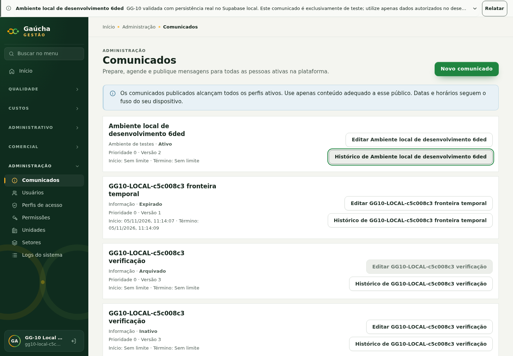
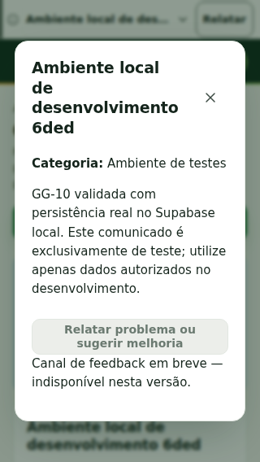
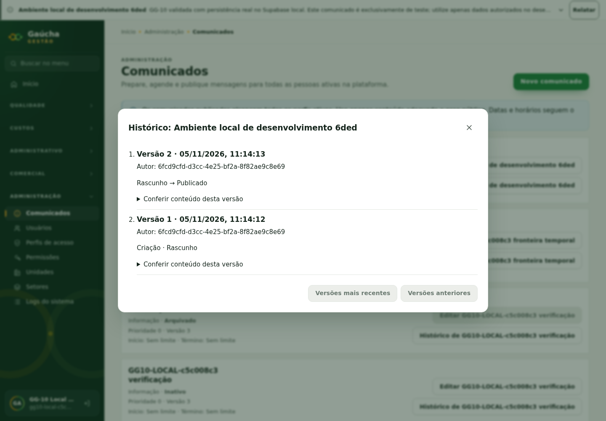

# GG-10 — Aplicação e validação real no localhost, 05/11/2026

## Autorização e diagnóstico

Continuação expressamente autorizada pelo mantenedor na branch
`codex/gg-10-announcements-admin`, baseline `aace128bd174abb33d8f5737d4207ded6c780e10`.
O novo pedido autoriza desenvolvimento real no Supabase local existente, aplicação
incremental da GG-10, testes e publicação de um comunicado sintético. Não autoriza
C30/STAGING/PROD, merge, deploy, reset nem alteração da frente paralela #101.

Confirmado `supabase_db_gaucha-gestao-local`, PostgreSQL 17.6 em
`127.0.0.1:54322`; Kong/API em `127.0.0.1:54321`, REST v16.2, Auth v2.196.0 e
Storage v1.72.1. Vite existente em 5173 reutilizado e preservado.
O histórico local possuía **31 migrations**, todas presentes no checkout.
Somente `20261105131548_announcements_administration.sql` estava pendente.
O schema `announcements` e a RPC `announcements_published()` não existiam;
portanto o POST 404 era ausência do backend no ambiente local.

Pré-condições: Platform Administrator protegido/global-only ativo; nenhuma colisão
com `announcement_manager`/`announcements.notice.manage`; ausência de
`room_booking.manage` na composição administrativa. Migrations da #101 não estão
neste checkout e não foram aplicadas por inferência.

## Aplicação incremental e preservação

1. Backup privado de escopo limitado das tabelas Core afetadas e do histórico de
   migrations, em formato custom do `pg_dump`, fora dos arquivos versionados.
   Índice conferido com `pg_restore --list`; **restore não executado**.
2. Inventário por contagens/hashes, sem imprimir conteúdo institucional ou segredos.
3. Dry-run da migration em transação com lock/statement timeout e `ROLLBACK`;
   contagens/hashes anteriores idênticos após o ensaio.
4. Aplicação da mesma migration em transação, registro atômico em
   `supabase_migrations.schema_migrations` e `NOTIFY pgrst, 'reload schema'`.
5. Conferência: **31 → 32 migrations**, quatro RPCs disponíveis, +1 capacidade,
   +1 papel protegido, +2 relações papel/capacidade. Nenhuma atribuição a pessoa
   existente criada pelo agente.

SHA-256 do arquivo aplicado:
`45be269746e64d76e04fd556e33cad479625edbadcc2bee801893400e54310e3`.
Migration histórica preservada, sem edição. Não houve `db push`, reset, rebuild de
serviços, novo banco/container/volume/porta ou alteração de configuração remota.

O postflight comparou os registros originais de **42 tabelas** por contagem/hash,
separando apenas a nova capacidade/papel/relações/migration, os registros sintéticos
deste ensaio e os novos eventos de auditoria. **PASS: todos os registros originais
preservados.** Tabelas de negócio, Storage e referências existentes não alteradas.

## Resultado funcional real

Comunicado de teste local preservado publicado:

- Assunto: **Ambiente local de desenvolvimento 6ded**.
- UUID sintético: `7ff63e57-7478-4c02-8b06-9038e4dae443`.
- Categoria `testing`, preset `neutral`, prioridade 0, sem limite de período.
- Estado `published`, versão **2**, **duas versões** no histórico.
- Texto declara uso exclusivamente local/de desenvolvimento. Nenhum dado real.

Criado como rascunho pela UI, confirmado no PostgreSQL, recarregado no navegador,
reaberto com o mesmo conteúdo e publicado pela UI. A barra reapareceu imediatamente,
permaneceu após nova recarga e abriu a leitura integral no celular. O histórico
mostrou a criação e a publicação. Todos os requests de comunicados observados no
fluxo browser final responderam **HTTP 200**, sem 404; zero `pageerrors`.
Após a aplicação, chamada anônima passou a retornar **401 / SQLSTATE 42501**,
a negação correta, comprovando endpoint existente sem permitir acesso anônimo.

O administrador local existente possui a nova capacidade por composição explícita
de seu papel global; nenhum perfil/grant pessoal existente foi modificado. Quem
manteve a aplicação aberta antes da migration pode recarregar a página/atualizar
acesso para receber a nova projeção de capacidades.

## Testes executados

| Prova | Resultado |
| --- | --- |
| Dry-run + fingerprint + aplicação incremental e histórico | PASS |
| Auth local real / JWT / PostgREST, sem interceptar respostas | PASS |
| Administrador e Gestor: criar, publicar, desativar e histórico | PASS |
| Anônimo/comum sem acesso à gestão; rascunho invisível | PASS |
| Grant revogado e perfil Core inativo com JWT ainda válido | PASS |
| Gestor com somente `announcements.notice.manage`; D5-B | PASS |
| DML direto por API em schema privado negado | PASS |
| RLS ativa e ausência de USAGE/SELECT/INSERT dos clientes nas tabelas | PASS |
| HTML, cor falsa em crítico, datas invertidas e prioridade inválida | PASS |
| Edição obsoleta negada por versão; arquivo terminal | PASS |
| Agendamento e expiração pelo relógio PostgreSQL | PASS |
| UI real: rascunho, recarga, publicação, barra, recarga e histórico | PASS |
| UI do Gestor: somente Comunicados; rota de Usuários negada | PASS |
| 1440/1024/768/375/320, sem overflow; barra entre 44–56 px | PASS |
| Texto integral/fechamento do painel em 320 px | PASS |
| `npm run typecheck`, `npm run lint` | PASS |
| Quatro arquivos focados de GG-10, **75 testes** | PASS |
| Teste do guard local sem opt-in | PASS: recusa antes de acessar Docker/banco |

A criação de rascunhos e a edição no browser confirmaram persistência com recargas
reais; não foram mocks, nem apenas provas PGlite. O script novo não aplica SQL de
migration: exige que o backend tenha sido aplicado previamente e recusa destinos
fora do projeto/portas locais esperados.

Falhas do ensaio corrigidas, sem alteração das regras do produto: reativação de
perfil não restaura automaticamente grants revogados pelo Core; o setup passou a
restabelecer explicitamente somente o grant sintético comprovado pelo recibo.
O seletor de rótulo do textarea preenchido foi substituído pelo nome acessível do
textbox na verificação. Teardown executa todos os passos mesmo se um falhar.

## Fixtures, evidências e reprodução

Seis perfis sintéticos e quatro atribuições foram criados nas duas primeiras
execuções; as seguintes reutilizaram as identidades comprovadas por UUID/e-mail do
recibo, sem novas contas. Ao final, **todos esses perfis e grants estão inativos**,
sessões encerradas, sem apagar autoria, comunicados ou auditoria. Somente o
comunicado demonstrativo acima permanece publicado; os avisos de verificação
foram inativados/arquivados. Rascunhos de tentativas anteriores foram preservados.
Não houve concessão permanente de acesso a conta de teste.

Capturas abaixo usam identidades e registros exclusivamente sintéticos, com
Auth/API/PostgreSQL reais do localhost:






Script: `tests/integration/announcements-local.mjs`. Reprodução somente no projeto
local autorizado, com CLI já instalado, Node e bibliotecas Chromium disponíveis:

```bash
GG10_LOCAL_TEST=gaucha-gestao-local \
GG10_SUPABASE_CLI=/caminho/do/cli/supabase \
node tests/integration/announcements-local.mjs
```

`GG10_LOCAL_RECEIPT` opcional reutiliza somente identidades sintéticas comprovadas
por recibo privado de execução anterior; renova apenas a senha dessas fixtures e
restabelece suas atribuições exatas durante o teste. Sempre inativa ao encerrar.
Não usar recibo de pessoa real. Sem esse parâmetro cria nova fixture sintética.
O script deixa um comunicado demonstrativo publicado por execução bem-sucedida;
qualquer desativação posterior deve usar a UI/RPC autorizada, preservando histórico.

Artefatos privados não versionados em `tmp/gg10-real-local/`: inventário,
backup de escopo limitado, fingerprints, recibos e `postflight.json`. Nenhum token,
senha, chave administrativa, `.env`, dump ou conteúdo real foi publicado.

## Limites

A prova de duas sessões concorrentes no CI do SHA `aace128` continua válida como
baseline; neste ensaio local foi verificada edição obsoleta sequencial, não repetida
a corrida entre conexões. Aparelhos físicos, leitor de tela, zoom nativo,
backup/restore completo e produção: **NOT EXECUTED**. O backup de escopo limitado
não é prova de recuperação integral. CI verde não é homologação operacional.
Sem bloqueio funcional observado no localhost ao final; decisão de merge permanece
com o mantenedor. Nenhum gate humano encerrado. **PROD NO-GO.**
