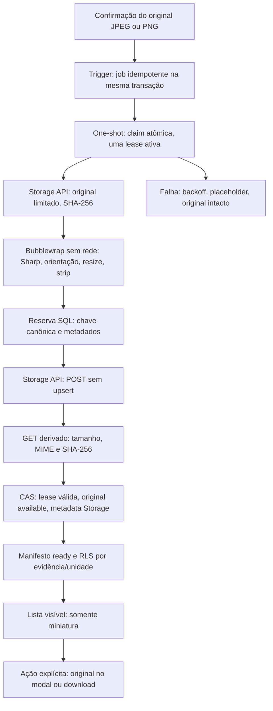

# AUD-IMG-02 — Miniaturas privadas: implementação para revisão

> **Estado posterior, 06/11/2026:** AUD-IMG-01/02 integradas pelas PRs #99/#101. A rodada MED-01/AUD-IMG-04 e a revisão do carregamento inicial estão no [relatório consolidado](MED01_FRONTEND_CLOSURE_20261106.md). Pendências/ausências abaixo descrevem a data e o SHA históricos deste documento; não invalidam provas posteriores. Homologação física e implantação continuam separadas.

**Continuação autorizada de desenvolvimento local:** [executor de terminal, estado automático no checklist e imagens pequenas](AUD_IMG_02_LOCAL_EXECUTOR_20261105.md). Nova migration incremental, sem alterar/aplicar novamente as anteriores; os cinco grants técnicos e o isolamento permanecem. Relatos abaixo são históricos das etapas de implementação.

**04/11/2026 · Issue #100 · PR #101 draft · GOs A/B de código/testes concedidos pelo mantenedor no brief desta rodada.** Este documento registra a implementação e seus gates históricos. **Atualização de 05/11:** o mantenedor concedeu GO C exclusivamente no desenvolvimento local, incluindo identidade mínima e teste visual temporário; [execução real e limites](AUD_IMG_02_LOCAL_GO_C_20261105.md). Migrations aplicadas, uma miniatura `ready` e Chromium comprovados; teste adicional de escrita parcial por timeout. Backfill, serviço permanente, merge e deploy continuam sem autorização. PROD NO-GO.

O [desenho preparatório](AUD_IMG_02_DESIGN_20261104.md) é histórico. Esta entrega implementa decoder JPEG/PNG real, executor one-shot, transporte Storage API e repositório SQL, migration append-only e UI desativada. Não afirma que esse backend está implantado. O diretório não rastreado `supabase/snippets/` foi preservado. Nenhum dado persistente ou serviço Docker foi alterado.

## Fluxo e propriedade

Audit possui a fila/manifesto/encoder; Core continua autoridade de perfil/grant/unidade. Shared conserva cache neutro. Não há Redis, broker, daemon, transformação Storage nativa ou dependência entre Core e Audit. Uma tabela reúne job e manifesto porque a unidade de trabalho é uma única evidência/versão, sem necessidade comprovada de outra fila.

O caminho operacional entre C e D **não está habilitado**: nenhum token/papel técnico foi criado, nem há grant técnico ou política de gravação concedida ao processador. As conexões em testes são fakes ou SQL em memória. O processamento não altera `audit.checklist_evidence`, inspeção, respostas, versões ou eventos históricos. O trigger apenas insere um job depois da confirmação; não faz backfill.

## Arquivos e contratos implementados

| Arquivo | Responsabilidade |
| --- | --- |
| `scripts/audit-derivative-once.mjs` | CLI one-shot; requer módulo adaptador externo explicitamente fornecido; sem adapter, termina bloqueada e sem conexão |
| `scripts/audit-derivative-worker.mjs` | claim → leitura → encoder → reserva → POST → read-back → CAS; adaptador SQL parametrizado e HTTP com timeout/streaming, sem credencial padrão |
| `scripts/audit-derivative-encoder.mjs` | Subprocesso com Bubblewrap e prlimit, env sem credenciais, monitor de RSS e kill por tempo |
| `scripts/audit-derivative-decoder.mjs` | Sharp **0.35.5**, lockfile; JPEG/PNG reais, orientação, redução, sem EXIF/GPS/XMP/ICC herdados |
| `supabase/migrations/20261104171756_audit_evidence_derivatives.sql` | Bucket privado, fila/manifesto, trigger, claim/prepare/complete/fail, RLS, RPC de leitura e grants mínimos de usuário |
| `apps/web/src/modules/audit/{evidenceImages.ts,EvidenceImage.tsx,ChecklistEvidence.tsx,types.ts}` | Miniatura quando visível sob flag, cache distinto, placeholder e abertura explícita; original no modal |
| `apps/web/.env.example` | Flag de build desligada por padrão, sem alterar `.env.local` |
| `.github/workflows/validate.yml` | Bubblewrap apenas no runner efêmero para testar isolamento; não instala no servidor |

A CLI aceita `node scripts/audit-derivative-once.mjs --adapter /caminho/absoluto/config.mjs`. O módulo externo deve exportar `createAdapters() → { repository, storage, close? }`; contém configuração operacional **ainda não aprovada/provisionada**, nunca versionar credenciais. Não há conexão implícita a `.env`, Supabase local ou ambiente remoto. `postgresRepository(connection)` usa apenas quatro funções internas parametrizadas; a conexão futura deve ter statement timeout e EXECUTE estritamente delimitados, sem BYPASSRLS/acesso geral. O `storageApiAdapter({request})` pode usar `authorizedStorageTransport({origin,apiKey,accessToken})`, que aceita HTTPS (HTTP apenas loopback), impede redirects, `service_role`/secret reconhecíveis e escrita fora do bucket derivado. Isso **não autentica criptograficamente** tokens no cliente; a API Storage continua a autoridade.

### Encoder e limites

- Entrada JPEG/PNG por assinatura e MIME declarado, `available`, chave original canônica; máximo 10 MiB, 16 milhões de pixels e eixo de 8192 px. Decoder estrito (`failOn: warning`), sem animação/múltiplas páginas.
- Lado maior 480 px, sem ampliação. PNG lossless mantém alpha e é preferido para o PNG recebido; JPEG qualidade 86 com chroma 4:4:4. Versão fixa `img-480-v1` identifica estes parâmetros; mudar encoder/parâmetros exige nova versão e revisão da constraint SQL.
- Saída até 1 MiB e **menor que original**; caso contrário job falha e a UI mantém placeholder. Não sacrificar qualidade para atingir percentual de economia. Qualidade de textos/códigos de barras exige avaliação humana posterior.
- Concorrência global inicial 1, lease 120 s, até 5 tentativas, backoff 30/60/120/240/480 s. Lease abandonada pode ser reclamada; a última tentativa expirada é marcada failed na próxima claim. Ready não é reprocessada.
- Linux, usuário não root, `/usr/bin/prlimit` e `/usr/bin/bwrap` necessários. Sem suporte a namespaces, falha fechada; **não há fallback para decoder sem isolamento**. Código/dependências/runtime são montados somente para leitura; home, `.env`, dados e rede do host não são montados. `/tmp` é efêmero, arquivos regulares não podem ser escritos (`RLIMIT_FSIZE=0`); capabilities removidas, novas sessões/PID/network/user namespaces.
- CPU: hard `RLIMIT_CPU=15 s`; endereço virtual: hard `RLIMIT_AS=2 GiB`; heap JS 64 MiB; cache libvips desativado, 1 thread libvips. RSS total dos subprocessos observado a cada 25 ms, kill acima de 384 MiB; wall timeout 20 s. **RSS é limite observado, não hard cgroup**; overshoot entre amostras e limites do kernel permanecem risco residual. Hardening/cgroup no host exige GO operacional; não foi instalado serviço.
- Processo pai confere SHA-256 de original lido e derivado gerado; read-back compara bytes/hash antes de ready. 409 somente tolerado porque GET seguinte deve ser idêntico. POST não usa upsert. O SQL verifica metadata Storage, **não os bytes físicos**, e confia no processador restrito para a conferência.

### Banco, RLS e identidade técnica bloqueada

Tabelas com RLS e acesso de usuário somente SELECT ready. RPC `audit.checklist_evidence_thumbnail(p_evidence uuid)` retorna chave pronta somente pela RLS. Assinatura de 60 s usa a Storage API sob token do próprio usuário: a política SELECT associa **chave completa** ao manifesto, original available e `private.has_unit_permission('audit.inspection.read', unidade da inspeção)`. Não aceita unidade/chave escolhida como parâmetro da RPC. Adivinhar uma chave não concede acesso; assinatura direta também depende da mesma policy. Auditorias finalizadas continuam legíveis e não ganham edição.

Perfis inativos, ausência/revogação de grants, grant de outra unidade ou apenas setor, anônimo, pending/removed, job não pronto e objeto órfão são negados. Políticas **restritivas** impedem INSERT/UPDATE/DELETE de derivados por `authenticated`, mesmo na presença futura de uma política permissiva de outro módulo; COPY/MOVE/upsert dependem dessas operações e permanecem negados. Nenhum SQL grava/exclui arquivos por `storage.objects`; acesso a essa tabela em funções é somente leitura. Mutações em stubs existem **apenas nas fixtures em memória**.

Funções `audit_private.{claim,prepare,complete,fail}_evidence_derivative` são SECURITY DEFINER com search_path vazio e EXECUTE revogado de PUBLIC/anon/authenticated. Prepare reserva a chave exata; complete faz CAS da lease, validade e disponibilidade do original sob lock. Remoção e publicação serializam pela evidência; claim usa lock transacional global e `FOR UPDATE SKIP LOCKED`. Estados/metadados antigos são limpos ao reclamar job, sem tocar em objetos ou originais.

**Atualização da continuação:** o Storage v1.74.0 aceitou o papel/JWT restrito no laboratório CI; [evidências reais, limites e configuração operacional ainda bloqueada](AUD_IMG_02_REAL_SECURITY_20261104.md). O impedimento deixou de ser a compatibilidade básica da API e passa a ser o provisionamento/autenticação/emissão operacional mínimos e autorizados. Portanto não existe adapter operacional, token, grant de processamento ou policy técnica de leitura/gravação concedida. A entrega não concede service_role nem resolve isso ampliando privilégios. As policies de gravação futuras devem usar **papel separado de authenticated**, chave reservada/lease viva para upload e read-back, sem update/delete/copy/move; leitura de original deve limitar-se ao job atual. Validar isso no laboratório autorizado antes de propor os grants concretos. GO A/B de código não autoriza criar tal identidade num ambiente persistente.

### Frontend desativado

`VITE_AUDIT_EVIDENCE_THUMBNAILS` só liga se for a string `true`; ausente/false conserva a PR #99 e não consulta o novo backend. A flag é de build. Com true, lista visível consulta manifesto e assina **somente o derivado**; falta/erro mostra “Miniatura indisponível” e “Abrir original”. Nunca chama o carregador original como fallback. Ampliar abre modal e carrega original por ação explícita. Download continua em `evidence.ts`, com mesmos bytes e nome apresentado.

Original e miniatura possuem chaves distintas, com versão do encoder; reusam `privateImageCache.ts`, TTL fixo máximo 60 s, deduplicação, limites, invalidação por sessão/permissões, remoção e reconciliação. Nada vai para cache persistente. PDF/DOCX/XLSX não ganham preview. URLs já emitidas e blobs têm janela residual até expirar; revogação conhecida limpa cache, mas não se promete revogação instantânea no Storage.

## Provas e pendências

- `tests/audit-derivative-worker.test.ts`: decoder **real**, JPEG/PNG sintéticos, dimensões, orientação/EXIF/GPS, alpha, sem ampliação, MIME falso/truncado/hostil/limites/timeout/RSS; worker com DB/Storage **fakes**, hashes, falha parcial, read-back, lease obsoleta, 409 e transporte limitado.
- `tests/audit-evidence-database.test.ts`: migrations e RLS executadas em **PostgreSQL/PGlite em memória**, Auth e Storage **stubs**; fila, retry/lease/CAS, escopo, revogação, grant setorial, chave/ID, escrita negada e finalização/reabertura. Chamadas sequenciais no engine em memória **não comprovam concorrência de múltiplas conexões reais** nem assinatura/headers/verbos reais da Storage API.
- `tests/audit-thumbnail-ui.test.tsx`: transporte/Storage **mockados**; flag off/on, viewport, ausência/falha sem fallback, modal original explícito, cache separado, reconciliação e logout. Suítes atuais de download/fluxo/histórico permanecem relevantes.
- Protocolo preparatório e seis casos Node offline foram preservados. Resultados, comandos e SHA constam no [registro de validação](AUD_IMG_02_VALIDATION_20261104.md) e na PR.
- **Não provado:** RLS/Auth/Storage integrado self-hosted, identidade técnica, JWT customizado, verbos copy/move/upsert/assinatura reais, duas sessões PostgreSQL concorrentes, backup/restore, bytes/headers em rede real, Android/iOS físicos e legibilidade humana. MED-01 10/30/100 e economia de 80% **não medidos**.

## Primeiro teste integrado após GO C específico

1. Nomear ambiente local existente, inventário, backup/restauração e fixtures sintéticas autorizadas; confirmar SHA e migrations. Não usar C30/STAGING/PROD e não criar/resetar Docker por rotina. Se não houver laboratório autorizado, aguardar autorização específica em vez de provisionar.
2. Revisar/aplicar somente a nova migration no destino autorizado; flag continua false. Confirmar bucket privado, policies, funções, ausência de grants técnicos e preservação do acervo. Não carregar ou processar fotos antigas.
3. Provar separadamente papel/JWT de menor privilégio na versão Storage instalada; autorizar/propor grants e policies técnicas exatas após a prova. Negar tokens comuns, outra lease/key, outro bucket, sobrescrita/copy/move/delete. Se falhar, parar integração privilegiada, sem fallback service_role.
4. Confirmar **uma** evidência JPEG/PNG sintética pelo fluxo atual, executar one-shot com adapter aprovado, verificar original antes/depois, SHA do derivado/read-back, metadados removidos, orientação/alpha e ready. Duas conexões devem disputar claim; expirar lease/forçar crash/409 e repetir até verificar retry e ausência de duplicação.
5. Testar Auth real com usuários autorizados/global/unidade, outra unidade, setor, inativo/revogado/anônimo; assinar via API, GET direto, keys/IDs forjados, pending/removed/órfão e verbos proibidos. Finalizar/reabrir mantém leitura/histórico e originais.
6. Somente com GO de ativação, build de teste com flag true; medir DevTools/CDP da primeira lista, modal e download explícito (hash/nome iguais), logout/permissões/remoção; coletar apenas métricas sem conteúdo/token. MED-01 e aparelhos físicos em autorização e etapa posteriores.

## Reversão e simplificação

Antes de aplicação, revert dos commits basta. Após eventual aplicação autorizada, desligar flag em novo build e parar chamadas one-shot mantém Auditoria no fluxo anterior. Preservar originais, manifestos, objetos e jobs para diagnóstico; não apagar buckets/linhas/arquivos nem editar migration histórica. Correção por nova migration forward-fix com GO. Ready sem objeto após restore falha em placeholder; regeneração/reconciliação/backfill e expurgo dependem de autorização específica. Não há rollback destrutivo automático.

A fila/manifesto única, um job por execução e nenhum agendador instalado mantêm a solução pequena. A única dependência nativa adicional é Sharp/libvips; Bubblewrap/prlimit vêm do SO. Pré-requisitos operacionais e custo de supervisão são explícitos. O mantenedor único revisa diff, CI e riscos; não houve segunda revisão humana nem aceite de merge nesta rodada.

Fontes técnicas consultadas: [Storage Access Control](https://supabase.com/docs/guides/storage/security/access-control), [Sharp constructor](https://sharp.pixelplumbing.com/api-constructor/), [Sharp output](https://sharp.pixelplumbing.com/api-output/) e help local de Bubblewrap/prlimit. Changelog Supabase consultado em 04/11; o CLI **2.101.0** foi fixado apenas para `migration new` (a transição CLI v3 não foi aplicada ao projeto).

## Continuação autorizada — contrato de CI e integração descartável

O mantenedor autorizou a investigação real no **mesmo** stack criado por `infra-validate`, sem novo ambiente Docker local. `scripts/ops/smoke.mjs` passa a exigir exatamente seis buckets, preservando verificações anteriores e acrescentando `audit-evidence-thumbnails` privado, 1 MiB e lista exata JPEG/PNG.

`scripts/ops/audit-derivatives.mjs` só aceita `GITHUB_ACTIONS=true`, ambiente `ci`, projeto do run/attempt corrente e marker de banco conferido pelo guard existente. Exercita Auth real, RLS/Storage API, um worker real com JPEG/PNG sintético, papel/JWT técnico efêmero e disputa de claim em duas conexões psql sem expor porta. Roles/policies criadas pelo script são **fixtures do laboratório**, não migration nem configuração operacional. A chave administrativa efêmera já existente é usada somente para criar contas Auth sintéticas; o processador e todas as operações de arquivos usam o papel técnico ou o usuário comum, sem fallback service_role. Casos adversos com bytes físicos usam uma policy de INSERT apenas nas chaves exatas da fixture, removida antes de verificar seus acessos.

A hipótese de papel técnico em teste é NOLOGIN/NOINHERIT/NOBYPASSRLS, sem herdar `authenticated`, com SELECT/INSERT limitados à lease viva e à chave reservada. Signing/list/copy/move/update/delete não são concedidos. A assinatura do token ocorre no harness CI com o segredo **efêmero** já gerado; isso não autoriza entregar o segredo global ao futuro worker. Sucesso do experimento não aprova emissão/rotação operacional, grants persistentes ou GO C.

Resultados deste ensaio devem ser lidos nos checks do SHA atualizado. Os resultados anteriores com mocks/PGlite continuam classificados como tais; não antecipam o resultado da integração real.

## Login técnico e emissão sem serviço permanente

Continuação autorizada: [contratos e prova nova](AUD_IMG_02_REAL_SECURITY_20261104.md#continuação-login-próprio-e-emissor-one-shot) e [runbook para solicitar GO C local](../../operations/AUD_IMG_02_LOCAL_GO_C_RUNBOOK.md). LOGIN/escopo SQL próprios e emissor one-shot substituem a dependência de SET ROLE administrativo do ensaio anterior; nenhuma configuração persistente foi aplicada. Confirmar resultado do novo HEAD na PR #101 antes de solicitar a autorização.
