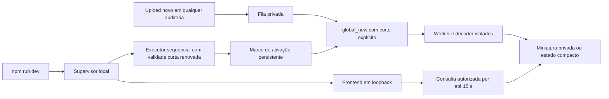

# AUD-IMG-02 — Desenvolvimento com comando único

Em 06/11/2026, continuação autorizada da PR #101 draft sobre `a85d463`. Somente o Supabase existente `gaucha-gestao-local`; sem backfill, containers novos, serviço permanente, merge ou implantação. Este documento substitui o procedimento diário de [05/11](AUD_IMG_02_LOCAL_EXECUTOR_20261105.md), preservado como registro histórico.

Na raiz do checkout, usar apenas:

```bash
npm run dev
```

O Vite inicia em `127.0.0.1:5173` com `strictPort`, independentemente do executor. O executor carrega o launcher privado em `~/.local/state/gaucha-gestao/audit-thumbnails/launcher.json` e verifica o container, as portas, a migration e o login restrito. Falhas no executor mantêm o app utilizável, com código e orientação no terminal. Porta ocupada é erro do próprio Vite. Em outra máquina, siga o [runbook de provisionamento e recuperação](../../operations/AUD_IMG_02_LOCAL_GO_C_RUNBOOK.md).

Pode-se navegar entre auditorias e anexar JPEG/PNG sem fornecer UUID nem executar `dev:thumbnails`. O comando anterior permanece como ferramenta opcional de diagnóstico, com `--inspection` opcional. O modo integrado sempre usa todas as auditorias. A flag local de miniaturas já habilitada no notebook foi preservada; a flag versionada permanece false.

`Ctrl+C`, SIGTERM e SIGHUP param o agendamento e o frontend, aguardam a execução corrente (limite de 110 s) e restauram `audit_derivative_worker NOLOGIN`. Falha do Vite também cancela o executor. O mantenedor deve aguardar a confirmação NOLOGIN antes de fechar o terminal.

## Escopo, concorrência e recuperação

A migration incremental `20261106112635_audit_derivative_global_new_uploads.sql` adiciona o modo transacional explícito `global_new`. Exige corte temporal finito, não futuro e UUID de auditoria ausente. O cliente transmite modo e corte ao worker por allowlist e aplica GUCs com `SET LOCAL` em uma transação. **O modo integrado não usa ambos os filtros nulos**, que continuam tendo o significado global histórico nos contratos de diagnóstico/CI.

A claim exige **evidência iniciada e job criado a partir do marco de ativação**. Uma foto iniciada antes do marco fica fora do escopo mesmo se a confirmação ocorrer depois. A atualização de leases expiradas também obedece ao corte, inclusive quando a quinta tentativa já se esgotou. Nenhuma linha existente é reenfileirada na aplicação da migration. Os filtros são proteção operacional contra seleção acidental; não constituem uma nova fronteira de autorização para o login técnico.

Há um executor por notebook, protegido pelo lock local já existente, e um one-shot por vez. O advisory lock e a verificação de lease ativa no banco continuam serializando a claim. Se um subprocesso cair, a sessão continua: uma lease interrompida só volta a ser elegível depois de expirar (2 minutos), sob o mesmo corte, teto de cinco tentativas e backoff existentes. A lease anterior perde validade; não há duas execuções simultâneas nem retomada irrestrita de pendências. Falha de renovação interrompe o loop e executa a limpeza.

**Encerramento forçado do supervisor ou energia:** SIGKILL impede `finally`. Os processos isolados usam `--die-with-parent`; one-shot/SQL/JWT/lease continuam limitados. Não há renovação de senha após a morte do supervisor: novas conexões expiram em até 10 minutos após a última renovação; `VALID UNTIL` não encerra conexões SQL já abertas, limitadas pelos timeouts e pelo ciclo one-shot. JWT continua com TTL máximo de 30 s e a policy também exige lease viva. O login pode continuar marcado LOGIN no catálogo até a recuperação, embora a senha expire.

Na primeira ativação bem-sucedida, o executor registra o horário do PostgreSQL em `activated-after`, no mesmo diretório privado do launcher (modo 0600). O diagnóstico com `--inspection` tem seu próprio `activated-after-<UUID>`. Preserve esses arquivos. Reinícios reaproveitam o marco e retomam pendências elegíveis, inclusive uploads confirmados enquanto o executor estava parado. Um marco ausente em uma nova configuração começa no horário atual. Um marco inválido ou futuro bloqueia o executor.

Um lock residual bloqueia o executor. Antes de recuperar, confira o PID, outros processos técnicos e a ausência de sessões SQL do login técnico. Se ainda houver lease ativa, aguarde a expiração natural. Restaure e confirme NOLOGIN com o comando restrito do [registro de 05/11](AUD_IMG_02_LOCAL_EXECUTOR_20261105.md). Só depois remova um lock comprovadamente residual. O supervisor também preserva o lock quando não consegue confirmar a limpeza de NOLOGIN.

## Credenciais e isolamento

A duração fixa de quatro horas foi removida. O supervisor renova a validade da senha existente para **10 minutos**, a cada minuto de loop, sem alterar senha, identidade, memberships ou grants. Uma execução pode postergar a renovação em até seu timeout de 110 s, ainda dentro da janela. A sessão permanece ativa enquanto `npm run dev` estiver ativo. Não há login permanentemente habilitado por configuração nem timer externo. A validade e a limpeza são responsabilidade do supervisor confiável; o worker não recebe autoridade de ALTER ROLE.

Continuam os cinco wrappers técnicos, `session_user=current_user`, checagem de ausência de privilégios/tabelas/segredo global, emissor com a mesma conexão mínima, tokens restritos a lease/bucket/chave e decoder irmão sem rede/segredos em Bubblewrap. O supervisor local usa o acesso Docker já existente somente para bootstrap LOGIN/validade/NOLOGIN. A configuração de assinatura permanece fora do checkout, modo 0600, e não aparece no ambiente/argv do worker ou no Vite.

A lista consulta o estado por até 15 segundos. Em caso de demora, oferece **Abrir original** e **Consultar novamente**. Falhas oferecem abertura explícita. A exceção automática exige o estado terminal autorizado `derivative_not_smaller` e um JPEG/PNG de até 64 KiB. O original usa o fluxo assinado e o cache em memória da sessão, com o mesmo prazo e descarte de acesso. Downloads preservam os bytes.

O derivado continua menor que o original, com lado maior de até 480 px. O terminal registra somente fases e códigos sanitizados, incluindo dimensões acima do limite, falha de decode, timeout e orçamento de memória. Os limites de 16.000.000 pixels, 8192 px por lado, 20 s de decoder e 384 MiB de RSS observado continuam vigentes.



## Confiabilidade no notebook em 11/11/2026

- **Partida.** O Docker local estava saudável, com API e Postgres em loopback. A porta 5173 estava livre, o launcher tinha modo 0600, a migration `20261106112635` constava no ledger e não havia lock, processo técnico, sessão SQL ou lease ativa. O role ainda estava em LOGIN com senha expirada. O log do banco registrava duas rejeições do bootstrap por estado de role e um episódio anterior de migration ausente. Foi feita a recuperação prevista pelo runbook e confirmado NOLOGIN. Com lock ativo de outro executor, o Vite respondeu HTTP 200 e registrou o diagnóstico `LOCK`.
- **Imagens pequenas.** Dois jobs históricos de 11.028 e 11.138 bytes estavam em `derivative_not_smaller`. A interface anterior exibia apenas a mensagem terminal. Os testes cobrem o uso do original privado com 11.138 bytes e os dois lados do limite de 64 KiB, além de negação de assinatura e descarte na troca de sessão.
- **Imagens de celular.** Havia oito falhas de geração entre 358.266 e 3.181.722 bytes, com três ou quatro tentativas e sem lease ativa. Os logs antigos registravam o erro genérico. A sessão sintética não tinha acesso aos sete originais ainda disponíveis dessa amostra, então as dimensões e a causa individual seguem inconclusivas. No decoder real, JPEG de 4032 × 3024 e JPEG progressivo de 4608 × 3456 passaram. JPEG de 4624 × 3468 excedeu o teto de 16.000.000 pixels. Esse caso agora tem código específico e os limites de segurança continuam vigentes.
- **Reinício.** Um JPEG sintético de 519.075 bytes e 4032 × 3024 entrou como `pending` com o executor parado. Uma sessão com o marco persistido reivindicou o job e encerrou sem completá-lo, confirmando NOLOGIN. O próximo processo usou o mesmo marco e, após a lease expirar naturalmente, concluiu a segunda tentativa como `ready`. O derivado privado tinha 61.879 bytes. A API autorizada retornou o original byte a byte e negou a assinatura anônima do derivado. Um PNG sintético de 91 bytes terminou em `derivative_not_smaller`; a API retornou os bytes originais ao usuário autorizado. Os dois uploads sintéticos ficaram na auditoria de teste existente.

O Chromium autenticado no localhost renderizou o derivado de 480 × 360 e o PNG compacto original. A lista não transferiu o JPEG original. O encerramento de `npm run dev` restaurou NOLOGIN. O ensaio reutilizou o `gaucha-gestao-local` com o ledger vigente. Nenhuma migration foi criada ou aplicada nesta correção. A homologação física de celular segue pendente.

### Continuação da homologação em 11/11/2026

| Caso do mantenedor | Causa confirmada | Comportamento da correção |
| --- | --- | --- |
| JPEG de 11.138 bytes | `derivative_not_smaller` | Original privado exibido no notebook e no celular na homologação relatada pelo mantenedor. |
| JPEG de 859.843 bytes, 1080 × 2340 | Trailer Samsung SEF de 211 bytes após o primeiro EOI. O decoder exigia EOI no fim do arquivo e rejeitava a imagem antes do Sharp. | O decoder isolado validou o diretório e produziu derivado de 39.312 bytes em 222 × 480 a partir do arquivo real, em ensaio somente leitura. |
| JPEG de 5.223.270 bytes, 8640 × 5760 | 49.766.400 pixels e um lado acima de 8192. | `DECODER_DIMENSIONS` permanece. Em novos jobs, o estado terminal informa que a resolução excede o limite e permite abrir o original autorizado. |

Para SEF simples, o decoder aceita um JPEG seguido por trailer Samsung SEF de até 64 KiB. O primeiro EOI é localizado pela estrutura de marcadores, e o trailer precisa ter diretório completo e blocos contíguos dentro do intervalo após EOI. Somente o JPEG principal entra no Sharp. O original continua íntegro e os limites de pixels, lado, bytes, CPU, RSS e timeout permanecem. Os blocos do trailer são descartados sem interpretação. [Formato SEF em ExifTool](https://github.com/exiftool/exiftool/blob/master/lib/Image/ExifTool/Samsung.pm) · [Opções de validação do Sharp](https://sharp.pixelplumbing.com/api-constructor/)

A migration incremental `20261111125540` estende a lista de erros e o wrapper de falha existente. `derivative_dimensions_exceeded` e `derivative_invalid_image` encerram a lease na primeira falha estrutural. O campo `attempts=5` representa orçamento esgotado, conforme o contrato existente. Timeouts, falhas de memória e erros não classificados continuam com backoff e teto de cinco tentativas. A alteração de schema preserva os jobs anteriores, ACLs e RLS. Os jobs históricos esgotados mantêm seus registros originais.

As mensagens e ações de erro ocupam uma linha de largura disponível no cartão. A caixa de 88 × 72 fica reservada às imagens exibidas. A ação explícita continua passando pela assinatura do original. A nova rodada física em Android/iOS cabe ao mantenedor.

### JPEG Ultra HDR do Galaxy S24 Ultra

Os dois uploads de teste de 3.427.799 e 3.266.531 bytes tinham um JPEG principal de 4000 × 2252, orientado para retrato, e um mapa de ganho JPEG monocromático de 1000 × 564. O índice MPF delimitava exatamente o principal e o mapa. O SEF versão 107 começava após o segundo EOI. O parser anterior encontrava o primeiro EOI corretamente e rejeitava o intervalo até o primeiro bloco SEF por exigir contiguidade imediata. A inspeção confirmou o perfil ISO 21496-1 e a ausência de contêiner de vídeo no sufixo examinado. [Estrutura Ultra HDR](https://developer.android.com/media/platform/hdr-image-format) · [Índice MPF](https://www.cipa.jp/std/documents/e/DC-X007_E.pdf)

A exceção exige o índice MPF 0100 de duas imagens no perfil observado, offsets e tamanhos coincidentes, o JPEG auxiliar completo com atributos MPF e ISO 21496-1 monocromático, e o SEF 107 contíguo após o mapa. O sufixo inteiro continua sujeito ao teto existente de 64 KiB. O mapa é decodificado com validação estrita no mesmo subprocesso e orçamento, com subteto de 1 Mi pixels. Seus pixels ficam fora da miniatura SDR, gerada apenas da imagem principal. Os limites da imagem principal, CPU, memória, tempo e isolamento permanecem.

O ensaio isolado em modo somente leitura produziu derivados de 30.045 e 24.347 bytes, ambos com 270 × 480. A integridade dos dois originais foi conferida antes e depois, sem registrar seus hashes. Os dois jobs históricos ficaram no estado anterior. Um upload sintético novo de 3.493.688 bytes ficou `ready` na primeira tentativa, com derivado privado de 31.635 bytes e 270 × 480 exibido no Chromium. O original permaneceu idêntico e as assinaturas anônimas do original e do derivado foram negadas. O ensaio usou o executor já ativo e preservou o marco local.

## Prova histórica executada em 06/11 no notebook

Migration aplicada incrementalmente apenas no local após dump custom de banco, roles, bytes Storage e snapshot de ledger/fila/evidências/objetos, em `tmp/aud-img-integrated-20261106/` (0700/0600, ignorado pelo Git). O ledger tinha 35 registros, todos preservados; adicionou-se somente esta migration. Sem reset, seed, atualização/restart de serviços ou restore sobre dados persistentes. Reversão funcional: parar o supervisor e manter NOLOGIN; eventual mudança SQL deve usar migration posterior, sem editar migrations aplicadas.

`tests/integration/audit-derivative-dev-local.mjs` foi executado com fixtures sintéticas novas e conta de teste existente. Ele inicia **somente `npm run dev`**, abre duas auditorias no Chromium e anexa uma imagem nova em cada uma, sem reinício do executor. Ambas mostraram “Preparando miniatura…” e atualizaram automaticamente. Na listagem houve zero GETs de original antes de uma ação explícita. Ampliação e download de cada original foram comparados byte a byte/SHA-256.

| Nova auditoria | Original | Miniatura automática | Ganho |
| --- | --- | --- | --- |
| A — JPEG sintético | 375.240 bytes | 23.428 bytes | 93,76% |
| B — PNG sintético | 2.577.833 bytes | 356.510 bytes | 86,17% |

Ambas ficaram `ready` com uma tentativa. Os **10 jobs, 21 evidências, 31 objetos e 31 arquivos físicos anteriores** ficaram idênticos; nenhuma foto anterior foi processada. Só foram adicionados dois originais e duas miniaturas. Anônimo foi negado em PostgREST real; identidade sem perfil não recebeu estado pelo contrato SQL. Encerramento por SIGINT no grupo npm retornou NOLOGIN. Uma rodada adicional de 65 s, sem uploads, conferiu renovação real após um minuto, NOLOGIN e negação de nova conexão técnica ao encerrar. [Prova sanitizada](evidence/aud-img-02-integrated-dev-20261106.json).

Testes de regressão cobrem seleção em duas auditorias, upload antigo confirmado tarde, lease expirada/retry e lease obsoleta, corte inválido/ausente, sessão nova sem pendências antigas, isolamento, RLS, estado compacto, polling e ciclo do supervisor. A continuidade além de quatro horas é verificada com relógio simulado; não foi aguardada uma sessão física de quatro horas. Os resultados finais de suíte/checks e CI são registrados na PR por SHA.

No primeiro ensaio, a porta estava ocupada pelo Vite anterior: o supervisor limpou NOLOGIN e falhou. O Vite desse mesmo checkout foi encerrado para repetir o comando único. As bibliotecas Chromium ausentes foram extraídas apenas em `/tmp/aud-img-browser-libs`, sem instalação no sistema ou containers. Testes de Bubblewrap precisam executar fora do sandbox da ferramenta; nenhum fallback de isolamento foi adicionado. Houve um timeout de teste de domínio durante validação concorrente; os resultados da repetição sem ensaio visual concorrente são registrados na PR.

A prova usa imagens sintéticas, sem fotos empresariais. A matriz real anterior de RLS/Storage continua documentada em [05/11](AUD_IMG_02_LOCAL_EXECUTOR_20261105.md); o timeout histórico de POST/upsert grande não foi resolvido nem ocultado. Sem homologação de dispositivos/textos/códigos de barras ou gates produtivos. Mantenedor único decide revisão/merge; não houve segunda revisão humana. PROD NO-GO.

## Orientação para futura implantação no servidor — não executada

O serviço da aplicação deverá supervisionar **um único executor contínuo**, com restart limitado/backoff e encerramento conjunto. O executor deve manter o ciclo sequencial e os one-shots isolados; não iniciar um worker por auditoria, aba ou requisição HTTP. Falhas devem produzir diagnóstico sanitizado e estado observável, preservando originais e limites de retry/lease.

A habilitação inicial deve registrar um **corte persistente aprovado** para o processamento global da fila de novos uploads. Reinícios controlados devem recuperar esse mesmo corte de configuração privada durável e as leases expiradas desse escopo, em vez de usar filtros nulos ou recalcular o corte e perder pendências. O acervo anterior ao corte fica excluído; qualquer backfill exige operação separada. O destino servidor precisa de seu próprio teste de falha e reinício antes do GO operacional.

Identidade SQL mínima, emissor separado, segredo fora do frontend, JWT curto e decoder isolado permanecem obrigatórios. O ciclo de credenciais deve ser supervisionado pelo serviço confiável: validade curta renovável enquanto ativo, NOLOGIN no encerramento e recuperação que desabilita o login residual antes de reabrir o executor. Não copiar o bootstrap Docker do notebook para um processo web com acesso administrativo. A forma de provisionar essa autoridade no servidor precisa de proposta/GO operacional próprios e respeitar o Identity Boundary vigente.

Antes da implantação, validar unicidade do executor, restart com lease interrompida, renovação/expiração, desligamento e recuperação NOLOGIN, negações de SQL/Storage, preservação de hashes, backups e limites de recursos. Este documento não instala serviço, altera C30/STAGING/PROD ou aprova produção.
