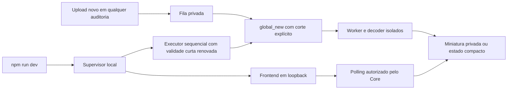

# AUD-IMG-02 — Desenvolvimento com comando único

Em 06/11/2026, continuação autorizada da PR #101 draft sobre `a85d463`. Somente o Supabase existente `gaucha-gestao-local`; sem backfill, containers novos, serviço permanente, merge ou implantação. Este documento substitui o procedimento diário de [05/11](AUD_IMG_02_LOCAL_EXECUTOR_20261105.md), preservado como registro histórico.

Na raiz do checkout, usar apenas:

```bash
npm run dev
```

O supervisor carrega a configuração privada já provisionada em `~/.local/state/gaucha-gestao/audit-thumbnails/launcher.json`, confere projeto/container/portas e migration, obtém corte pelo relógio do PostgreSQL e inicia o executor antes do frontend. O Vite usa loopback `127.0.0.1:5173` com `strictPort`. Configuração ausente, destino incorreto, lock existente ou porta ocupada causam falha explícita, com limpeza; não há frontend aparentemente funcional acompanhado de inicialização silenciosamente ignorada do executor. Em outra máquina, o provisionamento inicial continua seguindo o [runbook](../../operations/AUD_IMG_02_LOCAL_GO_C_RUNBOOK.md); nenhum segredo é versionado ou entregue ao frontend.

Pode-se navegar entre auditorias e anexar JPEG/PNG sem fornecer UUID nem executar `dev:thumbnails`. O comando anterior permanece como ferramenta opcional de diagnóstico, com `--inspection` opcional. O modo integrado sempre usa todas as auditorias. A flag local de miniaturas já habilitada no notebook foi preservada; a flag versionada permanece false.

`Ctrl+C`, SIGTERM e SIGHUP param o agendamento e o frontend, aguardam a execução corrente (limite de 110 s) e restauram `audit_derivative_worker NOLOGIN`. Falha do frontend também cancela o executor; falha do executor encerra o frontend. O mantenedor deve aguardar a confirmação NOLOGIN antes de fechar o terminal.

## Escopo, concorrência e recuperação

A migration incremental `20261106112635_audit_derivative_global_new_uploads.sql` adiciona o modo transacional explícito `global_new`. Exige corte temporal finito, não futuro e UUID de auditoria ausente. O cliente transmite modo e corte ao worker por allowlist e aplica GUCs com `SET LOCAL` em uma transação. **O modo integrado não usa ambos os filtros nulos**, que continuam tendo o significado global histórico nos contratos de diagnóstico/CI.

A claim exige **evidência iniciada e job criado depois do corte**. Assim, nem uma foto antiga confirmada depois da partida entra no escopo. A atualização de leases expiradas também obedece ao corte, inclusive quando a quinta tentativa já se esgotou. Nenhuma linha existente é reenfileirada na aplicação da migration. Os filtros são proteção operacional contra seleção acidental; não constituem uma nova fronteira de autorização para o login técnico.

Há um executor por notebook, protegido pelo lock local já existente, e um one-shot por vez. O advisory lock e a verificação de lease ativa no banco continuam serializando a claim. Se um subprocesso cair, a sessão continua: uma lease interrompida só volta a ser elegível depois de expirar (2 minutos), sob o mesmo corte, teto de cinco tentativas e backoff existentes. A lease anterior perde validade; não há duas execuções simultâneas nem retomada irrestrita de pendências. Falha de renovação interrompe o loop e executa a limpeza.

**Encerramento forçado do supervisor ou energia:** SIGKILL impede `finally`. Os processos isolados usam `--die-with-parent`; one-shot/SQL/JWT/lease continuam limitados. Não há renovação de senha após a morte do supervisor: novas conexões expiram em até 10 minutos após a última renovação; `VALID UNTIL` não encerra conexões SQL já abertas, limitadas pelos timeouts e pelo ciclo one-shot. JWT continua com TTL máximo de 30 s e a policy também exige lease viva. O login pode continuar marcado LOGIN no catálogo até a recuperação, embora a senha expire.

O lock residual bloqueia uma segunda sessão. Recuperação exige conferir que o PID do lock/processos técnicos terminaram, restaurar NOLOGIN com o comando restrito do [registro de 05/11](AUD_IMG_02_LOCAL_EXECUTOR_20261105.md) e só então remover o lock. Não remover um lock ativo. Uma nova partida recebe um corte novo: **não retoma fotos/pendências da sessão anterior por inferência**. A recuperação automática aqui cobre falhas dos one-shots enquanto o supervisor permanece ativo; reprocessamento de evidência de sessão encerrada exige seleção e autorização operacionais explícitas, sem backfill global.

## Credenciais e isolamento

A duração fixa de quatro horas foi removida. O supervisor renova a validade da senha existente para **10 minutos**, a cada minuto de loop, sem alterar senha, identidade, memberships ou grants. Uma execução pode postergar a renovação em até seu timeout de 110 s, ainda dentro da janela. A sessão permanece ativa enquanto `npm run dev` estiver ativo. Não há login permanentemente habilitado por configuração nem timer externo. A validade e a limpeza são responsabilidade do supervisor confiável; o worker não recebe autoridade de ALTER ROLE.

Continuam os cinco wrappers técnicos, `session_user=current_user`, checagem de ausência de privilégios/tabelas/segredo global, emissor com a mesma conexão mínima, tokens restritos a lease/bucket/chave e decoder irmão sem rede/segredos em Bubblewrap. O supervisor local usa o acesso Docker já existente somente para bootstrap LOGIN/validade/NOLOGIN. A configuração de assinatura permanece fora do checkout, modo 0600, e não aparece no ambiente/argv do worker ou no Vite.

O polling, o limite de 480 px, a política de redução estrita e a mensagem **“Imagem já compacta; não foi possível reduzir a miniatura.”** permanecem. Não há fallback automático ao original.



## Prova executada no notebook

Migration aplicada incrementalmente apenas no local após dump custom de banco, roles, bytes Storage e snapshot de ledger/fila/evidências/objetos, em `tmp/aud-img-integrated-20261106/` (0700/0600, ignorado pelo Git). O ledger tinha 35 registros, todos preservados; adicionou-se somente esta migration. Sem reset, seed, atualização/restart de serviços ou restore sobre dados persistentes. Reversão funcional: parar o supervisor e manter NOLOGIN; eventual mudança SQL deve usar migration posterior, sem editar migrations aplicadas.

`tests/integration/audit-derivative-dev-local.mjs` foi executado com fixtures sintéticas novas e conta de teste existente. Ele inicia **somente `npm run dev`**, abre duas auditorias no Chromium e anexa uma imagem nova em cada uma, sem reinício do executor. Ambas mostraram “Preparando miniatura…” e atualizaram automaticamente. Na listagem houve zero GETs de original antes de uma ação explícita. Ampliação e download de cada original foram comparados byte a byte/SHA-256.

| Nova auditoria | Original | Miniatura automática | Ganho |
| --- | --- | --- | --- |
| A — JPEG sintético | 375.240 bytes | 23.428 bytes | 93,76% |
| B — PNG sintético | 2.577.833 bytes | 356.510 bytes | 86,17% |

Ambas ficaram `ready` com uma tentativa. Os **10 jobs, 21 evidências, 31 objetos e 31 arquivos físicos anteriores** ficaram idênticos; nenhuma foto anterior foi processada. Só foram adicionados dois originais e duas miniaturas. Anônimo foi negado em PostgREST real; identidade sem perfil não recebeu estado pelo contrato SQL. Encerramento por SIGINT no grupo npm retornou NOLOGIN. Uma rodada adicional de 65 s, sem uploads, conferiu renovação real após um minuto, NOLOGIN e negação de nova conexão técnica ao encerrar. [Prova sanitizada](evidence/aud-img-02-integrated-dev-20261106.json).

Testes de regressão cobrem seleção em duas auditorias, upload antigo confirmado tarde, lease expirada/retry e lease obsoleta, corte inválido/ausente, sessão nova sem pendências antigas, isolamento, RLS, estado compacto, polling e ciclo do supervisor. A continuidade além de quatro horas é verificada com relógio simulado; não foi aguardada uma sessão física de quatro horas. Os resultados finais de suíte/checks e CI são registrados na PR por SHA.

No primeiro ensaio, a porta estava ocupada pelo Vite anterior: o supervisor limpou NOLOGIN e falhou. O Vite desse mesmo checkout foi encerrado para repetir o comando único. As bibliotecas Chromium ausentes foram extraídas apenas em `/tmp/aud-img-browser-libs`, sem instalação no sistema ou containers. Testes de Bubblewrap precisam executar fora do sandbox da ferramenta; nenhum fallback de isolamento foi adicionado. Houve um timeout de teste de domínio durante validação concorrente; os resultados da repetição sem ensaio visual concorrente são registrados na PR.

A prova usa imagens sintéticas, sem fotos empresariais. A matriz real anterior de RLS/Storage continua documentada em [05/11](AUD_IMG_02_LOCAL_EXECUTOR_20261105.md); o timeout histórico de POST/upsert grande não foi resolvido nem ocultado. Sem homologação de dispositivos/textos/códigos de barras ou gates produtivos. Mantenedor único decide revisão/merge; não houve segunda revisão humana. PROD NO-GO.

## Orientação para futura implantação no servidor — não executada

O serviço da aplicação deverá iniciar e supervisionar **um único executor contínuo**, com restart limitado/backoff e encerramento conjunto. O executor deve manter o ciclo sequencial e os one-shots isolados; não iniciar um worker por auditoria, aba ou requisição HTTP. Falhas devem produzir diagnóstico sanitizado e estado observável, preservando originais e limites de retry/lease.

A habilitação inicial deve registrar um **corte persistente aprovado** para o processamento global da fila de novos uploads. Reinícios controlados devem recuperar esse mesmo corte de configuração privada durável e as leases expiradas desse escopo, em vez de usar filtros nulos ou recalcular o corte e perder pendências. O acervo anterior ao corte fica excluído; qualquer backfill exige operação separada. Essa diferença deliberada em relação à sessão local precisa de teste de falha/restart antes do GO operacional.

Identidade SQL mínima, emissor separado, segredo fora do frontend, JWT curto e decoder isolado permanecem obrigatórios. O ciclo de credenciais deve ser supervisionado pelo serviço confiável: validade curta renovável enquanto ativo, NOLOGIN no encerramento e recuperação que desabilita o login residual antes de reabrir o executor. Não copiar o bootstrap Docker do notebook para um processo web com acesso administrativo. A forma de provisionar essa autoridade no servidor precisa de proposta/GO operacional próprios e respeitar o Identity Boundary vigente.

Antes da implantação, validar unicidade do executor, restart com lease interrompida, renovação/expiração, desligamento e recuperação NOLOGIN, negações de SQL/Storage, preservação de hashes, backups e limites de recursos. Este documento não instala serviço, altera C30/STAGING/PROD ou aprova produção.
