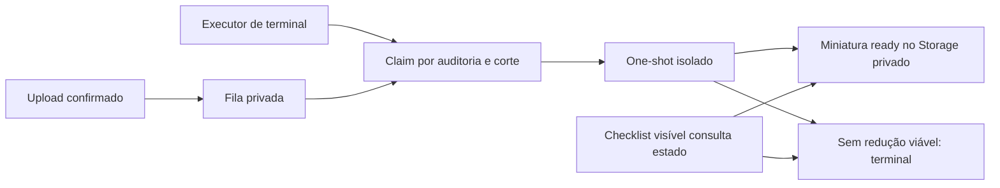

# AUD-IMG-02 — Miniaturas automáticas durante o desenvolvimento local

**05/11/2026 · PR #101 draft.** O mantenedor autorizou executor de terminal para novas evidências, atualização automática do checklist e tratamento explícito de imagens pequenas, exclusivamente no `gaucha-gestao-local`. Não instala serviço, timer do sistema, container, banco ou porta. Não autoriza backfill, STAGING/PROD, merge ou deploy.

## Iniciar e encerrar

Na raiz do projeto, com o frontend local existente em execução (`npm run dev` quando necessário), iniciar em outro terminal:

```bash
npm run dev:thumbnails -- \
  --config "$HOME/.local/state/gaucha-gestao/audit-thumbnails/launcher.json" \
  --inspection UUID_DA_AUDITORIA
```

Usar o UUID presente em `/audit/inspections/UUID_DA_AUDITORIA/checklist`. O executor confirma o projeto Docker e as portas locais, valida a configuração e a migration, habilita temporariamente o login já existente e registra o horário **do servidor**. Esperar a mensagem `Executor local iniciado` antes de anexar novas imagens nessa auditoria. Depois disso, cada upload confirmado entra na fila e é processado automaticamente; não executar one-shot por fotografia.

**Somente essa auditoria e uploads iniciados/confirmados após a partida são selecionados.** Imagens antigas, inclusive jobs pending anteriores, permanecem intocados. Trocar de auditoria exige encerrar e iniciar com seu UUID. Uma imagem anexada enquanto o executor estava desligado não é retomada por inferência na sessão seguinte. Os filtros são proteção operacional contra seleção acidental; não substituem as fronteiras de autorização existentes.

**Ctrl+C** no terminal interrompe o agendamento, aguarda o one-shot em curso (limite existente de 110 s) e restaura `audit_derivative_worker NOLOGIN`. SIGTERM/SIGHUP seguem o mesmo encerramento. Cada sessão dura no máximo quatro horas e executa um trabalho por vez; não há daemon ou instalação automática. Não fechar com SIGKILL: ele impede o `finally`. Se houver encerramento forçado/falha de energia, confirmar o processo e executar a recuperação local restrita:

```bash
docker exec supabase_db_gaucha-gestao-local \
  psql -U supabase_admin -d postgres \
  -c 'ALTER ROLE audit_derivative_worker NOLOGIN;'
```

O lock `/tmp/gaucha-gestao-local-audit-thumbnails.lock` impede dois executores locais. Um lock residual não é apagado automaticamente; conferir que o processo terminou e o login está NOLOGIN antes de removê-lo. A validade temporária da senha é de quatro horas e cinco minutos; não há rotação de senha/chave ou grant extra.

## Configuração e preservação

Nesta máquina, a configuração existente foi conservada em `/home/bernardodev/.local/state/gaucha-gestao/audit-thumbnails/launcher.json`, diretório 0700 e arquivos 0600, **fora do checkout**. O segredo preexistente do emissor foi copiado para arquivo protegido no mesmo diretório; não foi alterado nem entregue ao worker. Formato continua o do [runbook](../../operations/AUD_IMG_02_LOCAL_GO_C_RUNBOOK.md). O executor ignora `expectedEvidence` do antigo teste único e constrói escopo novo somente a partir da auditoria explícita e do relógio do banco; rejeita `queueScope` vindo do arquivo.

Não publicar o conteúdo desses arquivos. Em outra máquina, preparar a configuração mínima local conforme o runbook, sem chaves administrativas no worker. O executor não cria identidade, senha ou permissões: sua única operação de bootstrap é LOGIN/validade e NOLOGIN ao encerrar. O guard SQL original continua exigindo os mesmos cinco wrappers, sem tabelas, memberships, segredo global legível ou privilégios administrativos.

Migration nova **`20261105194432_audit_derivative_local_executor.sql`**, aplicada incrementalmente neste local após backup e conferência de que era a única pendente. As duas migrations anteriores não foram editadas ou reaplicadas. A nova migration mantém assinaturas/grants técnicos e adiciona filtros transacionais à claim, erro terminal de redução inviável e RPC mínima de estado para leitores Core autorizados. Nenhuma linha antiga foi reenfileirada/alterada.

Backup protegido anterior em `tmp/aud-img-auto-backup/` (ignorado pelo Git): dump custom, roles, bytes Storage e snapshot privado de ledger/fila/objetos. Não houve reset, restore sobre o banco ou atualização/restart de serviço.

## Checklist e imagens pequenas



Com `VITE_AUDIT_EVIDENCE_THUMBNAILS=true` **somente no `.env.local`**, imagens visíveis consultam `checklist_evidence_thumbnail_state`. Pending/processing e falhas ainda recuperáveis mostram **“Preparando miniatura…”**; a consulta se repete a cada dois segundos e troca automaticamente para a miniatura ready. Polling para ao sair do viewport, desmontar ou trocar a sessão; estados terminais não continuam consultando. Ampliação e download continuam sendo ações explícitas sobre o original. Flag versionada permanece false.

A RPC exige identidade autenticada, evidência available, perfil ativo e `audit.inspection.read` efetiva na unidade. Não expõe a fila, caminhos, hashes ou capacidade de processamento a quem não possua leitura. Um erro de autorização não dispara acesso ao original.

O decoder mantém Bubblewrap sem rede, limites de bytes/pixels/memória/CPU e máximo de 480 px. Tenta no máximo quatro combinações: **480/q86, 480/q82, 384/q82, 320/q80**, sem ampliação e sem reduzir além do limite de 320 para forçar ganho. JPEG conserva 4:4:4; PNG continua lossless/alpha. Para imagens originalmente menores, preserva sua dimensão máxima natural. Encerra na primeira saída estritamente menor; não entrega derivado maior ou igual.

Se nenhuma combinação reduz bytes, retorna `DECODER_NOT_SMALLER`. A lease é encerrada com `derivative_not_smaller`, esgotando a quota de retry (`attempts=5` como estado terminal, **não cinco codificações/processamentos realizados**). A UI mostra **“Imagem já compacta; não foi possível reduzir a miniatura.”** e oferece **Abrir original**. Não há fallback silencioso ou redução arbitrária de qualidade para obter PASS.

## Prova real no localhost

Executor iniciado uma vez; dois JPEGs anexados **pelo Chromium no checklist**, sem reload, comando adicional de processamento ou alteração de permissão durante os uploads. Ao final, encerramento por SIGINT e NOLOGIN confirmado. A configuração durável também teve início/parada real conferidos, sem novos uploads.

| Arquivo novo | Resultado real |
| --- | --- |
| JPEG **77.834 bytes**, 960 px | Miniatura automática `ready`, **39.929 bytes**, **480 × 252**; redução de **48,6998%** |
| JPEG **11.028 bytes**, 480 px | Nenhuma combinação ficou menor: saídas de 22.035, 20.718, 22.237 e 14.963 bytes. Estado terminal explícito; nenhum derivado gravado |

“Preparando miniatura…” foi observado antes da atualização. Na listagem, o navegador transferiu somente os 39.929 bytes do derivado pronto; **zero GETs do original sem ação explícita**. A segunda imagem não provocou download automático do original. Ampliação e download de **ambos** foram comparados aos arquivos anexados:

- 77.834 bytes: SHA-256 `6a2aba600e2dd149ee88ade87308b1def8d77175e2a260c0b36df1b8a9414bd0`.
- 11.028 bytes: SHA-256 `e3c8ee7b3ed2392c970ec42b5b7dbaf2ae9e8030197a0341fd50b2edf244c50f`.
- Miniatura: SHA-256 `a3cf6385d7ba7787ee709163c24257e253db8647187e1df05438eaa0dd45e6b9`.

Snapshot após o ensaio: os **34 registros anteriores do ledger, cinco linhas anteriores da fila, 25 objetos e seus 25 arquivos físicos** continuaram iguais. Apenas os dois novos originais e uma miniatura foram adicionados. Nenhuma foto anterior foi processada. A nova RPC foi testada em Auth/PostgREST reais: autor/leitor permitidos; sem grant, outra unidade, inativo, revogado e anônimo negados.

Fotografia de teste: [Double-alaskan-rainbow.jpg, Eric Rolph](https://commons.wikimedia.org/wiki/File:Double-alaskan-rainbow.jpg), [CC BY-SA 2.5](https://creativecommons.org/licenses/by-sa/2.5/), redimensionada/recomprimida para as duas fixtures. Nenhuma fotografia empresarial foi usada. Arquivos e capturas permanecem locais em `/tmp/aud-img-auto/`; [prova JSON sanitizada](evidence/aud-img-02-auto-local-20261105.json). Não se publica fixture privada, senha, JWT ou URL assinada.

## Testes e limites

- Suíte local completa: **79 arquivos / 1.110 testes PASS**; testes focados de decoder, executor, polling e SQL/RLS: **79 PASS**.
- Typecheck, lint, build com flag false, verify:build e audit: PASS; zero vulnerabilidades; aviso preexistente de chunk >500 kB.
- Regressões cobrem seleção sem backfill/cross-inspection, estado sem ganho, anônimo/unidade/perfil, isolamento/limites, polling até ready, cancelamento e ausência de fallback original.
- Harness real opt-in: `tests/integration/audit-derivative-auto-local.mjs`, derivado do ensaio executado; exige diretório privado com auditoria vazia/credenciais sintéticas e os dois JPEGs declarados, além da configuração explícita. Não executar como fixture geral ou contra dados existentes por inferência.

A prova de legibilidade é limitada à fotografia usada; não homologa textos/códigos de barras ou dispositivos físicos. A limitação de POST/upsert negado com corpo grande no gateway local, registrada na [revisão anterior](AUD_IMG_02_FINAL_REVIEW_20261105.md), não foi encoberta nem alterada nesta rodada. Não foram criados serviço permanente, backfill ou autorização produtiva. CI do HEAD publicado é registrado na PR por SHA; mantenedor único decide revisão e merge. PROD NO-GO.
