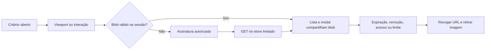

# Tráfego de imagens da Auditoria — MED-01 / AUD-IMG-01–05

## Estado consolidado — 06/11/2026

[Relatório MED-01/AUD-IMG-04 e frontend](MED01_FRONTEND_CLOSURE_20261106.md) · [evidência numérica sanitizada](evidence/med01-frontend-20261106.json).

| Frente | Estado real |
| --- | --- |
| AUD-IMG-01 | Integrada na PR #99; viewport/cache volátil preservados |
| AUD-IMG-02 | Integrada na PR #101; miniaturas e comando único `npm run dev` já existentes, sem reimplementação |
| MED-01 | Navegação local 10/30/100 executada: três repetições por modo, mesmos arquivos, zero pendências no bloco comparado; redução de corpo **77,47%**, meta de 80% não atingida no ruído sintético |
| AUD-IMG-04 | Revisão HTTP local concluída: HTML/assets/Storage privado/assinaturas/ETag/304/expiração; lacunas de cache/nosniff e política futura documentadas, sem mudança de hosting |
| Frontend | Rotas sob demanda medidas: JS inicial gzip 272.112 → 164.605 bytes (39,51%); aviso de chunk >500 kB permanece |
| Pendências | Captura API de transições de sessão parcial; timeout de upsert negado reproduzido separadamente; AUD-IMG-03/05, backfill, restore e executor/headers no servidor continuam independentes |

Originais e limites de acesso/memória preservados. Upload, processamento e download explícito não entram na redução. URLs assinadas mantêm janela residual após logout. Nenhuma migration ou alteração C30/Cloudflare/STAGING/PROD. **PROD NO-GO**; Issue #100 não encerrada.

Os registros abaixo preservam o diagnóstico e as decisões de 04–05/11. Afirmações de ausência de implementação/medição naqueles SHAs não descrevem a base atual.


**DEV atual.** A #120 integrou a transformação privada sob demanda e a #121 a disponibilizou no [Compose DEV](../../operations/DOCKER_LOCAL_STANDARDIZATION.md). A medição de 06/11 usou o [executor legado da #101](AUD_IMG_02_INTEGRATED_DEV_20261106.md). O coletor distingue os GETs de objetos e de transformações nativas. As métricas publicadas de 06/11 correspondem ao executor legado.

Data: 04/11/2026. Brief: solicitação do mantenedor «Otimização de tráfego de evidências da Auditoria». Base revalidada: `origin/main` em `d9b47359b00fd1516bc773d696d760c1c603ed84`, posterior ao HEAD de 03/11 citado no pedido. Branch: `codex/audit-evidence-traffic`.

**Escopo:** prévias de JPG/PNG do checklist. Originais, upload, metadados, download por anexo, RPCs, RLS, cotas, auditoria e ciclo de vida existentes preservados. Planos de Ação fora da implementação. Sem migrations, buckets, serviços, migração de acervo, CDN ou alterações C30/STAGING/PROD. O Supabase local `gaucha-gestao-local` foi apenas inventariado; bucket privado com limite de 10.485.760 bytes e migration de evidências presente. Arquivos não rastreados em `supabase/snippets/` pertencem ao trabalho anterior e não integram esta entrega.

## Diagnóstico e revisão restrita de E3 (histórico de 04/11)

A [PR #66](https://github.com/The-Vonky/Gaucha-Gestao/pull/66), integrada pelo merge `eaffb4f`, introduziu miniatura visual e modal utilizando o original. Seu relato confirma assinatura a cada miniatura/modal. O efeito dependia da referência de `row`; fechar critérios desmontava imagens e trocar seções remontava componentes. O upload já usava `cacheControl:"0"`; o download já assinava por 60s, verificava o objeto com HEAD e preservava bytes e nome de apresentação. Não havia compressão a reimplementar.

O [contrato E3 original](CHECKLIST_EVIDENCE_V1.md#risco-residual-e3--aprovação-original-de-29092026-histórico) proibia prévias inline e autorizava somente download por anexo. A PR #66 introduziu prévias JPG/PNG antes de registrar essa revisão. **Em 04/11/2026 o mantenedor autorizou formalmente a exceção restrita**, preservando os controles de acesso e a proibição de preview para PDF/DOCX/XLSX. Ver [revisão do E3](CHECKLIST_EVIDENCE_V1.md#revisão-restrita-de-e3--04112026) e [brief com decisão](../../briefs/AUDIT_CHECKLIST_EVIDENCE_V1.md#revisão-restrita-da-decisão-e3--04112026). A aceitação não significa que os bytes originais foram sanitizados:  e blob URLs continuam decodificando conteúdo não confiável. Cabeçalhos/endpoint produtivos, validação física, retenção, revogação remota instantânea e processamento privilegiado seguem sujeitos a controles e gates específicos.

## AUD-IMG-01 — implementação

`shared/privateImageCache.ts` fornece cache neutro em memória; `audit/evidenceImages.ts` possui identidade, transporte e reconciliação do módulo. Core informa somente o contexto de acesso. Não importa Auditoria nem depende dela. O padrão de epoch/contexto segue `core/unitCovers.ts`, cujo cache de URLs permanece independente.

- `IntersectionObserver` com margem zero inicia a transferência ao entrar no viewport. Critério fechado não monta imagens. Ao sair do viewport, o `` é desmontado; o blob comprimido pode permanecer no cache. Sem essa API, o usuário pode carregar/ampliar explicitamente.
- Identidade: inspeção, ID, chave imutável, MIME, tamanho e timestamp de confirmação. Mudanças na referência de `row` ou na numeração de apresentação não repetem efeitos.
- Miniatura e modal compartilham a mesma transferência em andamento e a mesma blob URL. Reabrir critérios/trocar seções reutiliza bytes disponíveis na mesma sessão.
- Orçamento LRU de **24 MiB de blobs**, até **duas** transferências simultâneas e **100** pedidos pendentes. Respostas são lidas com limite de bytes do registro e de 10 MiB por objeto; MIME e tamanho incoerentes falham. Timeout de 30s libera pedidos travados. O limite não inclui buffers transitórios, memória de decodificação ou memória interna do browser. Duas respostas podem representar mais 20 MiB transitórios; homologação móvel ainda é necessária.
- Validade fixa de **até 60s contados antes da assinatura**, nunca renovada por uso. Expiração/evicção revogam a blob URL e retiram imagens montadas. Nova transferência exige retry, nova entrada no viewport ou remontagem. Não existe renovação automática em loop.
- Login sem acesso carregado, logout, troca de usuário, perfil inativo, falha ao revalidar acesso e mudanças nos grants conhecidos descartam cache e respostas anteriores. Refresh do mesmo contexto preserva bytes; grants em ordem diferente não alteram o contexto.
- Logout limpa o cache no callback Auth, antes da microtask de bootstrap. Epoch, identidade do pedido e AbortController impedem reentrada de resultados antigos. `pagehide` limpa blobs, inclusive ao entrar no back/forward cache.
- Remoção confirmada invalida a evidência. Uma listagem autorizada reconcilia o conjunto completo da inspeção; registros removidos/ausentes e erros de listagem descartam suas imagens. Finalização/reabertura não alteram bytes disponíveis nem concedem novas capacidades; novas assinaturas continuam sujeitas ao backend.
- Fetch das prévias usa `cache:"no-store"`, sem credenciais adicionais e sem redirects. Não grava imagens/URLs em localStorage, sessionStorage, IndexedDB, Cache API ou service worker. `loading="lazy"`, `decoding="async"` e dimensões reservadas estabilizam a apresentação.
- Falhas de assinatura, rede, objeto ausente, link expirado, decodificação e memória têm retry explícito. Falhas não são cacheadas. Não há retry infinito.
- Download continua independente do cache de prévias: nova assinatura, HEAD e anexo com bytes originais/nome vigente. Resposta que atravessar uma mudança de sessão não inicia download.




**Limite de revogação:** AuthProvider revalida perfil/grants ao voltar à aba e a cada 60s. Revogação remota não é uma notificação instantânea; assinaturas já emitidas têm a janela residual existente. O cache não comprova acesso atual enquanto offline. Sem mudança conhecida, expira em até 60s e não renova por cache hit. Revogação instantânea exigiria contrato adicional no servidor e está fora desta entrega.

**Aceite:** revisitar dentro da validade, mesmo contexto e orçamento não gera novo GET completo. Reload, expiração, erro/remoção, evicção LRU e mudança de acesso são invalidações justificadas. Não prometer retenção simultânea de 100 fotos de 10 MiB em celular.

## MED-01 — procedimento reproduzível

**Registro histórico de 04/11, anterior à execução MED-01 de 06/11:** ainda não havia baseline de bytes de navegação com Storage real naquela entrega. O runtime persistente disponível não é a fixture descartável dos E2Es. Não foram criados usuários, inspeções nem objetos para medir nele. Resultados de mocks e tamanhos dos arquivos gerados não são egress medido. A redução de 80% permanece uma meta de AUD-IMG-02.

Ferramentas entregues:

1. `scripts/generate-audit-evidence-fixtures.mjs`: PNGs RGB determinísticos 960×640, entropia elevada, seeds fixas e manifesto com bytes/SHA-256; somente filesystem, sem upload. Limita a 10, 30 ou 100 arquivos e não sobrescreve existentes. Execução verificada para 10/30/100 em diretórios distintos de `/tmp`: 1.844.468 bytes por arquivo; totais registrados na [validação](EVIDENCE_IMAGE_VALIDATION_20261104.md). São ruído sintético para volume, não teste de legibilidade ou câmera.
2. `tests/integration/audit-evidence-traffic.mjs`: coletor opt-in Chromium CDP, categorias separadas app/API/Auth/assinatura/upload/GET/HEAD, alias numérico por objeto, etapa, status, falha, TTFB/duração, bytes codificados do corpo e bytes de rede incluindo headers. Upload tem tamanho de corpo fornecido por Playwright, sem leitura do conteúdo. Não emite paths, URLs, querystrings, tokens, filenames, headers Auth, cookies ou corpos.
3. `scripts/measure-audit-evidence.mjs`: conecta ao Chromium **já aberto** pelo mantenedor via CDP local, sem iniciar servidor, alterar cache do browser ou acessar banco. Seleciona a aba da aplicação local, permite marcar etapas e grava relatório sanitizado. Restringe origens a loopback; Storage esperado em `127.0.0.1:54321`. CDP é apropriado somente a um perfil de teste sem contas reais. Não habilitar tracing/HAR/vídeo/screenshots com sessões reais.

```bash
node scripts/generate-audit-evidence-fixtures.mjs 10 /tmp/med01-10
node scripts/generate-audit-evidence-fixtures.mjs 30 /tmp/med01-30
node scripts/generate-audit-evidence-fixtures.mjs 100 /tmp/med01-100
# Após abrir Chromium de teste com CDP local e a aplicação local já existente:
node scripts/measure-audit-evidence.mjs 10 /tmp/med01-before-10.json
# Repetir para 30/100 e para a candidata, informando origens locais opcionais se necessário.
```

Preparação pelo mantenedor: conferir o destino local e utilizar contas/unidades exclusivamente sintéticas já autorizadas; anexar no máximo dez imagens por critério, respectivamente em 1/3/10 critérios. Distribuir os dez critérios entre seções. Não substituir dados de uma auditoria real. Para comparação, usar a mesma release, build de produção local, conjunto de arquivos, browser, viewport e rede em ambas as execuções. O checkout histórico deve ser combinado separadamente pelo mantenedor; não trocar a release sob outro trabalho local. Registrar SHA e `dirty` do relatório. Fazer três repetições com perfil/contexto novo por cenário, mantendo cache habilitado no ensaio principal.

| Etapa marcada antes da ação | Procedimento | Conferência |
| --- | --- | --- |
| `startup` | Abrir aplicação/login com fixtures já anexadas | Bytes da aplicação/API/Auth separados dos de fotos |
| `upload` | Anexar lote sintético, separado da navegação | Bytes de upload, assinaturas e RPCs; retries idempotentes |
| `first-visit` | Abrir critério e rolar cada imagem ao viewport | GET/objeto, bytes, TTFB/duração, erros; fora da tela sem GET |
| `collapse` / `revisit` | Fechar/reabrir e rolar novamente dentro de 60s | Zero GET novo para entradas retidas; justificar LRU |
| `section` | Ir a outra seção e voltar | Reutilização sem mudança de identidade |
| `modal` | Ampliar/fechar cada imagem já carregada | Mesmo blob, zero GET novo se retido |
| `download` | Baixar explicitamente um original | Anexo, nome vigente e SHA-256 do manifesto iguais |
| `reload` | Recarregar com cache normal | Cache volátil perdido; nova autorização/transferência |
| `session` | Logout/login em usuário sem escopo; depois usuário autorizado | Imagens retiradas, nenhum byte anterior reaparece |
| `expiry` | Esperar mais de 60s e tentar de novo | URL/blob anterior descartado; nova assinatura |
| `offline` | Rede lenta, desconectar, reconectar e retry | Falha legível, nenhuma confirmação falsa ou loop |

Não alternar etapa enquanto houver pedidos pendentes: o estágio de CDP corresponde ao início do pedido; tamanho de upload é atribuído ao término. `unfinished` deve ser zero para consolidar; se não for, registrar parcial. `wireBytes` inclui headers/protocolo conforme CDP; `bodyBytes` usa `encodedDataLength`, não tamanho descomprimido. Flags de cache e bytes precisam ser interpretados juntos. Downloads de anexos podem sair do domínio Network da página como navegação abortada: **null/failed não significa zero bytes**; registrar tamanho/hash do arquivo salvo separadamente e usar medição de rede apropriada para fechar egress desses downloads. Não estimar wireBytes por `Content-Length`. Recursos externos às duas origens configuradas não entram; se houver CDN de assets, sua inclusão exige configuração explícita do coletor antes da medição.

Modelo de resultado (preencher, sem substituir por previsão): cenário/etapa; SHA; tamanho de lote; GETs por alias; soma de wire/body bytes; assinaturas; API calls; tempo total e p50/p95 das durações; falhas; indicadores de cache; invalidações esperadas. Comparar navegação sem upload/download explícito: `1 − bytes_fotos_candidata / bytes_fotos_baseline`. Se baseline for zero ou incompleto, não calcular percentual. Comparar cold visit e revisita separadamente.

## AUD-IMG-04 — observação histórica de 04/11 (revisão atual no relatório acima)

Observação somente leitura em 04/11, no runtime local existente: HEAD `/` em `127.0.0.1:5173` retornou 200, `Cache-Control: no-cache`, ETag presente, sem `nosniff`. HEAD para chave sintética inexistente e sem assinatura no Storage local retornou 400, sem Cache-Control/ETag/nosniff. **A segunda observação é de erro, não caracteriza arquivos autorizados nem os cabeçalhos de uma URL assinada válida.** Não há avaliação concluída de assets de produção, downloads autorizados, Caddy/Cloudflare ou STAGING. Nenhuma configuração foi alterada.

Upload `cacheControl:"0"` é o comportamento observado no código; não equivale a prova de `no-store` ou CDN bypass na entrega. O coletor registra somente diretivas permitidas de Cache-Control, disposição attachment/inline sem filename, presença de ETag, Age, nosniff e CF-Cache-Status conhecido. Em ambiente aprovado, medir resposta autorizada fria/quente, URL assinada nova/mesma/expirada, HEAD/GET/304 e HTML/assets públicos separadamente. HTML deve permitir atualização de release; política de longo prazo para assets com hash é uma proposta de hosting separada. Não misturar objetos privados com cache CDN compartilhado; nenhuma regra de CDN/Cloudflare/Caddy é criada por esta tarefa.

Documentação oficial consultada: [entrega de objetos privados e download](https://supabase.com/docs/guides/storage/serving/downloads), [bandwidth](https://supabase.com/docs/guides/storage/serving/bandwidth) e [changelog](https://supabase.com/changelog). A entrada Breaking Change de 12/10/2026 trata de cifras TLS da plataforma hospedada; não é motivo para alterar o Storage self-hosted local nesta tarefa. Cabeçalhos reais dependem do ambiente.

## AUD-IMG-02 — desenho histórico de derivados privados (implementado pela PR #101)

Política A preservada: original probatório imutável. Derivado de visualização separado, JPEG/PNG com lado maior inicial 480px (comparar 320px), orientação aplicada corretamente e sem EXIF/GPS. Meta exploratória de 30–100KB; imagens de texto podem exigir mais bytes. Miniaturas não substituem a leitura do original. **Abrir original exige interação explícita**; modal e download do original continuam autorizados e rastreáveis nos termos atuais.

| Alternativa | Segurança | Complexidade/custo | CPU/memória |
| --- | --- | --- | --- |
| Bucket privado separado + processador controlado | Policies por relação evidência/derivado; nenhuma URL pública; servidor trata entradas não confiáveis | Armazenamento extra + processamento; precisa governança de worker e novos contratos | Processamento uma vez, limites de pixels/bytes/tempo e concorrência; baixo custo por entrega |
| Rota autenticada de derivados, geração/entrega controlada | Verificação atual por requisição, headers no-store; não estende autorização do original | Novo runtime e manutenção; latência/custo de servir cada resposta; evitar regenerar a cada GET | Pode ser caro sob concorrência; exige orçamento e cancelamento no servidor |
| Derivado criado no browser e enviado com JWT atual | Baixo privilégio, mas cliente contornável: associação/hash não atestam derivação fiel | Menor serviço novo; protocolo de upload e saneamento ainda precisam design/RLS | CPU/RAM/bateria do celular; variação entre browsers; insuficiente como atestado confiável |
| Transformação nativa do Storage | Depende de suporte efetivo da edição self-hosted e da autorização de transformação | Evita manter encoder próprio se já disponível; disponibilidade/custo não verificados | Demanda de transformação por URL/tamanho; cache privado deve ser demonstrado |

**Preferência para discussão:** bucket privado separado com geração controlada uma vez por original, sempre condicionado a aprovação de arquitetura/segurança, suporte operacional e orçamento. Não introduzir serviço privilegiado por inferência; não usar credencial administrativa no browser. Nenhuma mudança do Identity Boundary/ADR-007 é autorizada. Papel técnico/processador, obtenção dos bytes e permissão mínima de escrita no derivado precisam de proposta específica; esta preferência não define sua implantação.

Modelo sugerido de propriedade da Auditoria: manifestação append-only com `evidence_id`, `original_object_key`, SHA-256 dos bytes efetivamente lidos, versão do encoder/parâmetros, MIME, largura/altura, tamanho, hash do derivado, chave gerada pelo servidor, status pending/ready/failed, timestamps e ator técnico. Associação imutável e constraint única por evidência/versão. Hash calculado no processamento prova associação à cópia processada, **não prova retrospectiva da captura nem sanitização do original**. Não colocar filenames/dados pessoais em chaves/logs.

Fluxo proposto: confirmação atual disponibiliza o original → trabalho idempotente de derivação → leitura autorizada do original → decode em ambiente controlado com limite de pixels/tempo/memória e encoder atualizado → Storage API em chave técnica imutável → confirmação validando objeto/manifesto → UI recebe somente derivado pronto. Job/reattempt com identidade determinística; falha não invalida evidência já aceita. Cotas, lifecycle e auditoria de evidência não mudam. Não criar fila/serviço permanente antes de demonstrar necessidade; a estratégia de execução é parte da aprovação futura.

Autorização da miniatura: evidência `available`, perfil ativo e `audit.inspection.read` na unidade do pai, inclusive finalizada, sem herdar permissões de outro módulo. Bucket separado privado, sem SELECT por prefixo genérico. Usuário comum não sobrescreve/remove/copia derivados; pendências não são legíveis. Registro removido nega novas assinaturas de ambos, preserva histórico e bytes até política de retenção aprovada. Reabertura mantém derivados existentes; novas evidências têm novos registros. Worker pode processar originais disponíveis de auditoria finalizada sem editar respostas/evidências, somente se seu contrato for aprovado. Não dar a usuários direito de anexar em finalizada.

Legado: mostrar placeholder «Miniatura indisponível» e oferecer abertura explícita do original; **não baixar o original silenciosamente como fallback**. Backfill somente com autorização e escopo inventariado, rate limit, checkpoint, reconciliação e cancelamento. Não migrar/remover objetos existentes nesta PR.

Reconciliação futura: original/manifesto/objeto derivado, ausência de bytes físicos, hash divergente, jobs órfãos e derivados de removidos; nunca excluir linhas Storage diretamente. Backup/restore devem incluir originais, metadados, manifests, jobs e objetos derivados ou um procedimento comprovado para regenerá-los. Derivados ausentes após restore mantêm placeholder; original continua disponível somente aos autorizados. Retenção, expurgo e restauração continuam decisões humanas separadas.

Testes planejados: usuário autorizado global/unidade; usuário B/unidade B; grant só setorial; anônimo/inativo/grant revogado; evidência pending/removed; auditoria finalizada/reaberta; assinatura vencida; manipulação de chave/ID/hash; gravação alheia/upsert/copy; MIME falsificado, arquivo truncado, limite de pixels e bomba de descompressão; orientação/transparência/textos/códigos de barras; concorrência e retry idempotente; restore com original ausente/derivado ausente; reconciliação sem vazamento; baseline MED-01 com redução alvo ≥80%. Backend/policies e testes negativos reais são obrigatórios antes de liberar essa solução.

## AUD-IMG-03 — políticas de upload

| Política | Bytes probatórios e custos | Riscos/decisões |
| --- | --- | --- |
| A — vigente | Preserva original; miniatura somente para navegação. Armazenamento original + derivado proposto | EXIF/GPS original continua; resolve volume de navegação sem perda probatória. E3/inline ainda exige conciliação |
| B — foto otimizada como evidência | Substitui original por imagem transformada antes do upload; reduz ingestão/armazenamento | Perda de informação/EXIF/resolução, legibilidade e proveniência; exige aprovação formal de produto/segurança/preservação e critérios de qualidade |
| C — original e derivado associados | Preserva original e mantém versão otimizada separada; mais armazenamento/manifestos/recuperação | Definir qual é evidência oficial, lifecycle atômico/idempotente, tratamento de falha parcial e custos. Derivado nunca substitui original implicitamente |

Não foi ativada compressão/conversão. PDF/DOCX/XLSX permanecem intocados. Se B/C forem autorizadas com transformação cliente, ela deve preceder `checkFile()` e `beginUpload()`; nome/MIME/tamanho/bytes finais precisam concordar, a tentativa deve reusar o mesmo Blob/ID e testes devem comprovar textos, rótulos e códigos de barras. Meta de tamanho não pode apagar conteúdo probatório.

## AUD-IMG-05 — homologação pendente

Executar no Chrome e Edge desktop, Android Chrome físico e iOS Safari físico, registrando aparelho/OS/browser/build/rede/data e responsável. Emulação 375px não é aparelho físico. Usar apenas conteúdo sintético e verificar:

1. Câmera/galeria, orientação retrato/paisagem, JPEG/PNG suportados e mensagem para HEIC não suportado; sem transformação automática.
2. Abrir/fechar/rolar/trocar seções/modal (X, Esc e backdrop), dimensões, foco, zoom e texto legível; anexos longos e limite 10/critério/100/inspeção.
3. Wi-Fi, rede móvel lenta, perda de conexão durante upload/assinatura/GET/confirmação; retry sem duplicar evidência, sem consumo em loop.
4. Download com nome vigente, SHA-256/bytes iguais ao original, sem popup e sem sair da rota; finalizada somente leitura, reabertura preserva evidências.
5. Logout/troca de conta/revogação/perfil inativo, aba em segundo plano, retorno/back-forward cache, reload e 60s de expiração; nenhum blob anterior visível após invalidação conhecida.
6. Estresse de 30/100 arquivos e pressão de memória: evicção esperada, retry acessível, app responsiva; medir memória e bytes sem expor fotos/URLs.
7. Originais sintéticos com texto pequeno, rótulos e códigos de barras válidos; avaliar no original, não concluir legibilidade a partir do ruído do gerador MED-01.

## Validação, riscos e reversão (histórico da PR #99)

Testes adicionados/ampliados: cache (deduplicação, TTL, LRU, limites, timeout, fila e contexto), transporte (no-store, MIME/tamanho, 401/403/404/500, retry, remoção/reconciliação), UI (viewport, referência estável, reabertura/modal, logout e controles), AuthProvider e negações SQL de imagem por inativação/unidade/grants. E2E real estendido com PNG sintético, GET contado no modal/revisita e download com comparação de bytes. O coletor também tem testes de sanitização e contagem.

Resultados finais por SHA estão em [validação de 04/11](EVIDENCE_IMAGE_VALIDATION_20261104.md). Integração Storage/Chromium real, baseline 10/30/100, headers de arquivo autorizado e dispositivos físicos permanecem pendentes até execução documentada. Não há afirmação de homologação, backup comprovado ou PROD pronta.

Riscos principais: exceção restrita E3/inline registrada com risco residual aceito pelo mantenedor em 04/11/2026; janela residual de revogação; orçamento de blobs não equivale a limite total do processo; decodificação de originais não confiáveis continua; thumbnail visual ainda transfere original na primeira visita. Não foi provada redução percentual. A Política A é diretriz de produto; miniaturas físicas com processamento privilegiado, migrations, bucket e infraestrutura aguardam proposta e autorização técnica/operacional específica. Políticas B/C não aprovadas.

Rollback: revert dos commits desta PR e novo build local restabelecem a prévia anterior; nenhum schema/dado/objeto precisa ser revertido. A decisão de preview/E3 foi registrada pelo mantenedor, mas não equivale a segunda revisão humana, homologação física ou autorização para deploy. A integração da PR requer avaliação final de diff/CI e merge deliberado pelo mantenedor; nenhum ambiente C30/STAGING/PROD é alterado automaticamente.
