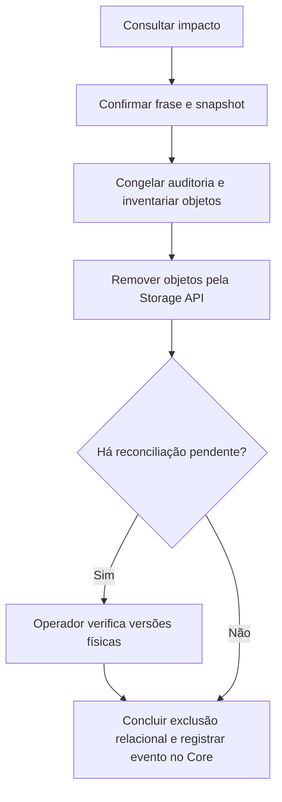

# Exclusão definitiva de auditorias

O mantenedor aprovou a AUD-DELETE-01 em 26/11/2026, inclusive para auditorias finalizadas ou reabertas e planos verificados. A exceção de retenção vale para a auditoria selecionada e os planos com `source_type='checklist'` e `source_inspection_id` igual ao seu ID. Outras origens, planos manuais, cadastros do Core e catálogo de checklist permanecem independentes. A operação preserva backups e os eventos anteriores de `core.system_audit_log`, que podem conter snapshots históricos.

## Histórico da unidade

Em **Auditorias → unidade → Histórico**, use **Excluir** ao lado de **Abrir**. Confira unidade, data, responsável e situação. As contagens incluem as respostas, observações, reservas, evidências em todos os estados, registros de miniaturas, planos em cada situação e evidências de todas as rodadas. O comentário do critério corresponde ao campo de observação. Os planos verificados já estão incluídos nos concluídos. A exclusão remove atribuições de responsáveis, prazos, tratamentos e verificações. O cadastro de cada responsável é preservado.

Digite exatamente `excluir auditoria`. Cancelar antes da confirmação apenas fecha o modal. Após confirmar, a remoção é irreversível. Se a conexão cair, volte ao histórico. Uma pessoa que ainda tenha leitura e exclusão na unidade pode retomar a mesma operação, inclusive após revogação do acesso de quem a iniciou. Em caso de conflito antes do início, leia a prévia atualizada e confirme novamente.

| Acesso | Prévia, início e retomada |
| --- | --- |
| Platform Administrator com grants efetivos globais | Sim |
| Quality global ou da unidade | Sim, no escopo do grant |
| Quality Viewer ou perfil personalizado sem a nova capacidade | Bloqueado |
| Grant somente setorial, perfil inativo, sessão estrita sem admissão | Bloqueado |

## Protocolo e integridade

1. A RPC estável `audit.inspection_delete_impact` consulta o conjunto em um snapshot MVCC. A impressão SHA-256 considera versões de auditoria, respostas e planos, ciclos das evidências, manifestos dos derivados e versões dos objetos. A consulta devolve contagens e identificação da auditoria.
2. `audit.begin_inspection_delete` revalida a frase, o snapshot e os grants com `audit_private.authorize`. Escritores de negócio tomam locks consultivos compartilhados por auditoria. A confirmação solicita o lock exclusivo sem esperar e faz o mesmo para cada namespace de Storage. Um escritor concorrente exige uma nova tentativa. O commit congela os namespaces e registra o inventário e o evento de início. As projeções de auditoria, planos e exportações excluem o conjunto em processamento. O histórico exibe a pendência.
3. `audit.inspection_delete_state` entrega lotes de até 100 objetos catalogados. O cliente usa a Storage API com seu JWT. A política de SELECT específica da operação `storage.object.delete_many` e a de DELETE exigem a identidade exata do objeto inventariado e os dois grants atuais. O ingresso estrito existente revalida a sessão. Um novo upload ou uma publicação tardia no namespace congelado é rejeitado. Um lote parcial pode ser repetido.
4. `audit.finish_inspection_delete` consulta o Storage no banco, verifica a eventual pendência operacional e exclui, na mesma transação, evidências dos planos, planos da origem, derivados, evidências do checklist, respostas e inspeção. A trilha administrativa guarda o autorizador, o executor da conclusão, a unidade, a situação anterior, as contagens e o resultado. O inventário de objetos é descartado. Os identificadores de namespaces congelados impedem que uma gravação tardia recrie o alvo.
5. O cliente recarrega a unidade, preserva o filtro do histórico e invalida o cache volátil de imagens dessa auditoria. Ao abrir painéis, planos ou relatórios, as consultas usam as projeções atuais. Bytes já entregues e exportações anteriores ficam sob controle de seus destinatários.



## Reconciliação excepcional no DEV pessoal

Na imagem Storage v1.72.1 do Compose pessoal, `Uploader.upload` grava uma versão física antes de `completeUpload` registrar o objeto. Uma queda entre essas etapas pode deixar uma versão que o endpoint HTTP comum não enxerga. O backend `file` implementa `list` devolvendo uma lista vazia. Um DELETE HTTP com resultado vazio não atesta ausência no volume. A confirmação marca reconciliação quando encontra reserva pendente, original sem catálogo ou tentativa de derivação sem conclusão física verificável. A auditoria continua pendente até a verificação.

No notebook, retome primeiro a operação pelo histórico para esgotar o lote HTTP. O operador identifica o UUID na URL original ou no evento de início dos Logs do sistema. Em janela sem uploads ou processamento no Storage, confira o projeto pessoal e execute a inspeção sem mutação:

```bash
python3 scripts/audit-delete/reconcile-local.py UUID_DA_AUDITORIA
```

O utilitário confere daemon local, projeto, serviço, digest, backend e operação congelada. Lê somente os namespaces persistidos pelo início da exclusão. Verifica a gramática de chave e versão e recusa arquivos ambíguos, links e conexões ativas. Depois de conferir o alvo e a contagem, execute:

```bash
python3 scripts/audit-delete/reconcile-local.py UUID_DA_AUDITORIA --apply
```

O caso excepcional usa o manipulador nativo `ObjectAdminDelete` da imagem, o mesmo usado pelo Storage para compensar um upload interrompido. É uma ação manual dentro do container, por versão física confirmada. O caminho normal usa HTTP. A reinspeção física deve encontrar zero versões para registrar `verified_at`. Retome pelo histórico com JWT autorizado para finalizar e gravar o evento do Core. Falhas mantêm a pendência. Acesso ao Docker continua restrito ao operador do notebook.

Uma perda externa de catálogo/volume ou versão física antiga sem qualquer indício no banco exige apuração operacional. O resultado normal atesta os objetos inventariados. O utilitário é exclusivo do backend e layout fixados do DEV. Mudanças de imagem, separador, backend ou ambiente requerem nova validação. GG-06, O6 e PROD continuam com gates próprios.

## Roteiro de homologação

Use a unidade sintética identificada na entrega da PR. Abra o histórico em desktop e em 375 px, confira o impacto e cancele. Abra novamente, confira que o campo está vazio e confirme apenas a auditoria sintética escolhida. Confira o resumo, evolução, painel de Qualidade, planos, URL direta, exportações e os dois eventos nos Logs do sistema. Verifique que outra auditoria e um plano manual da mesma unidade continuam disponíveis.
