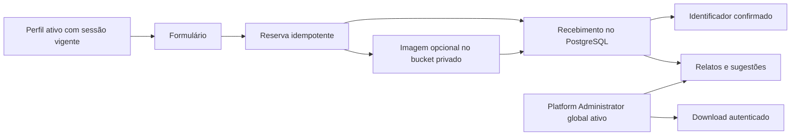

# GG-11 — Relatos e sugestões v1

Em revisão para homologação. A autorização para o piloto depende do mantenedor.

## Fluxo e autorização

O perfil ativo abre o formulário por **Relatar problema ou melhoria**, à direita
na barra de navegação, com ou sem comunicado ativo. Seleciona problema ou sugestão,
módulo/tela e descrição de 10 a 4.000 caracteres. O formulário orienta a
ocultar dados pessoais e confidenciais antes de anexar uma imagem. O servidor
deriva o autor de `auth.uid()` e o horário de recebimento do PostgreSQL. O
contexto inclui somente a família da rota e, se disponível, `VITE_APP_VERSION`.
A versão é opcional. Defina-a com o identificador da release quando gerar o
bundle da candidata. Nenhuma query string, ID de página, captura automática
ou credencial é coletada pelo formulário.

A interface de Administração oferece lista por data decrescente e UUID como
desempate, paginação por cursor, filtros de tipo/módulo/período e leitura do
detalhe. O nome de exibição é consultado no Core. O backend exige sessão vigente,
perfil ativo, atribuição global do papel `platform_administrator` e capacidade
`feedback.report.read` no mesmo papel. Um trigger impede a delegação da
capacidade para outros papéis. Usuários ativos podem enviar sem uma capacidade
administrativa. O envio, a consulta e o download revalidam a sessão, inclusive
após revogação. A auditoria de recebimento registra ator, identificador e horário.

## Armazenamento, falhas e limites

O bucket privado `feedback-attachments` aceita um PNG ou JPEG de até 5 MiB por
relato. A chave usa o UUID opaco do relato e a extensão canônica. A UI verifica
extensão, MIME e assinatura dos bytes. O Storage limita MIME declarado e tamanho.
O SQL confere proprietário, nome reservado e metadados do objeto antes de
confirmar o relato. A assinatura no cliente é uma verificação de formato
superficial e pode ser contornada por chamadas diretas. O backend não decodifica
nem analisa malware em imagens. O arquivo é entregue como download, sem
renderizar seus bytes na aplicação. A política do bucket permite somente upload
reservado e download autenticado de relatos recebidos. O acesso exige token
vigente e autorização atual. A URL temporária do browser contém somente o
objeto já transferido e é revogada após iniciar o download.

A primeira RPC reserva o conteúdo e a chave. A última RPC confirma o
recebimento depois de encontrar o anexo, quando declarado. O UUID é mantido no
formulário em falhas de conexão e o reenvio idempotente devolve o mesmo recibo.
Uma reserva abandonada fica fora da consulta administrativa. Um upload concluído
cuja confirmação se perdeu pode ser recuperado na mesma tentativa. Uma reserva
abandonada e o eventual objeto ficam retidos até decisão do mantenedor. O
arquivo original pode conter metadados ou conteúdo sensível, portanto a
orientação ao usuário continua necessária.

## Critérios para release candidata

- Revisar as duas migrations e verificar sobreposições legadas antes da aplicação.
- Verificar a matriz de sessão, perfil, papel, RPC e Storage no CI.
- Validar login, envio com e sem anexo, recibo, consulta e download a 320 px e desktop.
- Incluir o schema e o bucket privado na validação de backup e restore antes de liberar o piloto.
- Em caso de reversão do frontend, preservar registros e anexos. Correções de banco são incrementais.

[Contrato de Comunicados](../announcements/ADMINISTRATION_V1.md) e [registro de validação](../announcements/GG10_GG11_VALIDATION_20261110.md).
