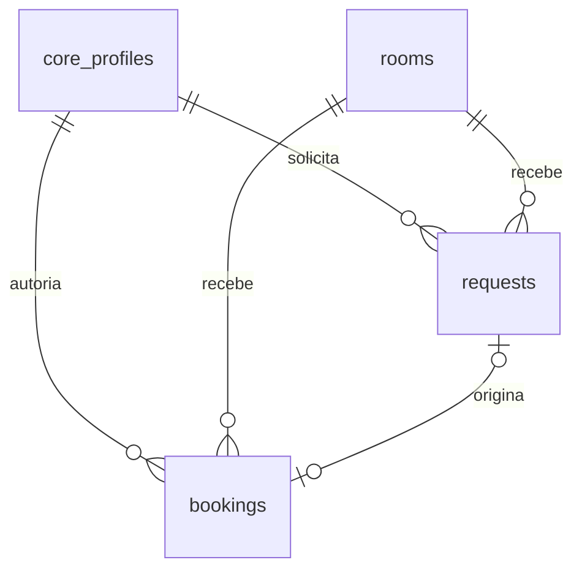

# AG-01 — Fundação do Agendamento de Salas

Estado: implementação para revisão na Issue #87, base `677a70c`. Autorização expressa do responsável nesta conversa em 23/10/2026 para codificar migration, grants, RLS e testes isolados e abrir PR. Essa instrução substitui o bloqueio anterior de **início da codificação**; não representa parecer humano independente, review `APPROVED`, autorização de merge ou deploy. D5-A aprovado pelo responsável; parecer independente ainda deve ser registrado na revisão. PROD NO-GO.

## Modelo e fronteiras

Migration `20261023190247_room_booking_foundation.sql`, append-only. Domínio global sem `unit_id`; depende somente do Core. Sala inicial `Sala de Reunião`. Nenhum acesso ao legado.

- `rooms`: UUID, nome único, ativo, versão e timestamps. Seed de uma sala, sem UI de cadastro.
- `requests`: FK de sala/solicitante/decisor/cancelador; `pending`, `approved`, `rejected`, `cancelled`; finalidade privada; chave de idempotência única por solicitante; versão positiva e timestamps. Metadados de decisão/cancelamento coerentes com estado. Pendentes podem sobrepor.
- `bookings`: vínculo opcional e único ao pedido, com FK composta impedindo sala divergente; `confirmed` ou `cancelled`; `booked_for`, `secretary_notes`, autoria e cancelamento. FKs preservam referências, sem cascata destrutiva.
- Intervalos finitos, positivos, em minutos inteiros, mesmo dia civil em `America/Sao_Paulo`, fim até `23:59:00`. Sem grade de 15 minutos, expediente ou limite de antecedência. Índices para fila, próprios pedidos, agenda e FKs.
- Exclusão GiST parcial por sala e `tstzrange(...,'[)')` somente em `confirmed`: adjacência permitida, cancelamento libera a faixa. `btree_gist` é instalado no schema privado do módulo quando ausente; extensão preexistente é reutilizada sem mover seu schema.

## Matriz de permissões

| Papel Core | schedule.read | request.create | request.read_own | manage |
|---|---|---|---|---|
| `room_booking_requester` | sim | sim | sim | não |
| `room_booking_manager` | sim | sim | sim | sim |
| `platform_administrator` | sim | sim | sim | sim |

Prefixo de todas as permissões: `room_booking.`. Novos papéis de sistema são `global_only`. Nenhuma atribuição automática a usuários. O administrador delega pelo Core existente (`private.can_delegate`), com auditoria de concessão/revogação. Não há bypass pelo nome do papel.

RLS habilitada nas três tabelas, políticas restritivas de negação para clientes, sem grants de schema/tabelas/funções a `anon`/`authenticated`/`PUBLIC`. Mesmo gestores não consultam tabelas brutas. Permissões de negócio não equivalem a privilégios SQL de tabela. O schema não é adicionado ao PostgREST nesta etapa.

## Contrato para AG-02

A fundação não oferece operações de negócio ainda. RPCs futuras devem verificar perfil ativo e permissões atuais pelo Core; fixar `search_path=''`, revogar `EXECUTE` de `PUBLIC`/`anon` e conceder apenas o necessário. Funções com privilégio do proprietário precisam validar autorização explicitamente: RLS não protege contra bypass do proprietário.

Consulta autorizada e limitada por período retorna somente confirmadas com sala/horário/`booked_for`/`secretary_notes`. Não liberar SELECT bruto nem expor `purpose`, identidade técnica, fila ou decisões. Os limites textuais técnicos são 160 caracteres para nome/reservado para e 2000 para finalidade/notas/motivos.

Regras dependentes do tempo **não** são CHECK com `NOW()`: criação/aprovação/cancelamento próprio revalidam o instante do banco **após adquirir travas**, inclusive início que vence durante espera. Pedido vencido permanece `pending` até recusa manual. Reunião iniciada/histórica admite só correção de `booked_for`/`secretary_notes`, com versão e auditoria. As colunas de versão/timestamps estão preparadas; comparação da versão esperada, incremento, autoria e auditoria de negócio serão responsabilidade das RPCs, não estão implementados aqui.

F2 exige serializar por sala criação de pedido, aprovação, reserva direta e mudança de faixa; exclusão em `bookings` sozinha não impede corrida entre pedido e confirmação. Aprovação deve atualizar pedido/inserir reserva/auditar atomicamente. Revogação concorrente requer coordenação de locks com Core (critério C4), não apenas uma consulta inicial à permissão. Estados terminais, idempotência com payload divergente e correções históricas permanecem AG-02.

## Validação e isolamento

- `tests/fixtures/room-booking.sql`: cenários sintéticos compartilhados por PGlite e PostgreSQL 17; negativos de ACL/RLS, perfil inativo, falta de papel, revogação, delegação, escopo de unidade inválido, integridade, idempotência, sobreposição, adjacência, minuto livre, meia-noite, 23:59 e fusos UTC/Tokyo.
- `tests/room-booking-database.test.ts`: todas as migrations em PGlite isolado. `tests/pglite.ts` registra a extensão necessária também nas suítes existentes que carregam todas as migrations.
- `python3 tests/integration/room-booking.py`: cria container próprio com sufixo aleatório e label `owner=codex-ag01`, imagem `public.ecr.aws/supabase/postgres:17.6.1.167`, rede `none`, nenhuma porta publicada, PGDATA exclusivo em tmpfs e sem arquivo de credenciais. Aplica todas as migrations em banco novo com stubs de Auth/Storage, executa a matriz SQL e concorrência de duas sessões com COMMIT/ROLLBACK. Remove somente o container criado em `finally`. Não aceita URL de banco externo.
- PostgreSQL real comprova invariantes/ACL/RLS; stubs não comprovam Supabase Auth, JWT, REST, Storage ou integração completa. Nenhuma RPC/UI AG-02/03, homologação ou implantação foi provada.

## Reversão e revisão

Antes de implantação, basta não aplicar a migration; não existe alteração de ambiente persistente nesta entrega. No laboratório, o descarte do container elimina seu tmpfs. Se futuramente aplicada em ambiente persistente, preservar dados e auditoria e usar forward-fix revisado, sem `DROP ... CASCADE`, edição de migration histórica ou remoção automática de `btree_gist` (pode ter consumidores externos).

Revisão humana deve avaliar ampliação efetiva do administrador, delegação/revogação, privacidade da agenda e futuro contrato transacional. AG-01 não encerra AG-00 humano, AG-04/05 nem gates P1–P9/O1–O8.
