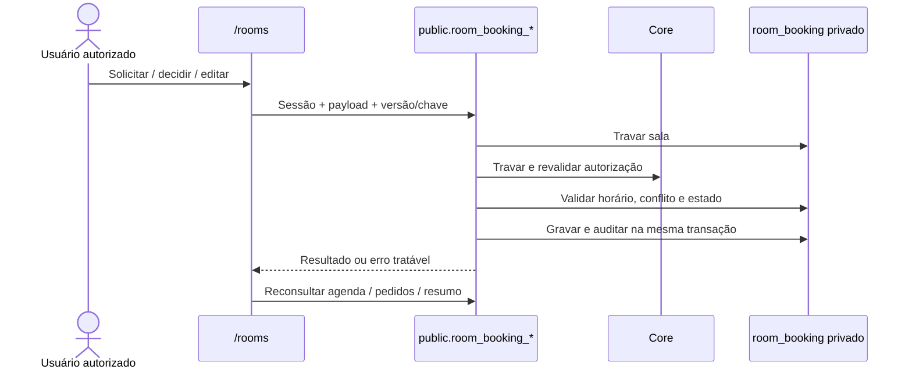

# Agendamento de Salas — AG-02/AG-03 local

## Escopo autorizado e entrega

O mantenedor autorizou ampliar a PR #88 na branch
`feat/ag-01-room-booking-schema-20261023` para RPCs e interface completa,
reutilizando `gaucha-gestao-local`. Não há segundo revisor, merge automático,
novo banco, container, volume, porta ou worktree. D5-A está aprovada pelo titular.

A rota **Administrativo > Agendamento de Salas**, `/rooms`, usa Supabase Auth
e RPCs reais. Inclui agenda por data, pedido, meus pedidos com estado da reserva
vinculada, fila com aprovação/recusa, reserva direta, edição e cancelamento.
O banner apresenta resumo real do banco. O fundo gráfico verde/dourado é um
fallback, sem fingir fotografia da sala; `--room-cover-image` em `rooms.css`
permite adicionar uma fotografia institucional local autorizada.

## Contratos e segurança

| RPC em `public` | Permissão global | Contrato |
|---|---|---|
| `room_booking_schedule` | `room_booking.schedule.read` | Intervalo inclusivo de até 31 dias; somente confirmadas, horários, sala, `booked_for`, notas e versão |
| `room_booking_summary` | `room_booking.schedule.read` | Relógio do banco, situação, total hoje e próxima reserva; contagem pendente só com `manage` |
| `room_booking_requests` | `request.read_own` ou `manage` | Próprios pedidos ou fila pendente; páginas de 50, ordem estável; finalidade privada não vai à agenda |
| `room_booking_create_request` | `request.create` | Idempotência por usuário/chave; mesma chave com conteúdo diferente rejeitada |
| `room_booking_decide_request` | `request.read_own` ou `manage` | Cancelar próprio pendente futuro ou aprovar/recusar com versão esperada |
| `room_booking_save_booking` | `manage` | Criar/editar/cancelar; reunião iniciada admite só nome e notas, sem mudar horário ou cancelar |

Os sufixos de permissão da tabela pertencem ao domínio `room_booking`.
`room_booking` permanece privado, sem USAGE ou SELECT/DML para clientes e com RLS
restritiva. As seis funções expostas têm `search_path=''`, EXECUTE revogado de
PUBLIC/anon e checagem interna de autorização; nenhuma configuração adicional de
schemas no PostgREST é necessária, pois `public` já está exposto.

Mutações travam a sala antes de revalidar permissão e horário. Autorizações travam
perfil, atribuições, papéis e permissões no padrão Core, e verificam o estado atual
no banco. Exclusão GiST garante reserva única; pendentes coexistem. Aprovação e
inserção da reserva ocorrem na mesma transação. Versão esperada impede sobrescrita.
Auditoria registra ator, entidade, operação, estado, versão e horários, sem copiar
finalidade, nome ou notas livres. Nenhum DELETE de negócio foi acrescentado.

O banco aplica início estritamente futuro, minutos inteiros livres, mesmo dia em
`America/Sao_Paulo` e término até 23:59. A interface converte por IANA, independe
do fuso do navegador e recarrega após mutação, retorno à aba e a cada minuto.
A data selecionada da agenda não altera os indicadores de hoje no banner.



## Ambiente e preservação

AG-01 (`20261023190247`) e AG-02 (`20261023193032`) foram aplicadas em
23/10 em uma transação única no container existente
`supabase_db_gaucha-gestao-local`, porta 54322. O histórico passou de 19 para
21 migrations. Contagens de usuários e perfis foram conferidas antes/depois,
sem alteração. Em 26/10, após reabrir o Docker Desktop existente, o histórico foi
reconferido; nenhuma migration foi reaplicada, e nenhum serviço foi recriado.
Frontend Vite retomado na mesma porta 5173.

Os ensaios SQL funcionais usam transação com ROLLBACK. Ensaios concorrentes e de
navegador usam somente registros sintéticos novos, preservando histórico e
cancelando as reservas de teste. Autenticação do navegador usa a conta local já
existente via sessão temporária; chaves/sessões ficam em memória, não no repositório.
O script não envia e-mail, não troca senha e não cria usuário.

**Reversão:** falha durante aplicação aborta a transação. Após aplicada, não usar
reset/DROP: desabilitar acesso ao módulo por revogação administrativa apropriada,
preservar os registros e corrigir por nova migration append-only. Restore ou
rollback destrutivo de banco persistente não foi ensaiado nem autorizado.

## Reprodução e limites

```sh
npm run typecheck
npm run lint
npm test
npm run build
npm run verify:build
npm audit --audit-level=moderate
node tests/integration/room-booking-local.mjs
# SUPABASE_CLI pode apontar para o CLI instalado, se fora do PATH.
node tests/integration/room-booking-browser.mjs
```

Os dois runners de integração são específicos do `gaucha-gestao-local`, verificam
o nome/porta do container e não provisionam serviços. O navegador requer Chromium
compatível com Playwright e suas bibliotecas. Na sessão WSL, foram baixados em
`/tmp`, sem instalação de infraestrutura no projeto. O frontend deve estar na
porta 5173. Não executar o runner histórico `room-booking.py` nesta validação:
ele descreve o laboratório descartável de AG-01, fora do escopo atual.

Homologação pela secretária/mantenedor, aparelho celular físico, corrida de
revogação simultânea C4, restore/rollback persistente e uso produtivo não estão
comprovados por esta entrega. Revogação sequencial, perfil inativo, falta de papel,
negação de acesso bruto e operações privilegiadas estão cobertos pelos testes SQL.

## Evidências

Resultados finais e SHA são registrados na descrição da PR #88. CI remoto deve ser
avaliado pelo mantenedor antes do merge; testes locais não substituem AG-05 nem
P1–P9/O1–O8. C30, STAGING, PROD, DEV de terceiros e legado não foram alterados.

Validação local de 26/10/2026 (árvore de código entregue nesta PR):

| Verificação | Resultado |
|---|---|
| `npm run typecheck`, `npm run lint` | PASS |
| `npm test -- --maxWorkers=4` | PASS: 44 arquivos, 600 testes, sem skips |
| `npm run build`, `npm run verify:build` | PASS; aviso de bundle acima de 500 kB |
| `npm audit --audit-level=moderate` | Zero vulnerabilidades |
| `node tests/integration/room-booking-local.mjs` | PASS: matriz SQL com ROLLBACK, C1/C2/C3, F2 concorrente e atomicidade C5 |
| `node tests/integration/room-booking-browser.mjs` | PASS: Chromium 1440 e 390 px, Auth/REST reais; criar pedido, aprovar, consultar, editar, cancelar e reserva direta; UTC/Asia-Tokyo e texto inerte; anônimo negado |
| `git diff --check` | PASS |

Durante o teste de navegador, foi corrigido o nome acessível da textarea de
observações ao editar conteúdo existente. O teste de UI cobre essa regressão.
Tentativas interrompidas deixaram duas reservas sintéticas confirmadas; ambas
foram canceladas por RPC e mantidas no histórico. O fluxo final passou em ambos
os tamanhos, e suas reservas também foram canceladas. A rota continua acessível
em `http://127.0.0.1:5173/rooms`, usando o login local já existente.

Uma execução concorrente com build/navegador excedeu o timeout de 10 s de um teste
de `audit-database.test.ts` (599/600 passaram). A suíte já havia passado com
600/600 nesta retomada; a verificação final limita os workers a quatro, sem
alterar testes ou elevar timeouts, para evitar competição por recursos no WSL.
