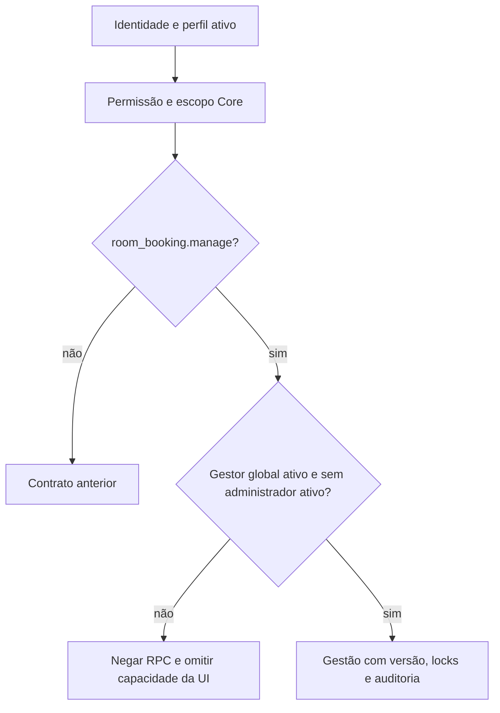

# D5-B — Separação e provisionamento de gestão

**D5-A revogada pelo responsável em 26/10/2026. D5-B adotada: o administrador geral não administra reservas; a gestão cabe ao papel `room_booking_manager`, com provisionamento administrativo restrito e auditado.** PR #88, mesma branch. D1–D4, D6–D11 e F2 preservadas. Mantenedor único decide revisão e merge; não houve segunda revisão humana.

## Contrato implementado

Migration incremental `20261026132054_room_booking_d5b_access.sql`; AG-01/02 históricas não foram editadas. Remove somente a relação `platform_administrator` → `room_booking.manage`. As três permissões de leitura/solicitante do administrador e as quatro do gestor permanecem. Atualiza `core.roles.name` e `description` dos dois papéis; IDs, chaves, `system`, `active`, `global_only` e atribuições são preservados. O trigger Core atualiza versão/timestamp e audita os nomes.

`private.permission_assignment_allowed` acrescenta negação de gestão se faltar atribuição global ativa de `room_booking_manager` ou existir atribuição ativa de `platform_administrator` com papel ativo. É uma exceção explícita de separação de funções autorizada pelo pedido atual, restrita a essa permissão: não substitui perfil ativo, catálogo, escopo ou relação de permissões. O Core só consulta tabelas Core, sem depender do schema de negócio. `private.has_scoped_permission` e `core.my_access` usam a mesma restrição; helpers globais, delegação, RPCs e UI recebem o resultado efetivo. Nenhuma RPC nova foi exposta.

Atribuições simultâneas existentes permanecem armazenadas e são ineficazes para gestão. O procedimento técnico abaixo rejeita novas concessões conflitantes. Não há limpeza automática nem constraint retroativa. Uma conexão técnica com poder de proprietário ainda pode escrever uma combinação conflitante; a negação efetiva permanece no banco. `private.can_delegate` continua exigindo todas as permissões: o administrador não concede o gestor pela UI, nem por payload forjado.

`validate_assignment` adquire `FOR UPDATE` no perfil durante concessão/ativação, serializando com `FOR SHARE` das autorizações existentes. Locks de atribuições/papéis/permissões, versão, exclusão de intervalos, RLS e auditoria das RPCs são preservados. Deadlocks são abortados pelo PostgreSQL, sem operação parcial; repetição deve reconsultar estado/versão. Não alegar prova de todas as corridas apenas com testes sequenciais.



`RolesPage` exibe `row.name`; a busca consulta `core.roles.name/key`; `RoleEditor` usa o nome do Core no detalhe. Nomes: **Room Booking Manager** — Gestão de pedidos e reservas.; **Room Booking Requester** — Solicitações individuais e consulta da agenda. Nenhum nome de outro perfil foi traduzido.

## Procedimento técnico — secretária e substituta

Executar **somente após autorização específica do responsável para destinatário, ambiente e ação**. Esta entrega não concede gestor permanentemente a nenhuma conta. Operador técnico autorizado usa conexão direta `postgres` no ambiente verificado, sem JWT/impersonação de usuário, sem Data API/service_role no browser. Identificar o operador por perfil Core ativo e registrar uma referência de autorização (issue/registro restrito, sem dados pessoais/texto de reunião). A identidade declarada no registro deve corresponder ao operador; a autenticação da conexão técnica e a evidência externa sustentam essa atribuição.

1. Confirmar host/projeto/histórico, destinatário existente, papel e atribuição atual. Inspecionar conflitos; nunca apagar papéis automaticamente. Definir duração/retorno da substituta e responsável pela revogação.
2. Abrir transação, configurar os parâmetros **locais à transação**, executar o script revisado e conferir registros antes de COMMIT. Substituir os marcadores somente na sessão técnica; não versionar dados reais.

```sql
begin;
select set_config('room_booking.operator_id','UUID_DO_OPERADOR',true);
select set_config('room_booking.target_id','UUID_DO_DESTINATARIO',true);
select set_config('room_booking.provision_action','grant',true);
select set_config('room_booking.authorization_ref','REFERENCIA_DA_AUTORIZACAO',true);
-- No psql, executar a partir da raiz do repositório:
\i scripts/ops/room-booking-manager.sql
-- Conferir a atribuição e os eventos grant + technical_grant relacionados.
-- COMMIT somente após conferir o resultado; em dúvida, ROLLBACK.
commit;
```

3. Revogar no retorno executando o mesmo procedimento com `provision_action='revoke'`, nova referência e mesmo destinatário. A atribuição é desativada, nunca apagada. Para reativação futura, reutiliza ID. Concessão já ativa e revogação já inativa falham explicitamente.
4. Registrar na evidência restrita: operador, autorizador/referência, ambiente, SHA do script, horário, ID da atribuição, eventos e resultado. Conferir capacidades efetivas na sessão do destinatário após atualizar a página.

O script é uma única instrução `DO` atômica, sem função persistente ou RPC. Exige `session_user=current_user=postgres` e `auth.uid()` nulo. Usa validações/triggers atuais do Core e adiciona `technical_grant`/`technical_revoke` em `core.system_audit_log`, com operador humano declarado, referência, usuário técnico, ID e antes/depois. O evento automático Core sem JWT permanece como evidência técnica vinculada pelo ID; não é necessário adulterar o trigger para simular identidade. Nenhuma incompatibilidade de auditoria exigiu correção do Core.

## Aplicação local e reversão

Em 26/10, destino confirmado `supabase_db_gaucha-gestao-local`, porta 54322, histórico anterior de 21 migrations até AG-02. Aplicada somente a migration D5-B em transação, registrando a 22ª entrada no histórico. Comparação antes/depois confirmou preservação integral de usuários, atribuições, IDs/atributos dos papéis, contagem de pedidos e reservas. Falha anterior a COMMIT abortaria tudo; após aplicação, reversão é forward-fix append-only autorizado, sem restaurar D5-A por conta própria, sem reset/DROP ou exclusão de dados.

`tests/integration/room-booking-d5b-local.mjs` reutiliza a única conta local em transação, simula administrador, conflito e gestor alterando atribuições apenas dentro dela e faz ROLLBACK integral. Não cria usuários. Verifica RPCs negativas, pedido/agenda próprios, operações do gestor, procedimento técnico, auditoria e igualdade do estado persistente após o ensaio. Fixtures que criam usuários rodam apenas em memória nesta entrega. Runners antigos que pressupunham administrador gestor são históricos e não devem ser executados sob D5-B.

Resultados/SHA finais são registrados na PR #88 e no relatório AG02_AG03_LOCAL. Homologação humana, celular físico, C30/STAGING/PROD e recuperação persistente não são comprovados por estes ensaios. PROD NO-GO.
