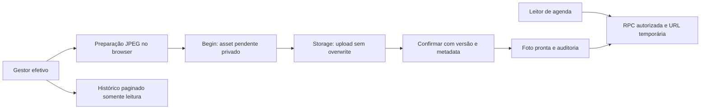

# Agendamento — foto, status temporal e histórico de gestão

Melhorias aprovadas pelo responsável em 26/10/2026, na mesma PR #88 e branch `feat/ag-01-room-booking-schema-20261023`, após testes manuais do módulo. D5-B permanece vigente: administrador geral não opera gestão, mesmo com atribuição simultânea conflitante. Sem merge/deploy automático; mantenedor único revisa e decide.

## Contratos de banco

Migration append-only `20261026181548_room_booking_experience.sql`, posterior às 22 migrations existentes. Aplicada uma única vez no `gaucha-gestao-local`, totalizando **23**. Comparação em transação preservou usuários, papéis, atribuições, pedidos e reservas existentes. Migrations anteriores não foram editadas.

| RPC pública | Autorização | Contrato |
|---|---|---|
| `room_booking_summary` | `room_booking.schedule.read` | Acrescenta `in_use_until`, término da confirmada em andamento, ou null; mantém `server_now`, `[início,fim)` e contador pendente somente para gestão efetiva |
| `room_booking_history` | `room_booking.manage` | Todos os estados de pedidos, inclusive passados; filtros opcionais de estado e período do horário solicitado em America/Sao_Paulo; cursor `(starts_at,id)` decrescente; 25 itens e `has_more` |
| `room_booking_cover` | `room_booking.schedule.read` | Versão atual, asset/chave privada quando pronta, enquadramento e dimensões; sem URL persistida |
| `room_booking_begin_cover_upload` | `room_booking.manage` | Valida JPEG declarado, 1 B–1 MiB, dimensões 1–2560; máximo de cinco pendentes válidos por sala por hora; chave única gerada pelo banco |
| `room_booking_save_cover` | `room_booking.manage` | `confirm`, `position`, `remove` exigem versão esperada; `cancel` aposenta somente pendente do próprio uploader; todas as ações revalidam acesso após trava da sala |

O histórico retorna nome de exibição do solicitante e do decisor pelo Core, nome da reserva, horários, estado, criação, decisão/motivo e situação/cancelamento posterior da reserva vinculada. Não retorna e-mails, finalidade privada ou UUIDs de identidade. Não é uma API de alteração nem outro local de aprovação. Reservas diretas não geram pedidos artificiais. Nomes refletem o cadastro atual do Core, não um snapshot histórico do nome.

Cursor composto evita que novas inserções no topo desloquem a próxima página. Filtros reiniciam o cursor. O índice `requests_history_order` acompanha a ordenação; não usa OFFSET. A consulta não congela um snapshot entre páginas: mudanças de estado podem mudar a participação em um filtro, e a interface pode ser atualizada para reconsultar.

## Foto e Storage privado

O módulo é proprietário de `room_booking.cover_assets` e `room_booking.room_covers`, sem SELECT/DML cliente, com RLS de negação. `room_covers` tem versão independente, enquadramento 0–100 e FK composta que só aceita asset da própria sala. Constraint deferred garante uma única foto pronta referenciada. Metadados do arquivo são imutáveis; ciclo `pending → ready → retired` ou `pending → retired`. Triggers auditam estado, autoria, enquadramento e versão em `core.system_audit_log`, sem object key ou URL assinada.

Bucket **`room-covers`**, privado, limite 1 MiB e `image/jpeg`. INSERT exige gestão efetiva D5-B, objeto pendente do uploader com menos de uma hora e operação de upload. SELECT/assinatura exige `room_booking.schedule.read` e foto atual pronta da sala ativa. Não existem políticas cliente de UPDATE/DELETE: sem sobrescrita, upsert, move ou copy. `unit-covers`, permissões de unidades e demais módulos não mudaram.

Confirmação confere objeto existente, uploader, tamanho e MIME registrados pelo Storage; substituição aposenta o anterior e muda a referência atomicamente. Versão esperada protege substituição, enquadramento e remoção; concorrência retorna `40001`. Arquivos aposentados/pendentes expirados não são apagados: expurgo e retenção física continuam fora do escopo, exigindo procedimento autorizado. Operador pode reconciliar `cover_assets` com `storage.objects` pela chave, sem dar acesso bruto ao cliente.

O processamento reutiliza **`core/unitCoverImage.ts`**, sem duplicar o codec: JPEG/PNG/WebP pelos bytes, entrada ≤8 MiB e ≤40 MP, reconversão JPEG com remoção de EXIF, lado ≤2560 px, alvo ≤512 KiB e teto ≤1 MiB. UI reutiliza Modal/Notice e estilos de prévia/enquadramento. Arquivo original não é enviado. A validação física/reconversão ocorre no browser; SQL/Storage verificam limites e metadata, **não decodificam pixels nem comprovam conteúdo/remoção de EXIF de payload forjado**. Sem nova garantia criptográfica ou scanner de malware.

URLs assinadas têm TTL de 300 s, somente em memória, com renovação a cada 240 s e ao voltar à aba. Mudança de principal/permissões remonta o estado e invalida respostas anteriores. Remoção/revogação bloqueia novas assinaturas; URL já emitida continua bearer token até expirar. Erro de assinatura/arquivo ou ausência de foto mantém o fundo institucional. Falha após begin tenta aposentar o pendente sem mascarar o erro original. Falha de cancelamento, inclusive por revogação, deixa pendente para reconciliação técnica.

A ação **Alterar foto da sala** só aparece com `manage` efetivo. Editor permite selecionar, pré-visualizar, centralizar, enquadrar horizontal/verticalmente, substituir e remover. Overlay preserva legibilidade. A foto não é vinculada a unidades nem usada por outros módulos.

## Status e contador

Badge verde **✓ Disponível agora**; vermelho **◷ Em uso**, inclusive no resumo lateral. Texto/ícone acompanham a cor, sem animação piscante. Em uso, `Termina em HH:mm:ss` usa `in_use_until - server_now - tempo monotônico transcorrido`, com `performance.now()`. A âncora é capturada quando a resposta do resumo chega, antes de aguardar outras consultas; o relógio civil do aparelho não governa a contagem. Há a tolerância normal de latência da amostra do servidor.

O timer local atualiza a cada segundo e nunca solicita o banco a cada segundo. Ao zerar, trava em zero, esconde a contagem vencida, mostra consulta em andamento e dispara uma atualização real uma única vez por amostra. Uma reunião imediatamente seguinte pode manter **Em uso** com novo término. Quando livre, `next_start` também agenda a reconsulta na borda. A página reconsulta periodicamente (60 s) e em `visibilitychange` ao retornar; o tick usa tempo transcorrido, sem acumular decrementos perdidos em aba inativa. Em erro de rede, não inventa disponibilidade; mantém feedback de erro e tenta na atualização normal/manual.

## Visão por permissão

Gestor efetivo não renderiza **ORGANIZE SEU ENCONTRO**, **Novo pedido** ou **Meus pedidos**, nem consulta pedidos próprios. Agenda ocupa a largura disponível. Mantém reserva direta, fila e decisões, edição/cancelamento autorizados, foto e histórico somente leitura. Os grants de solicitante do papel não foram removidos: a mudança é de apresentação. Administrador D5-B e solicitante continuam com seus próprios pedidos e agenda; sem foto editável, fila, contador privado ou histórico geral.

## Validação e limites

- `tests/fixtures/room-booking-experience.sql`: negativas diretas de foto/histórico, metadata, versão obsoleta, enquadramento/substituição/remoção, RLS Storage, leitura, cancelamento pendente, auditoria, resumo, estados, passado, filtros e cursor. Executado em PGlite e PostgreSQL local com ROLLBACK e verificação de preservação.
- `tests/room-banner.test.tsx`: status, contagem, zero sem repetição/negativos, próxima reunião, retorno da aba sem ticks e atraso entre recebimento/renderização.
- `tests/room-photo-client.test.tsx`: upload falho, cancelamento pendente, `upsert:false`, versão/enquadramento esperados, falha de assinatura e fallback. Validação/codec completos cobertos também pelos testes preexistentes de `unit-cover-image`.
- `tests/room-booking-ui.test.tsx`: visões gestor/solicitante/D5-B, reserva direta preservada, estados/decisão/cancelamento posterior e filtro/cursor no histórico.
- `tests/integration/room-booking-experience-browser.mjs`: Auth/REST/Storage reais com contas existentes; upload PNG convertido em JPEG, substituição, enquadramento, versão antiga recusada, leitura por solicitante, anônimo negado, remoção ao encerrar; duas visões em 1440/390 px, sem `pageerror` ou overflow horizontal.

A conta solicitante local acumula `platform_administrator` e `room_booking_requester`; a secretária possui `room_booking_manager` sem conflito. Nenhuma conta/atribuição foi criada ou modificada para os testes. Solicitante sem administração também é testado em memória. O ensaio Storage usa imagem sintética, só quando não existe foto real, e remove logicamente a foto de teste ao fim. Seus assets aposentados e eventos de auditoria são preservados. As capturas mascaram listas com dados potencialmente pessoais e foram incluídas em `evidence/` para revisão. O bloco magenta é máscara de privacidade do teste, não parte da interface. A imagem de fundo nessas capturas é sintética, não a foto real da sala.

Testes não equivalem a homologação humana, celular físico, recuperação do bucket ou implantação. Não se alterou C30/STAGING/PROD/legado, nem se executou reset. Após COMMIT, correções por nova migration autorizada; sem editar a migration aplicada nem apagar arquivos para reverter. O mantenedor continua responsável pelo aceite e merge. PROD NO-GO.

## Entrega final — 27/10/2026

Código/testes no commit `53c5a01`; as verificações finais abaixo rodaram sobre os mesmos arquivos antes do commit. O commit documental seguinte acrescenta relatório e capturas sem modificar código.

| Verificação | Resultado |
|---|---|
| `npm run typecheck` | PASS em 27/10 |
| `npm run lint` | PASS em 27/10 |
| `npm test -- --maxWorkers=4` | PASS em 27/10: **48 arquivos, 612 testes**, sem skips |
| `npm run build` | PASS em 27/10; aviso de chunk acima de 500 kB |
| `npm run verify:build` | PASS em 27/10 |
| `npm audit --audit-level=moderate` | PASS em 27/10: zero vulnerabilidades |
| `room-booking-experience-local.mjs` | PASS em 26/10, inclusive histórico passado; ROLLBACK e comparação do estado persistente |
| `room-booking-experience-browser.mjs` | PASS em 26/10: Auth/REST/Storage reais, duas contas existentes, 1440/390 px, foto e visões por permissão |
| RPCs de leitura em 27/10 | PASS: resumo/foto para gestor e solicitante; histórico permitido ao gestor e negado ao solicitante, sem mutações |
| Histórico local em 27/10 | **23 migrations**, última `20261026181548`; nenhuma reaplicação |
| `/rooms` em 27/10 | HTTP 200 em `http://127.0.0.1:5173/rooms` após retomar o Vite existente |
| `git diff --check` | PASS |

Na retomada, Docker Desktop estava fechado e a integração WSL ainda indisponível. Foi reaberto o aplicativo já instalado; os mesmos containers voltaram, sem criação/recriação de ambiente. A consulta do histórico foi feita pelo CLI Windows existente e a integração WSL voltou em seguida. Há uma foto cadastrada atualmente: foi preservada, sem repetir upload/substituição/remoção. A tentativa de nova navegação somente leitura em 27/10 não iniciou porque o Chromium temporário de `/tmp` não sobreviveu à interrupção; não se reapresenta a prova de 26/10 como nova execução. A auditoria npm antes bloqueada por limite da ferramenta foi concluída com sucesso nesta retomada.

A rodada completa de checks foi repetida apenas porque a saída do processo final anterior não pôde ser recuperada após a interrupção. O runner de mutação em Storage não foi repetido sobre a foto existente. O primeiro teste de navegador de 26/10 encontrou ambiguidade no nome acessível do filtro de status; o rótulo explícito foi corrigido e a rodada final passou.

Capturas de 26/10, sem listas pessoais:

- [Gestor — desktop](evidence/manager-desktop-20261026.png)
- [Gestor — celular](evidence/manager-mobile-20261026.png)
- [Solicitante — desktop](evidence/requester-desktop-20261026.png)
- [Solicitante — celular](evidence/requester-mobile-20261026.png)

Pendências reais: revisão/merge pelo titular, conclusão dos checks remotos do SHA enviado, homologação humana e celular físico. Restore do bucket e prontidão produtiva não foram comprovados. `supabase/snippets/` permanece preexistente e fora dos commits.
