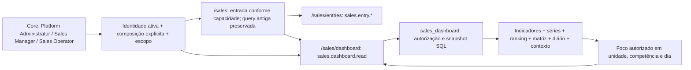

# VEN-04B — Dashboard gerencial de Vendas / Maquininhas

**MEL-01 (30/10/2026):** com zero unidades, capacidades globais existentes permitem
retornar o estado vazio. Sem criar fixtures permanentes ou conceder novas permissões.
[Migration incremental e provas locais](VEN04B_MEL01_LOCAL_CLEANUP.md).

**Estado:** implementada para revisão do mantenedor, sem homologação VEN-07.
Autorização expressa em 29/10/2026 para desenvolvimento, fixtures e testes no
notebook, branch e PR. Baseline `origin/main` reconferida por fetch:
`7ddcd3155da91561ba94f088ff277ee4fc659f90`, merge da VEN-04A ([PR #93](https://github.com/The-Vonky/Gaucha-Gestao/pull/93)).
VEN-00/01/02/03 integradas nas PRs #89/#90/#91/#92. A entrega original de UI não
continha migration. A correção obrigatória anterior ao merge acrescenta
`20261029180613_sales_institutional_roles.sql`: sete capacidades para o administrador,
Sales Manager/Operator protegidos, sem atribuições automáticas nem mudança de RLS/RPC.
[Composição, limpeza local e validação](VEN04B_ACCESS_CORRECTION.md).

## Acesso e componentes

**MEL-03–06 (30/10/2026):** menu único e expansível em Comercial → Vendas / Maquininhas,
com **Visão geral** (`/sales/dashboard`) e **Lançamentos** (`/sales/entries`) filtrados
por capacidade. `/sales` prioriza o dashboard quando permitido; somente operacional
segue para Lançamentos. URLs antigas `/sales?…` preservam query, hash e estado por
redirecionamento `replace` para `/sales/entries?…`, inclusive `?method=Stone`.
Não há item/rota Relatórios. `/sales/dashboard` usa **exclusivamente**
`sales.dashboard.read`, global ou unitária, com perfil/identidade ativos. Menu,
Guard do módulo e páginas distinguem as duas áreas. Setor não concede agregados de unidade.
`SalesNavigation` exibe um único atalho no cabeçalho: **Ir para lançamentos**
(principal no dashboard) ou **Voltar ao dashboard** (secundário na operação), somente
com acesso ao destino. Mantém competências/datas e modalidade equivalente: Stone
permanece Stone; PIX/ambos usam combinado. A volta por estado restaura datas exatas,
PIX e página; unidade é revalidada inclusive nesse estado, exigindo leitura na área
de destino. Caminhos de retorno seguem lista fechada interna. Histórico nativo
preserva Voltar/Avançar. Controles gerenciais Voltar/Comparar tudo/Redefinir/Atualizar
permanecem. Os cabeçalhos não repetem a legenda Comercial; breadcrumb institucional
mostra módulo e subpágina, sem alterar PageTitle ou breadcrumbs de outros módulos.

**Novo lançamento** fica visível e desabilitado quando impedido, associado ao aviso
por `aria-describedby`. Catálogo tem carregamento/erro/retry separados da consulta
financeira. Distingue ausência de cadastro (somente com catálogo completo por grant
operacional global), todas as unidades autorizadas inativas, ausência de create e
ausência de unidade ativa autorizada. Nunca infere ausência global de catálogo
restrito. **Cadastrar unidade** leva a `/admin/units` somente com
`admin.unit.manage` global. Sem acesso operacional, não há controle de cadastro.
[Validação e screenshots MEL-03–06](VEN04B_MEL03_06_VALIDATION.md).
O dashboard nunca chama listagem, detalhe ou catálogo operacional. Drill-down de
dia mostra somente agregados; não descobre lançamentos individuais.

`SalesDashboardPage` consome `salesDashboard`/`SalesDashboard` da VEN-03;
`DashboardCharts` contém `MonthlyEvolution`, `Ranking`, `Stacked`, `Heatmap`,
`DailyAnalysis` e `PaymentMix`. Indicadores, resumo mensal, insights e reconciliação
usam o mesmo payload. `dashboard.ts` reúne filtros, formatação e geometria.
Shared e Core não receberam mudanças de contrato. A rota usa importação dinâmica.

## Filtros e foco

Padrão Stone, janeiro até o mês corrente em `America/Sao_Paulo`. Datas de competência
são civis `YYYY-MM`, enviadas com dia `01`; não são instantes UTC. O intervalo não
pode exceder 24 competências, inclusive lacunas; sem divisão de consolidados.
`from`, `to`, `unit`, `scope`, `daily`, `day`, `baseFrom` e `baseTo` ficam na URL.
O foco preserva a janela de comparação original, inclusive ao abrir URL sem bases
explícitas. Histórico do navegador sustenta Voltar/Avançar/reload; o botão Voltar
retorna ao estado anterior ou à janela base de um link direto.

Ranking/líder focam unidade; evolução/resumo/competência recente/melhor completa
focam competência; empilhadas/heatmap focam célula; tabela diária foca dia observado.
Comparar tudo restaura a janela base e todas as unidades autorizadas. Redefinir
restaura o padrão Stone. Atualizar revalida acesso e consulta novamente, preservando
seleção. Cada mudança financeira lê novamente a RPC; não existe cache financeiro
entre montagens da área. Retornar após CRUD refaz a leitura.

UUID inválido ou fora do escopo gera indisponibilidade; não vira filtro global.
O banco verifica novamente a autorização. Se todas excederem 100, a resposta é erro,
sem total parcial; **Recorte direto por UUID** permite escolher uma unidade autorizada.
Uma seleção unitária não descobre nomes de outras unidades. Seletores mostram somente
o catálogo do payload corrente; comparar tudo permite consultar novamente o conjunto.
Competência diária fora da janela é recusada. Respostas antigas são descartadas por
cleanup da requisição; resultado é vinculado a identidade, grants, filtros e revisão.
Mudança de acesso oculta imediatamente o resultado e elimina o estado anterior.

## Precisão, status e gráficos

Dinheiro exibido é formatado diretamente da string decimal, inclusive grandes somas
além de `Number.MAX_SAFE_INTEGER`, centavos e diferenças assinadas. Nulo significa
Indisponível/Sem comparação. Não há cálculo financeiro nem arredondamento no React.
Percentuais são os seis decimais da RPC, removendo apenas zeros finais.

`visualRatio` usa BigInt para limitar uma razão de coordenadas a 1 ppm antes de
convertê-la para Number; suporta inclusive valores maiores que `Number.MAX_VALUE`.
Essa quantização é exclusivamente visual, nunca soma, total, rótulo ou oráculo.
Empilhamento acumula apenas posições visuais. Intensidade do heatmap vem diretamente
de `unit_months.intensity`; ocultar séries altera somente o desenho/legenda.
Nenhuma biblioteca de gráficos ou dependência foi acrescentada.

Evolução mensal ocupa posições civis; lacunas interrompem a linha e aparecem como
lacunas, sem pontos de zero inventados. Média mensal é a da API; parcial tem marcador
e texto. Ranking preserva posição/desempate da API. A matriz não trunca unidades ou
competências. Células de zero mostram valor e contexto sem movimento financeiro.

Diário usa `daily.totals`, sem somar pontos unitários. `has_elapsed` de `daily.points`
limita os dias observados; referência é a anterior disponível, inclusive fora da janela.
O corte aparece no gráfico e no texto. Projeção só aparece se autorizada pelo campo
`projection_is_estimate`, em tracejado separado até o endpoint exato. Valores diários
e acumulados têm alternativa tabular. Ajustes nunca são distribuídos pelos dias.

Histórico unitário com `historical_unavailable`/`partial=null` é explicitamente
indeterminado; médias/comparações/projeções nulas permanecem nulas. `scoped_dates`
usa somente datas do recorte. `is_closed=null` em status **derived** não é convertido
em histórico indisponível quando `partial` é conhecido: aparece como derivado e sem
fechamento confirmado. Snapshot global não é reconstruído por outras consultas.

**Nuance preservada da VEN-03:** `summary.best_closed` seleciona `NOT partial`, que
pode incluir mês completo com `is_closed=false` ou `null` derivado. A interface usa
“Melhor competência fechada confirmada” somente com `is_closed=true`; nos demais casos,
“Melhor competência completa (VEN-03)” acompanhado do status real. Não alteramos a
seleção/fórmula aprovada para prometer uma confirmação ausente. Mudança desse critério
exige decisão explícita sobre o contrato; não é workflow de fechamento manual.

Reconciliação é a diferença aritmética calculada no SQL: mensal − diário − ajuste.
Não comprova conciliação bancária, auditoria externa ou migração do histórico real.
Composição sempre mostra Stone e PIX; indica a distinção em relação ao total principal.

## Matriz de cobertura da interface

Evidências executáveis: `tests/sales-dashboard-ui.test.tsx` (**UI**),
`tests/sales-dashboard-format.test.ts` (**FMT**), `tests/sales-dashboard-envelope.test.tsx`
(**ENV**), `tests/integration/sales-dashboard-local.mjs` (**LOCAL**) e regressões
`tests/sales-analytics-database.test.ts` (**SQL**). Resultados efetivos e limitações em
[VEN04B_LOCAL_VALIDATION](VEN04B_LOCAL_VALIDATION.md); cobertura não significa homologação.

| EQ | Implementação e evidência |
| --- | --- |
| EQ-01 | Painel completo, estados e escopo: UI “Stone padrão”, “vazio”, “falha”; LOCAL login real |
| EQ-02 | Janela civil, 24 meses e lacunas: FMT “competências civis”; UI filtros/URL; LOCAL reload |
| EQ-03 | Todas autorizadas/unidade/inativa: Ranking/Heatmap; UI UUID externo e unidade inativa; LOCAL A/B |
| EQ-04 | Stone padrão/combined: UI alternância; LOCAL oráculo dos dois modos |
| EQ-05 | Total exato da API: UI oráculo/valores elevados; SQL oráculo; LOCAL totais |
| EQ-06 | Média diária e dias de base: indicadores/resumo; UI histórico indeterminado; SQL divisores 28–31 |
| EQ-07 | Recente/variação/referência disponível: UI referência07/2026 e percentual; LOCAL jul/set2042 |
| EQ-08 | Corte parcial explícito/valores comparados: DailyAnalysis e comparação; UI/SQL/LOCAL |
| EQ-09 | Melhor completa com status real, líder/participação: UI três estados is_closed, ranking; LOCAL fechado/parcial |
| EQ-10 | Insights de avanço/recuo/concentração/ritmo: UI valores negativos/concentração/projeção/nulos; SQL comparáveis; LOCAL renderização |
| EQ-11 | Evolução em linha, média, parcial e lacuna: UI marcadores/linhas interrompidas; LOCAL |
| EQ-12 | Ranking proporcional/posição/desempate/foco: UI empate e histórico; LOCAL ranking |
| EQ-13 | Empilhadas + legenda visual independente: UI ocultação sem RPC/KPI; ENV2400; LOCAL |
| EQ-14 | Heatmap/intensidade/zero/teclado/célula: UI intensidade e Espaço; ENV2400; LOCAL Enter/foco |
| EQ-15 | Resumo mensal Stone/PIX/total/%/média/dias/unidades/status/referência: UI dois modos e três status; LOCAL |
| EQ-16 | Acumulado e referência anterior: UI250/300 e série anterior; LOCAL dados reais sintéticos |
| EQ-17 | Estimativa separada3750/4500, nunca realizado: UI oráculo/null; SQL; LOCAL |
| EQ-18 | Mix de ambos os métodos/base zero: UI composição/percentuais nulos; LOCAL |
| EQ-19 | Contexto efetivo, unidades/lacunas/status/último dia: BaseContext, UI lacuna/acesso unitário; LOCAL |
| EQ-20 | Diário/ajuste/mensal/diferença: UI50 e diferença assinada; SQL identidade; LOCAL0¢ |
| EQ-21 | Foco por unidade, mês, célula e dia agregado: UI teclado/URL; LOCAL sem entries para dashboard-only |
| EQ-22 | Voltar/Avançar/comparar tudo/reset/atualizar/pós-CRUD: UI histórico/resposta antiga; LOCAL navegação e CRUD |

VEN-F07→EQ01/05/20; F08→EQ04/18; F09→EQ07/08; F10→EQ06/15;
F11→EQ09/12; F12→EQ11/13; F13→EQ14/21; F14→EQ08/16/17;
F16→EQ19/29 (representação de status); F17→EQ21/22.
EQ-29 cobre apenas exibição/reconciliação de ajustes, sem ferramenta de importação/correção.
EQ-37 gerencial cobre loading/vazio/erro/retry/revogação/teclado/reduced-motion/refresh.

## Limites e reversão

Sem Excel/PDF/print (VEN-05), migração histórica (VEN-06), homologação global
(VEN-07), operação/cutover (VEN-08), Modo Apresentar, serviço privilegiado novo,
fechamento manual ou mudança no legado. VEN-04A permanece integrada.
Reversão de interface: reverter os commits desta PR; schema/RPCs permanecem iguais.
Fixtures sintéticas imutáveis e auditoria não são removidas por essa reversão.
Sem segunda revisão humana presumida. Mantenedor revisa diff/CI/riscos e decide merge.
**STAGING/PROD intocados; PROD NO-GO.**
