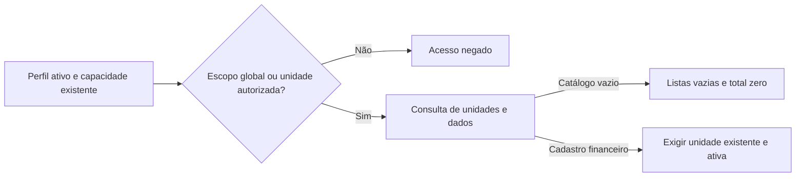

# VEN-04B — MEL-01: catálogo local de unidades vazio

**Data:** 30/10/2026, `America/Sao_Paulo`. Branch existente
`codex/ven-04b-sales-dashboard`, PR #94, baseline `636cdc8`. SHA final e CI
registrados na PR. Revisão e decisão de merge pertencem ao mantenedor único;
não houve segunda revisão humana presumida, merge ou deploy.

## Autorização e destino

O pedido inicial autorizou todas as unidades, mas preservava históricos. O inventário
mostrou que a FK da auditoria e os guards financeiros impediam exclusão física.
O mantenedor então autorizou expressamente excluir também os registros vinculados,
inclusive financeiros, Qualidade, arquivos e eventos históricos, e tratar temporariamente
os triggers de negócio no procedimento local. A conta administrativa, papéis oficiais,
permissões, Auth, migrations e dados independentes continuaram fora da exclusão.

Destino confirmado antes de escrita: container `supabase_db_gaucha-gestao-local`,
Supabase PostgreSQL 17.6, binding `127.0.0.1:54322`, API `http://127.0.0.1:54321`.
Reutilizados os serviços existentes. Nenhum reset, volume removido, infraestrutura
provisionada, banco remoto, C30, STAGING ou PROD. As alterações preexistentes em
`package-lock.json` e `supabase/snippets/` foram preservadas fora deste commit.

## Backup e inventário privados

Diretório ignorado pelo Git: `tmp/mel01-4d899e09-3b25-4d3c-9932-fc0fdee29a3f/`,
acesso ao diretório 0700 e arquivos 0600. Não publicar dumps, linhas, UUIDs reais,
objetos, credenciais ou dados de pessoas na PR.

- `inventory.json`: UUID/código/nome/estado das 31 unidades, migrations, FKs e
  dependências por unidade; 86 FKs verificadas, **zero referências órfãs**.
- `application.dump`: dump custom consistente com snapshot PostgreSQL exportado;
  schemas públicos/privados da aplicação, `storage` e `supabase_migrations`.
  Auth/credenciais permanecem no banco e estão fora do dump.
- SHA-256 do dump: `51304a8239975f03a2da96e31b7d8963e327988d0f384c1a414ebc13526fb514`,
  **728.992 bytes**; TOC conferido com `pg_restore --list`.
- `storage-objects.json` e dois arquivos `.bin`: metadados, bytes e checksums da
  capa e da evidência vinculadas. Os oito objetos de Salas são independentes e permaneceram.
- `deletion-plan.json` e `maintenance-result.json`: linhas exatas e recibo da operação.
  O procedimento destrutivo pontual está somente em `tmp/mel01-maintenance.mjs`.
  Não há migration de limpeza de dados.

Restauração exige análise dirigida do plano/dump, ordem de FKs, vínculos com as
identidades preservadas e reposição dos bytes pelas respectivas chaves de Storage.
Não executar restore integral sobre alterações posteriores sem decisão específica.
Prova efetiva: `pg_restore --data-only` reconstruiu **42 tabelas TEMP tipadas**
no banco local existente, dentro de transação revertida. Fingerprints exatos de
unidades, auditoria, lançamentos e perfis coincidiram com a fotografia anterior;
reconstituídas 31 unidades, 190 lançamentos e 158 respostas. Recibo em
`restore-proof.json`. Nenhuma tabela de domínio foi sobrescrita. Essa prova de dados
não constitui restore operacional completo de Auth/serviços.

## Dependências e resultado da manutenção

Valores imediatamente antes/depois do COMMIT da limpeza, antes dos novos ensaios:

| Relação | Antes | Depois |
| --- | ---: | ---: |
| `core.units` | 31 (1 ativa, 30 inativas) | **0** |
| `sales.entries` | 190 (3 ativos) | **0** |
| `sales.legacy_monthly_adjustments` | 1 | **0** |
| `sales.month_statuses` | 2 | **0** |
| `audit.inspections` | 1 | **0** |
| `audit.inspection_answers` | 158 | **0** |
| `audit.checklist_evidence` | 1 | **0** |
| `core.unit_sectors` | 8 | **0** |
| `core.unit_cover_assets` | 1 | **0** |
| `core.system_audit_log` | 2.220 | **1.219** |
| Arquivos de Storage vinculados | 2 | **0** |
| Arquivos de Storage de Salas | 8 | **8** |
| `core.roles` / relações de permissões | 9 / 66 | **9 / 66** |
| Atribuições globais preservadas | 3 | **3** |
| `core.profiles` | 64 | **64** |
| Migrations | 28 | **28** |

ABC, Planos de Ação/evidências, import batches e atribuições unitárias não tinham
registros a remover. Seus vínculos diretos e indiretos foram inspecionados. Preservados
catálogos de checklist, setores, usuários/perfis, todas as linhas de Salas, papéis oficiais
e demais linhas independentes. Comparação integral das linhas restantes, Auth e sessões
foi exigida antes do COMMIT. Os dois snapshots globais removidos tinham a proveniência
`ven04b_synthetic`, competências 2042-07/09 e criação documentada no roteiro VEN-04B;
nenhum snapshot independente foi removido por conveniência.

As tentativas diretas das 31 unidades falharam e foram revertidas individualmente.
O procedimento completo fez **BEGIN → exclusões dirigidas → validação → ROLLBACK**,
comparou o estado integral e repetiu com revalidação antes do **COMMIT**. Duas tentativas
preparatórias foram revertidas devido à ordem do constraint trigger adiado da capa;
a ordem correta desvinculou a capa, removeu ativo/unidade e validou a consistência
antes de restaurar os triggers. Nenhum arquivo foi removido nessas tentativas.

Suspensão temporária somente dos triggers nomeados `record_change` de unidades,
vínculos e atribuições; `guard_entry_mutation`, `adjustments_immutable`,
`month_statuses_immutable` e `import_batches_immutable`. FKs e triggers internos
continuaram ativos. Definições/estados de todos os triggers foram comparados com a
baseline; **zero triggers de negócio desabilitados ao final**. Sem `TRUNCATE`,
`DROP`, CASCADE amplo ou `session_replication_role`. Os arquivos foram removidos
pela API local de Storage após verificar o banco, com cópias e compensação de bytes
prevista para falha antes do COMMIT. A exclusão de arquivos e a transação SQL não
são uma única transação distribuída; o recibo privado permite recuperação após
interrupção abrupta. Nenhuma falha ocorreu nessa etapa.

## Correção funcional e ciclo das fixtures

A validação real com zero unidades revelou `42501` em Vendas: `authorize` e
`sales_operation_units` exigiam encontrar uma unidade, mesmo com capacidade global
válida. A migration append-only **`20261030145036_sales_empty_units.sql`** reconhece
as capacidades globais já existentes, preservando o ramo unitário, perfil ativo,
locks de revogação, validação de unidade nas mutações, ACLs, RLS e permissões.
Aplicação local **28 → 29 migrations** com histórico na mesma transação; backup das
definições anteriores. Reversão requer forward-fix explícito, sem editar migrations.

VEN-03/VEN-04A/VEN-04B e a prova administrativa usam `retireSalesUnits`: recibos
UUID/código/nome/tag, proveniência, identidade sintética, autoria dos lançamentos,
FKs conhecidas diretas/indiretas, ausência de dados de outros domínios e snapshots
exclusivos. Divergência recusa a exclusão. Backup 0600, dry-run, revalidação,
exclusões exatas, restauração dos triggers e comparação da auditoria independente.
Nenhuma unidade legítima é escolhida por prefixo ou desativada para satisfazer testes.
O teardown roda em `finally`, inclusive após falha do navegador. Um SIGKILL não permite
executar `finally`: recuperar somente os recibos privados após inspeção, sem varredura
por prefixo. Os ensaios SQL continuam preferindo uma transação integral com ROLLBACK.

O dashboard cria unidades novas por execução e reutiliza somente identidades
sintéticas anteriores. Snapshots têm fonte exclusiva por execução, sem `ON CONFLICT`
que adote dados existentes. Os preparadores Auth ainda preservam perfis sintéticos
inativos e setores independentes; esta MEL-01 não implementa descarte de identidades.
Uma recusa segura durante a implementação detectou a FK conhecida de Planos para
`unit_sectors` ausente na allowlist; corrigida e recuperadas somente as duas fixtures
exatas do manifesto, com nova prova de **zero unidades**.

## Validação

- `npm run typecheck`, `npm run lint`, `npm run build`, `npm run verify:build`: PASS.
- `npm test -- --maxWorkers=2`: **776 PASS / 61 arquivos**, 108,15 s.
- `npm audit --audit-level=moderate`: **0 vulnerabilidades**.
- PostgreSQL real: operações/unidades **19 PASS**, analytics **15 PASS**, novo
  estado vazio **4 PASS**; todos com ROLLBACK. O teste de estado vazio também foi
  repetido em PGlite após adaptar os controles de savepoint ao client PostgreSQL bruto.
- Auth/PostgREST VEN-03 e Auth/PostgREST/Chromium VEN-04A: PASS; unidades retornam
  à baseline zero; próprios papéis removidos; históricos próprios retirados com recibos.
- `sales-empty-ui-local.mjs`: PASS em Chromium real. Administração vazia, “Exibir
  inativas” vazio, “Nova unidade”, INSERT pela UI, retirada da unidade temporária,
  reload ainda autenticado com zero unidades. `/sales` sem lançamento/cadastro
  financeiro disponível e dashboard sem movimento. A senha do titular não foi usada.
- Dashboard Auth/PostgREST/Chromium: **duas rodadas completas PASS**, cada uma
  partindo de zero e voltando a **zero unidades / nove papéis**. Falha deliberada após
  preparar três unidades/sete papéis: processo falhou como esperado, `finally` removeu
  as fixtures, **zero erros de teardown**, catálogo novamente vazio. Prova administrativa
  Auth/Chromium com papel protegido também passou.
- Advisors locais: sem ERROR; três WARN `auth_rls_initplan` preexistentes no Core.
- Casos negativos: anonimato, ausência de perfil/papel/capacidade, capacidade revogada,
  perfil inativo, unidade inexistente, identidade/unidade indevida,
  ajuste externo, recibo divergente e FK desconhecida. Proteções e auditoria independente
  conferidas em repetição; regressões de concorrência e D5-B permanecem nas suítes.
- Aviso de chunk >500 kB preexistente. Sem homologação VEN-07, prova completa de
  recuperação operacional, carga produtiva, review formal humano ou autorização de deploy.

Conferência final após todos os ensaios: **zero unidades**, zero lançamentos,
inspeções/respostas/evidências, Planos, referências ABC, vínculos unitários e capas;
**86 FKs verificadas, zero órfãos, zero triggers desabilitados e zero referências
antigas de unidade na auditoria**. Preservados nove papéis, 66 relações de permissões,
três atribuições globais e oito objetos de Salas. A auditoria terminou em 1.514 eventos:
os 1.219 independentes preservados mais 295 eventos independentes gerados pelos ensaios.
Perfis passaram de 64 para 77 por 13 identidades exclusivamente sintéticas novas,
inativas ao término; os perfis anteriores foram preservados. Migrations: **29**.

Prova SQL da conta administrativa real, sem senha/login Auth: perfil e atribuição
global protegida ativos, sete capacidades Vendas, listas vazias, dashboard 0.00,
`room_booking.manage=false`, tudo em ROLLBACK. O navegador utilizou identidade
sintética com o mesmo papel, sem afirmar novo login real do titular. Evidência privada
`tmp/mel01-final-proof.json`. Checks de CI no SHA final são registrados na PR.
**PROD NO-GO.**
