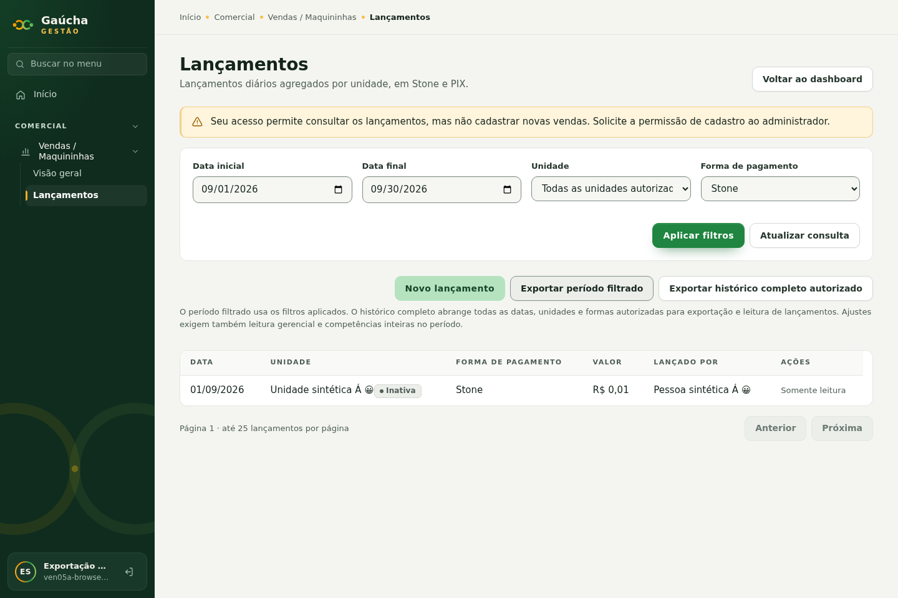
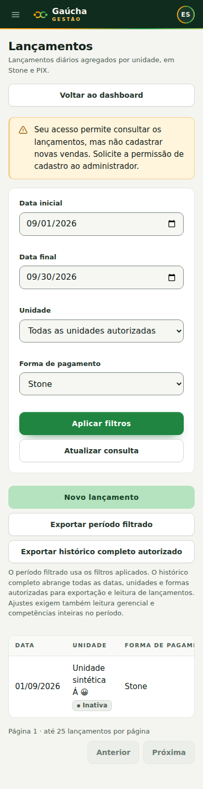
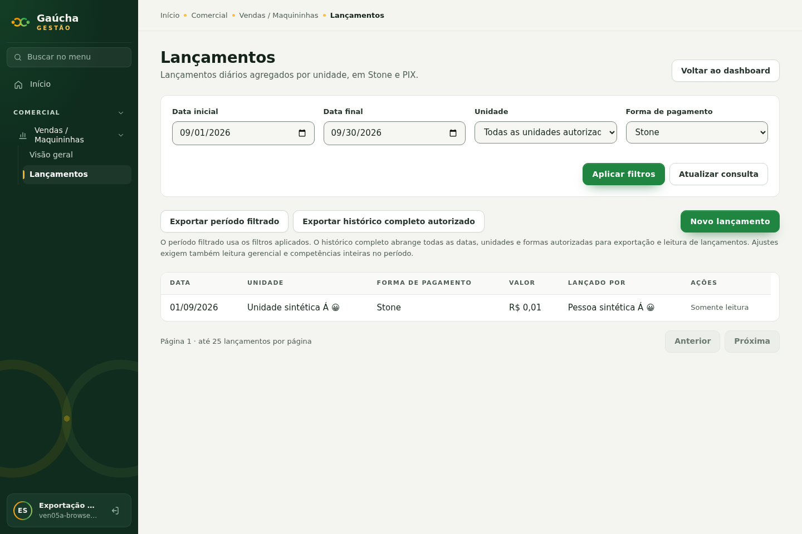
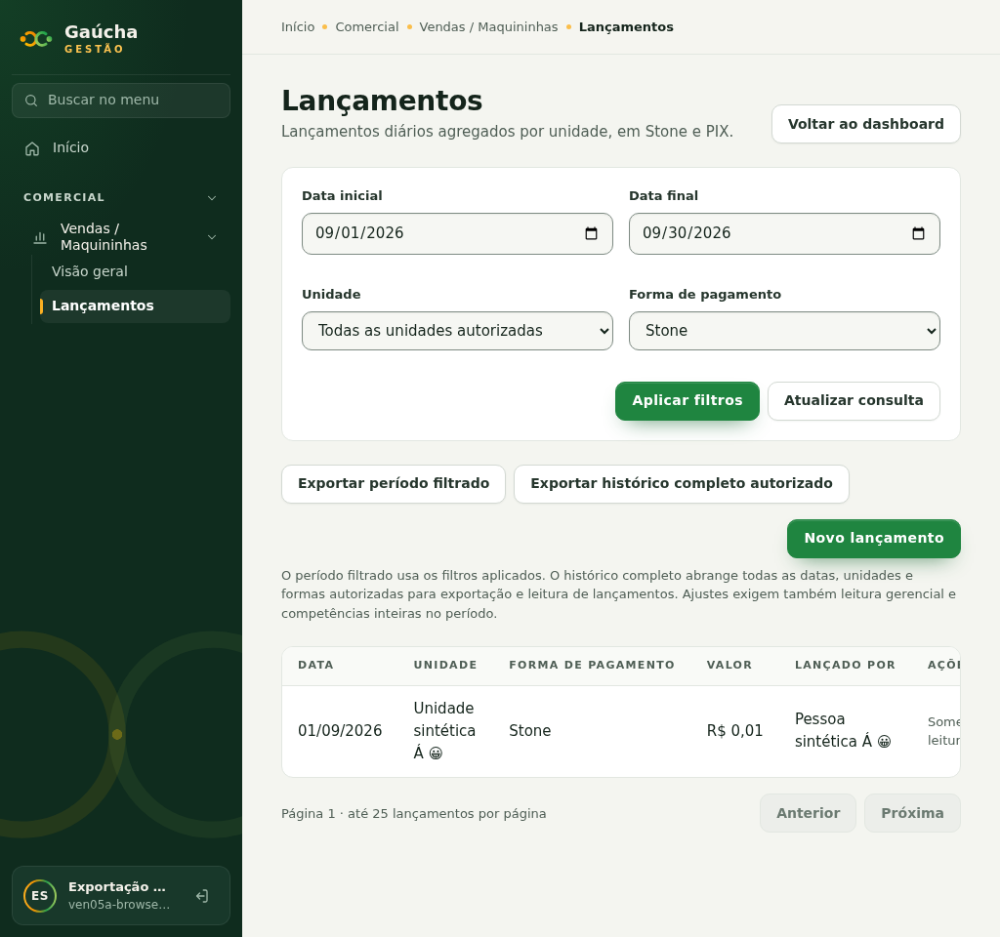
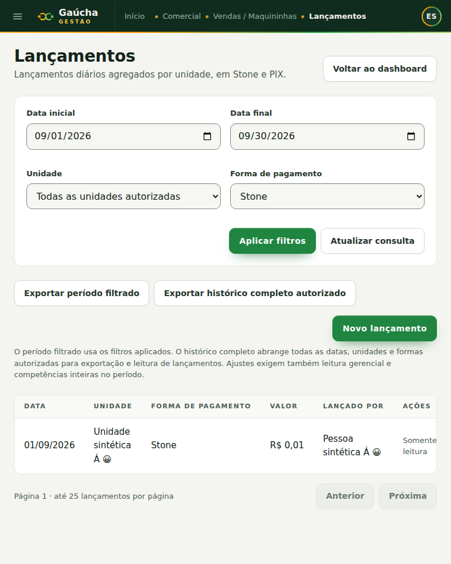
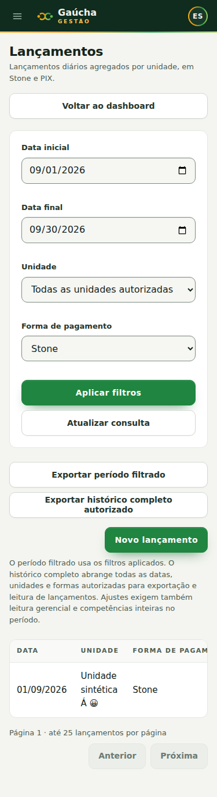

# VEN-05A — Exportação Excel autorizada

**Correção final de apresentação em 04/11/2026:** somente uma coluna monetária
por registro/total, com fallback exato na própria célula; exportações à esquerda
e cadastro isolado à direita. [Registro final](#uma-coluna-monetária-e-ações-separadas--04112026).

**Refinamentos de 04/11/2026:** exportação somente em Lançamentos; ações após os
filtros, nomes de arquivo legíveis, planilha com total destacado e coluna
**Lançado por**. Migration incremental `20261104122256` aplicada somente no
Supabase local por autorização expressa do mantenedor; dados preservados.
[Registro desta rodada](#refinamentos-finais--04112026). Sem merge/deploy.

**Atualização operacional de 03/11/2026:** migration aplicada exclusivamente no
notebook autorizado, com backup validado estruturalmente e quatro fluxos de
exportação homologados tecnicamente no navegador real. [Registro local](#aplicação-controlada-e-homologação-no-notebook--03112026).
Aceite/merge da PR #98 continuam pendentes do mantenedor; STAGING/C30/PROD intactos.

**Estado da entrega original em 03/11/2026:** implementada para revisão do mantenedor;
naquela autorização, sem aplicação persistente, deploy, migração financeira ou cutover.
VEN-05B (impressão/PDF) permanece fora de escopo. **PROD NO-GO.**

**Autorização:** pedido expresso do titular de 03/11 para limpar dez branches
integradas, implementar VEN-05A, testar com dados sintéticos e abrir PR sem merge.
Base: `91bd16b4344ab0be6ecea7f5f2067c3cbd2c3183`, merge da PR #94 (VEN-04B).
Branch: `codex/ven-05a-sales-xlsx`. A pasta preexistente `supabase/snippets/`, não
rastreada, foi preservada. Nenhum worktree, container, volume ou banco foi criado.

## Referências e equivalência

[VEN-00](../../briefs/VEN-00_consolidada_vendas_maquininhas_2026-10-28.md),
VEN-D01/02/08/09/11/12; VEN-F18, F15 e F22; EQ-30/35; A2/5/7/11.
[VEN-01](VEN01_FOUNDATION.md), [VEN-02](VEN02_OPERATIONS.md),
[VEN-03](VEN03_ANALYTICS.md), [VEN-04B](VEN04B_DASHBOARD_UI.md),
[autorização Core](../../architecture/AUTHORIZATION.md) e ADR-001/002/004/005.

Foram consultados no repositório `The-Vonky/dashboard_vendas-Gaucha`:

| Arquivo | Blob consultado | Evidência funcional |
| --- | --- | --- |
| `backend/app/services/excel_export.py` | `80d40566522e3f3032499323e3a0cfe2a69cce3f` | Lançamentos: data, unidade, forma, valor, última atualização; ajustes: competência, unidade, forma, valor e motivo; títulos, BRL, painéis congelados; arquivo integral sem filtros, conversão `float` e fórmula SUM |
| `frontend/print-tools.js` | `f9346b86b9035c0279d3ef62c7f4396fb467ae25` | Preparação de impressão e rótulos; sem contrato de Excel filtrado; impressão não portada nesta etapa |
| `frontend/app.js` | `00fd7264fb66fefdcca900cdb226d1697ae38740` | Não contém tratamento próprio de Excel no arquivo consultado; não inferir que transporta os filtros para o exportador |
| `docs/GUIA_USO.md` | `ac9811bd07aabe94937c9ba0f6506c1b08806455` | Dashboard/Dados & Backup iniciam download nativo em Downloads do Windows e exibem caminho; ajustes em aba separada |

A plataforma preserva a utilidade das abas, substitui caminhos Windows por download
web e acrescenta código da unidade, nome do criador, contexto e reconciliação.
IDs e versão continuam internos ao transporte autorizado, fora da aba principal. Não copia
exportação irrestrita, aritmética `float` ou fórmulas do legado. Os padrões de
`audit/reporting/{workbook,download,ReportingActions}` foram examinados; usa-se a
mesma biblioteca instalada `write-excel-file@4.1.1` e tipagem explícita, sem importar
internals de outro módulo e sem alterar Auditoria ou dependências.

## Interface e recorte aplicado

Os controles de exportação aparecem **somente em Lançamentos**, quando há
interseção de leitura detalhada e capacidade de exportação. O Dashboard não tem
entrada visual de exportação. As permissões da tela e do arquivo continuam
independentes. Ações entre filtros e tabela: **Exportar período filtrado** e **Exportar histórico
completo autorizado** no grupo esquerdo; **Novo lançamento** isolado à direita.
A explicação fica abaixo da linha de botões. Em telas menores os grupos se
reorganizam, mantendo a distinção entre exportar e cadastrar. O retorno ao dashboard
permanece no cabeçalho; criação mantém os bloqueios de capacidade/unidade ativa.

- **Exportar período filtrado:** datas inclusivas, unidades e Stone/PIX da URL
  aplicada em Lançamentos, sem limitar à página visível. Rascunhos ainda não
  confirmados nos controles não afetam o arquivo.
- **Exportar histórico completo autorizado:** todas as datas, unidades e formas
  cobertas simultaneamente por `sales.entry.read` e `sales.export.full`, inclusive
  unidades inativas. Não herda os filtros da tela. Não significa banco inteiro.

A tela explica que ajustes exigem também leitura gerencial e competências inteiras.
Um recorte diário incompleto não pode atribuir um ajuste a um dia: somente meses
inteiramente cobertos pelos extremos entram na aba/totais. Por exemplo, 02/09–30/09
inclui os lançamentos desses dias e **não** inclui o ajuste de setembro. 01/09–30/09
inclui esse ajuste autorizado. Limites nulos abrem a extremidade correspondente.
Datas/meses sem dados não criam linhas financeiras fictícias.

Estados: preparando, download iniciado, nenhum dado, autorização/sessão recusada,
falha de consulta, limite de volume e nova tentativa explícita. Não há retry
automático nem arquivo parcial. Troca de filtros aplicados, identidade, grants,
bloqueio ou desmontagem invalida a preparação pendente. Depois de gerar o Blob,
a interface reautoriza e confere o conjunto no banco antes de iniciar o download.

## Matriz de autorização

| Dado/ação por unidade | Capacidades simultâneas necessárias |
| --- | --- |
| Lançamentos no período | `sales.entry.read` + `sales.export.filtered` |
| Lançamentos no histórico | `sales.entry.read` + `sales.export.full` |
| Ajustes e justificativas no período | As duas anteriores do período + `sales.dashboard.read` |
| Ajustes e justificativas no histórico | As duas anteriores do histórico + `sales.dashboard.read` |

O direito de exportação é necessário também para justificar a saída de campos
textuais detalhados dos ajustes. Não se presume que o dashboard sozinho autorize
esse detalhe. Sem `sales.dashboard.read` na unidade, ajustes/justificativas não são
consultados nem incluídos nos totais; a unidade recebe `adjustments_authorized=false`
e o Resumo explicita a exclusão. Não se informa quantidade/valor de dados recusados.
Um usuário de leitura operacional + exportação pode, portanto, gerar relatório
operacional cujo total difere do dashboard por falta de acesso aos ajustes.

Cada capacidade usa seu escopo próprio: grant exportador em A e leitor em B não
se combinam. `global` cobre as unidades pertinentes; `unit` apenas sua unidade;
`sector` não cobre agregado unitário. Seleção explícita com qualquer UUID fora da
interseção nega a chamada inteira, sem revelar sua existência. Perfil inativo,
sessão sem identidade ou concessão revogada negam no banco, inclusive sem dados.
Histórico de unidade inativa mantém o mesmo contrato de autorização Core.

Nenhuma capacidade, papel ou atribuição foi criada/concedida. As sete capacidades
já existiam; a composição institucional da VEN-04B permanece intacta. Tabelas,
schemas privados e RLS restritiva continuam sem grants de leitura direta.

## RPC e paginação

Migrations append-only geradas pelo CLI: `20261103175405_sales_excel_export.sql`
e `20261104122256_sales_entry_creator_name.sql`. Ambas aplicadas exclusivamente
no Supabase local, conforme autorizações e registros ao final deste documento.

```sql
public.sales_export_page(
 p_mode text, p_from date default null, p_to date default null,
 p_units uuid[] default null, p_method text default null,
 p_offset integer default 0, p_limit integer default 500, p_token text default null
) returns jsonb;
```

`p_mode`: `filtered` ou `full`; `full` **recusa** datas/unidades/método não nulos,
evitando chamar um recorte restrito de histórico completo. Método nulo = Stone+PIX.
Datas finitas de `0001-01-01` a `9999-12-31`; início <= fim. `p_units` nulo = todas
as unidades da interseção; array explícito unidimensional não vazio, até 1.000 UUIDs,
sem nulos. Duplicatas são deduplicadas pelo catálogo. Limite por página 1–500;
offset 0–20.000, token obrigatório após a primeira página. Sem SQL dinâmico.

Resposta versionada com catálogo Core, permissibilidade de ajustes, filtros
efetivos, contagens, totais `numeric` como strings de duas casas e limites dos
dados disponíveis. Linhas contêm somente: tipo, UUID, data ou competência, UUID
da unidade, forma e valor; lançamento acrescenta versão/última atualização e `created_by_name` (nome atual
do perfil Core referenciado por `created_by`, ou null). Ajuste acrescenta
justificativa. A exportação não retorna UUID de autor, e-mail, lotes ou `source_ref`.
A listagem recebe o mesmo nome como campo adicional, mantendo os demais campos
operacionais anteriores. Não há consulta ao diretório administrativo no frontend,
novo endpoint de perfis, grant ou mudança de RLS. Nome de criador inativo permanece
legível no lançamento autorizado; quem consulta precisa continuar ativo.

`SECURITY DEFINER` é necessário para acessar as tabelas privadas; `search_path=''`,
objetos qualificados, validação ativa via helpers Core e EXECUTE somente para
`authenticated`. PUBLIC/anon ficam sem EXECUTE. A autorização usa os bloqueios
do contrato VEN-02, com bloqueio adicional das relações de leitura gerencial.

### Consistência e custo

Ordem: lançamentos antes dos ajustes; dentro de cada família, data/competência e
UUID ascendentes. Catálogo, linhas e totais são lidos por **uma instrução SQL com
CTEs materializadas**, no mesmo snapshot MVCC. Cada família é limitada a 20.001
linhas; a união também tem sentinela de 20.001. O limite nunca corta um sucesso:
excesso gera `54000` sem dados/totais parciais.

Escolheu-se offset sobre um conjunto **conferido por conteúdo**, em vez de cursor
isolado: cursor evita deslocamento de posição, mas sozinho não detecta mudanças
de valor, exclusão ou escopo durante a leitura. O SHA-256 do JSONB canônico cobre
linhas, IDs, versões, valores, datas, motivos, catálogo, visibilidade de ajustes,
modo, filtros e nome do criador; timestamps de requisição ficam fora do digest. Cada página refaz
o conjunto limitado e exige o token original. Chamada final no offset total faz
a mesma revalidação depois de gerar o arquivo. O cliente também verifica ordem,
unicidade, avanço, quantidades e reconciliação independente em BigInt.

O token é detector de mudança, **não** credencial, assinatura de autenticidade ou
capacidade privilegiada. A autorização atual é executada em cada chamada. Mudança
relevante resulta em `40001` e descarte integral. Revogação total resulta em `42501`.
O arquivo representa o mesmo conjunto observado nas chamadas bem-sucedidas; não
mantém uma transação/snapshot MVCC aberto entre requisições. Mudanças que aconteçam
e sejam integralmente revertidas entre observações não são detectadas. Alterações
após a última validação não atualizam um arquivo já autorizado. Não se declara
snapshot histórico de um instante fixado nem se congelam as escritas de Vendas.

Reprocessamento custa O(páginas × conjunto limitado), com hashes/JSON em cada
chamada. Até 40 páginas de 500 + conferência final. A favor: sem tabela de snapshots,
job persistente, retenção nova, backend privilegiado ou armazenamento temporário
de dados financeiros no servidor. Bases maiores devem receber solução própria
aprovada; o erro atual é explícito e o limite fica pendente do aceite operacional.

| Limite | Conduta |
| --- | --- |
| 20.000 linhas somando lançamentos e ajustes | `54000`; reduzir período/unidades, jamais download parcial |
| 1.000 unidades | `54000`; seleção menor para recorte; histórico não é fracionado silenciosamente |
| 8 MiB de JSONB canônico | `54000`; inclui todas as linhas/metadados, mesmo com poucas linhas |
| 20 MiB de XLSX final | Descartar Blob e informar limite |
| 32.767 unidades UTF-16 por célula | Recusar texto excessivo; sem truncar nomes/justificativas |

Esses limites delimitam processamento em memória; não são promessa de consumo
máximo do navegador, pois o writer mantém dados/XML/ZIP intermediários. Homologar
hardware e bases representativas antes de uso real. Downloads usam ObjectURL,
âncora temporária e revogação em 30s; nome sem acentos/espaços, em minúsculas:
`historico-filtrado-dd-mm-aaaa-dd-mm-aaaa-XXtotal.xlsx` ou
`historico-completo-dd-mm-aaaa-dd-mm-aaaa-XXtotal.xlsx`, sem nomes de pessoas/unidades.
`XXtotal` conta apenas lançamentos, nunca ajustes nem a linha de total.
No filtrado, datas explícitas da consulta são preservadas. Extremos abertos e
histórico completo usam os limites dos dados exportados; ajustes abrangem até
o último dia de sua competência. Sem lançamento, ajustes ainda resultam em
`0total`; se não houver qualquer dado, a UI não baixa arquivo. O helper isolado
usa a data de geração em São Paulo quando não há extremos disponíveis. O navegador define onde salvar.

## Formato e precisão

| Aba | Colunas |
| --- | --- |
| Lançamentos | Data civil dd/mm/aaaa; unidade; código; forma; valor BRL (numérico seguro ou texto decimal exato); Lançado por; última atualização em America/Sao_Paulo |
| Ajustes mensais (se houver autorizados) | Competência mm/aaaa, sem dia inventado; unidade; código; forma; valor do ajuste BRL (numérico seguro ou texto decimal exato); justificativa; UUID do ajuste; UUID da unidade |
| Resumo | Modalidade; datas aplicadas; formas; geração/fuso; unidades com estado e cobertura de ajustes; quantidades; limites disponíveis de lançamentos/competências; totais separados e consolidado; reconciliação; consistência e limitações |

A aba principal tem título institucional em verde, subtítulo, faixa com modalidade,
quantidade e geração, cabeçalhos verdes com texto branco, bordas leves, linhas
alternadas e quatro linhas superiores congeladas. A linha **Total exportado**
contém somente o total de lançamentos; ajustes e consolidado ficam no Resumo.
Cada registro tem uma única coluna monetária; **Valor exato (BRL)** foi removida.
Totais no Resumo também aparecem uma única vez, sem linhas monetárias auxiliares. Resumo/ajustes usam o mesmo cabeçalho verde.

No SQL, somas `numeric` exatas de **somente ativos** e ajustes autorizados. JSON usa
strings canônicas com duas casas. JavaScript soma/verifica exclusivamente `BigInt`
em centavos. Sem `Number`, `parseFloat` ou fórmulas para acumular valores.

A única conversão para `Number` ocorre ao serializar uma célula: até **15 dígitos
no inteiro de centavos**, roundtrip de `toFixed(2)` e de `toPrecision(15)` devem
preservar a string canônica. Se não preservarem, a célula é **String decimal**, sem
arredondamento silencioso. A própria célula única mantém o texto decimal exato
quando a conversão numérica não é segura, inclusive no total final e no Resumo. Valores individuais até
`999999999999.99` permanecem numéricos e em centavos exatos no readback; somas maiores
podem virar texto. BRL textual usa ponto decimal canônico, identificado no cabeçalho.

Excel usa ponto flutuante e suas fórmulas manuais não são prova de reconciliação.
Os totais gravados já foram conferidos contra o SQL com diferença **zero centavos**.
Não se alteraram fórmulas gerenciais VEN-03 nem se introduziu tolerância financeira.

Todo texto usa `type:String`, inclusive prefixos `=`, `+`, `-`, `@`, espaços,
tabulações e quebras de linha. Não há fórmulas, APIs de hyperlink, macros, vínculos
externos ou recursos executáveis. Controles inválidos para XML, surrogates
isolados e U+FFFD (que a biblioteca remove) viram `□`, com política explícita no
Resumo e cobertura de readback; demais caracteres Unicode válidos são preservados.
Testes abrem o ZIP/XLSX e rejeitam tags `<f>`, hyperlinks, vínculos externos e DDE.

## Evidências e reprodução

| Camada | Evidência |
| --- | --- |
| Banco em memória | `tests/sales-export-database.test.ts`: migrations reais, identidade ativa, global/A/A+B, negação de C/UUID inexistente, unidade inativa, read sem export, dashboard+export sem read, escopos distintos, revogação, inserts/updates/deletes/ajustes/catálogo entre páginas, limites e somas exatas |
| API | `tests/sales-export-api.test.ts`: paginação, contrato/tipos, duplicações/ordem, totais inconsistentes, cancelamento, token alterado, sessão expirada e erros sem detalhes SQL |
| XLSX real | `tests/sales-export-workbook.test.ts`: writer instalado + `read-excel-file`, XML interno, tipos, limites, injeção nos três campos, Unicode/controles, abas, datas/fuso e 20.000 linhas |
| UI/download | `tests/sales-export-ui.test.tsx`, `tests/sales-export-download.test.ts`: aplicado vs rascunho, Dashboard sem exportação, ações após filtros, coluna do criador, nomes de arquivos, Stone, histórico sem filtros, negações, estados, recuperação, revogação final, troca de identidade e ObjectURL |
| Chromium com transporte sintético | `tests/integration/sales-export-browser.mjs`: aplicação, writer, download e readback reais, API/Auth inteiramente interceptados, sem acesso a banco; executado localmente com PASS e adicionado antes da inicialização Supabase no CI |
| PostgreSQL17 real no CI | matriz `sales-integration` acrescenta `export`, roda a mesma suíte de banco em serviço vazio do runner |
| Auth/PostgREST/Chromium no CI | `tests/integration/sales-export.mjs`, guarda exclusiva de runner hospedado antes de ler configuração; JWTs reais, >1.000 registros, unidades autorizadas, mutação, bloqueio Core observado nas duas ordens e download/readback/XML pelo navegador |

Oráculos sintéticos, independentes do payload: setembro Stone `250.00+50.00=300.00`;
Stone+PIX `300.00+50.00=350.00`; conjunto global incluindo máximo individual
`1000000000300.10+50.01=1000000000350.11`; muitas linhas 0,01/0,10/0,29 somam 133,41.
Readback de 20.000 linhas de `999999999999.99` soma `19999999999999800.00` por BigInt;
total Excel correspondente deve ser texto, sem perda de centavos.

Comandos locais usam somente PGlite em memória, sem flags de ensaio persistente:

```bash
npm run typecheck
npm run lint
npm test
npm run build
npm run verify:build
npm audit --audit-level=moderate
```

### Resultado local registrado em 03/11/2026

Implementação de referência: `4f82117102ad100f87e3e021cf35776ddbfffc39`.

| Comando | Resultado real |
| --- | --- |
| `npm run typecheck` | PASS |
| `npm run lint` | PASS |
| `npm test` (primeira execução) | 918 PASS / 4 falhas: expectativa histórica de sete RPCs e três timeouts de Auditoria sob concorrência alta |
| `npm test -- --maxWorkers=2` | **922 PASS / 67 arquivos**, 145,27s, após ajustar a expectativa para oito RPCs |
| `npm test -- tests/sales-export-database.test.ts tests/sales-zero-units-database.test.ts tests/sales-operations-database.test.ts --maxWorkers=2` no commit de referência | **37 PASS / 3 arquivos**, 13,86s; inclui correção do catálogo vazio global e negativos/grants |
| `npm run build` | PASS, valores públicos fictícios de CI; aviso informativo de chunk >500 kB |
| `npm run verify:build` | PASS, aplicação presente e sem chaves privilegiadas no bundle |
| `npm audit --audit-level=moderate` | PASS, **0 vulnerabilidades** |
| `node --check tests/integration/sales-export.mjs` / `git diff --check` | PASS |
| `node tests/integration/sales-export-browser.mjs` (Chromium já instalado no ambiente) | PASS: login sintético, aplicação e writer reais, rascunho PIX sem aplicação não altera arquivo Stone, download/readback e total `0.11`; nenhum banco consultado |

Os testes de Auditoria não foram alterados; reduzir concorrência de execução
resolveu os timeouts locais. O readback do writer real, incluindo 20.000 linhas,
passou na suíte completa. Não há tolerância de centavos.

**Checks GitHub e evidência de integração:** [PR #98](https://github.com/The-Vonky/Gaucha-Gestao/pull/98/checks).
Consultar o resultado associado ao HEAD da PR; não confundir aprovação local com
PostgreSQL/Chromium reais. A descrição da PR registra o resultado final dos jobs.
O contrato original não autorizava execução no banco do notebook, C30, STAGING ou
PROD. A autorização posterior limita-se ao notebook no registro abaixo. O CI aplica migrations exclusivamente nos seus
serviços efêmeros. Não é prova de aplicação persistente nem de login em produção.

## Limitações, reversão e próximo gate

Pendente homologação humana no Excel/LibreOffice real, dispositivos físicos,
download nos navegadores usados pela equipe, limites em hardware representativo,
matriz de concessões reais e revisão humana da apresentação final. O brief desta
rodada registra limites, precisão e competências inteiras já aceitos pelo titular;
volume que excede o limite não recebe alegação de histórico completo exportado.
Sessão sem identidade/inválida é testada no transporte; códigos de expiração no
adaptador. Não se declara ter aguardado expiração de um JWT real.

Reversão **em código antes de aplicação persistente**: reverter os commits desta
feature em PR, incluindo controles, módulo export, testes e alteração do workflow.
Depois de eventual aplicação aprovada em ambiente persistente, **não remover ou
editar migration histórica**: nova migration deve revogar EXECUTE desta assinatura
e/ou corrigir por forward-fix, preservando dados/auditoria e seguindo GO próprio.
Nenhum rollback operacional foi executado nesta tarefa.

O mantenedor único revisa diff, CI, negativos de permissão e os riscos antes de
decidir merge. Não houve segunda revisão humana nem review formal inventado.
VEN-05B, homologação VEN-07, migração real e cutover têm autorizações separadas.

**Correção do ensaio CI:** na primeira execução de Auth/concorrência, a conexão
owner da fixture ainda carregava a identidade sintética de leitura/exportação
usada para autoria dos lançamentos. O Core recusou a restauração administrativa
de uma concessão por esse ator, como deve ocorrer. O ensaio agora limpa esse
contexto antes da preparação pelo owner do CI; os dois participantes da corrida
e o browser continuam usando seus papéis/identidades restritos. Nenhum helper,
grant ou contrato de autorização de produção foi relaxado. Diagnóstico de falha
registra SQLSTATE sem anexar payloads de Auth.

**Correção do seletor Chromium:** a segunda execução ultrapassou as duas ordens
da corrida e parou ao localizar a forma de pagamento pelo texto exato do label.
O padrão do formulário inclui o texto das opções no label; o ensaio agora usa
`select[name="method"]`. A prova local com transporte interceptado reproduziu
essa falha e passou após a correção, incluindo download/readback. O teste real
ganhou identificação de cada etapa e captura apenas da mensagem sanitizada da UI.

## Aplicação controlada e homologação no notebook — 03/11/2026

**Autoridade:** novo pedido expresso do mantenedor para aplicar exclusivamente
`20261103175405`, após auditoria de pendências e backup, e validar exportação sobre
os dados locais existentes, somente por leitura/exportação. Não autoriza C30,
STAGING, produção, seeds, novas concessões, migração financeira ou cutover.
Referência revisada: PR #98, `49686a3737ad8986de86e0a2b52cb339f5add22f`.

### Diagnóstico e destino confirmado

O mantenedor observou HTTP 404 em `POST /rest/v1/rpc/sales_export_page` e função
ausente no banco. A auditoria somente leitura confirmou assinatura inexistente,
nenhum overload conflitante, **29 migrations aplicadas** e uma única pendência:
`20261103175405_sales_excel_export.sql`. Não havia versões locais extras nem
outras migrations a aplicar. Helpers, tabelas e quatro capacidades necessárias
estavam presentes; o arquivo era idêntico ao da branch publicada.

| Elemento | Identificação efetivamente verificada |
| --- | --- |
| Projeto | `gaucha-gestao-local` |
| Frontend | `http://localhost:5173`; URL efetiva do cliente conferida no módulo servido pelo Vite |
| API/Kong | `http://127.0.0.1:54321`; container `supabase_kong_gaucha-gestao-local` |
| PostgREST | `supabase_rest_gaucha-gestao-local`; destino interno verificado por URI sanitizada, DNS e rede Docker |
| PostgreSQL | `supabase_db_gaucha-gestao-local`, versão 17.6, database `postgres` |
| Conexão do host | `127.0.0.1:54322`, confirmada pelo binding real e pelo status do CLI; não inferida apenas do arquivo de configuração |
| CLI existente | Supabase 2.117.0; versão e ajuda de `migration list`/`migration up` conferidas |
| Método de auditoria | `migration list --local` e consultas SQL em transação somente leitura; nenhum vínculo remoto |
| SHA-256 da migration | `e209d103b80d950455e0dccc10ba40cff954a5d76c0db28ba5606cbe40697e4d` |

### Backup preservado e limites da prova de recuperação

Diretório privado, fora do repositório:
`~/backups/gaucha-gestao-local/ven05a-2026-11-03T19-22-18-124Z-c384cae9/`.
Os caminhos absolutos e checksums constam no `manifest.json` privado desse
diretório. Arquivos com modo `0600`, diretório `0700`; nenhum conteúdo financeiro,
senha, hash de senha, JWT, sessão ou dump enviado à PR.

| Arquivo | Tamanho | SHA-256 |
| --- | --- | --- |
| `postgres-before-ven05a.dump` | 1.009.606 bytes | `c43de935d0125b3b3e15965501f2f16c07afa0eae4db48f8d5bf118788f4e40d` |
| `globals-before-ven05a.sql` | 7.436 bytes | `6ffd04ac44ea37e34501b8304a0e2512ec569515ce1cc7349bca5b4eca79fafb` |
| `postgres-before-ven05a.toc` | 110.088 bytes | `1550d194bc8b99c844ee7f2d21df4ea215c2f225a72438cadc45286f8f1779e1` |

`pg_dump --format=custom` abrangeu a base completa, sem exclusão de schemas/dados,
funções, owners, grants ou histórico de migrations. `pg_dumpall --globals-only`
preservou os objetos globais separadamente, em arquivo privado sensível. Foram
conferidos tamanho, checksums, `pg_restore --list`, presença de Auth/Core/Vendas e
histórico, e **decodificação integral** do arquivo com `pg_restore --file=/dev/null`,
sem conectar a destino de restauração.

Não foi provisionado banco/container adicional para restore. **Não houve restore
operacional completo**: TOC e decodificação comprovam integridade estrutural,
não recuperação funcional de Auth/serviços/Storage. Esta limitação não foi
substituída por uma alegação de backup/restore produtivo validado.

Recuperação proposta, sem execução: preservar esses originais; inventariar o
estado posterior; obter autorização para um destino separado; revisar/restaurar
globals e owners/grants necessários; restaurar o custom dump nesse destino e
validar dados/RPCs/Auth. Não usar `--clean`, reset ou restore integral sobre a base
em uso por inferência. Como a mudança local é de leitura, eventual contenção pode
usar forward-fix que revogue EXECUTE da assinatura, com nova autorização e migration.

### Aplicação e pós-verificação

Após revalidar hashes do backup e da migration, assinatura ausente e pendência
única, executou-se **`supabase migration up --local`**, usando o CLI já instalado.
Nenhum `--linked`, `db push`, `reset`, `repair`, seed ou SQL remoto foi usado.
A migration histórica permaneceu sem edição. Aplicação concluída em
03/11/2026 às **16:26:14, America/Sao_Paulo**.

Resultados efetivos:

- `to_regprocedure('public.sales_export_page(text,date,date,uuid[],text,integer,integer,text)')`
  passou de `NULL` à assinatura esperada;
- histórico local passou de **29 para 30 migrations**, preservando todas as
  anteriores e acrescentando somente `20261103175405` pelo mecanismo oficial;
- `SECURITY DEFINER=true`, `search_path=''`, EXECUTE de `authenticated=true`,
  `anon=false` e `PUBLIC=false`;
- o cache PostgREST reconheceu a função após o NOTIFY contido na própria migration:
  chamada anônima recebeu **HTTP 401 / SQLSTATE 42501**, sem dados; não foi
  necessário executar um NOTIFY adicional;
- contagens e fingerprints SHA-256 das **79 tabelas** comparadas imediatamente
  antes/depois foram idênticos. Nenhuma tabela anterior foi alterada pela aplicação.

### Exportações reais, identidade e reconciliação

O mantenedor autenticou interativamente uma janela InPrivate do Edge do Windows,
sem informar senha/JWT ao agente, e confirmou manualmente um download. A automação
usou essa sessão real contra o frontend existente e o mesmo PostgREST confirmado;
não houve mock, service role no browser, conta criada, senha alterada ou grant novo.

| Origem | Modalidade | RPC | XLSX/readback | Reconciliação com fonte SQL |
| --- | --- | --- | --- | --- |
| Lançamentos | Período aplicado | HTTP 200 | PASS | PASS, zero centavos de diferença |
| Lançamentos | Histórico autorizado | HTTP 200 | PASS | PASS, zero centavos de diferença |
| Dashboard | Período aplicado | HTTP 200 | PASS | PASS, zero centavos de diferença |
| Dashboard | Histórico autorizado | HTTP 200 | PASS | PASS, zero centavos de diferença |

Os quatro arquivos foram lidos com `read-excel-file`. Conferiram-se abas esperadas
(ajustes somente quando presentes/autorizados), IDs de todas as linhas, unidade,
forma, data/competência, valor decimal textual e célula numérica/textual. Totais
foram comparados com consultas SQL independentes sobre ativos e ajustes, filtradas
pelas unidades autorizadas, e novamente somados em BigInt. O Resumo coincidiu com
essas fontes; não se usou fórmula Excel como oráculo. XML/ZIP foi conferido contra
fórmulas e vínculos externos executáveis.

Em Lançamentos, mudou-se apenas o rascunho da forma de pagamento e confirmou-se
que o arquivo permaneceu no filtro aplicado. O Dashboard usou competências inteiras
e escopo combinado; históricos não herdaram os filtros das telas. Unidades dos
arquivos foram verificadas contra a interseção atual de capacidades Core.

**Limite do negativo unitário desta sessão:** a conta autenticada cobria todas as
unidades existentes; não havia unidade existente fora de seu escopo para um 403
real com essa mesma conta. A recusa anônima foi exercida; a matriz de usuário
restrito permanece coberta pelos testes PostgreSQL/CI. Não se afirma que o agente
tenha instrumentado uma segunda sessão restrita ou observado um HTTP 403 nela.

**Teste restrito informado pelo mantenedor em 03/11/2026:** o titular relatou ter
usado uma conta operacional já existente, concedido temporariamente acesso a
somente uma das duas unidades e confirmado que a exportação incluiu apenas a
unidade permitida. Resultado manual informado: **PASS**. Trata-se de evidência
real relatada pelo responsável, distinta dos quatro ensaios instrumentados acima;
não equivale a captura HTTP adicional, review formal `APPROVED` ou decisão de merge.
Essa concessão foi ação do titular, não do agente, e não pertence à migration.

As cópias de XLSX e recibos ficaram somente no diretório privado do backup,
sem valores, nomes, IDs empresariais ou screenshots na documentação pública.
Os downloads originais foram preservados. Após os quatro fluxos, as **56 tabelas
fora de Auth** comparadas mantiveram contagens e conteúdo iguais ao estado posterior
à aplicação. Sessões/metadados de autenticação decorrentes do login não são
declarados idênticos. O agente não mutou lançamentos, ajustes ou permissões;
a alteração temporária de acesso relatada posteriormente pelo titular não é
incluída na comparação de preservação anterior nem revertida automaticamente.

### Correção da mensagem e checks desta continuação

`exportMessage` agora distingue **`PGRST202`** (função ausente no cache/contrato
PostgREST) e **`42883`** (função indefinida) de falha real de rede. A interface
informa que a exportação ainda não está disponível naquele ambiente e orienta
procurar o responsável, sem expor assinatura, schema ou detalhes SQL. HTTP 404
isolado não é considerado prova de RPC ausente. Mensagens de autorização, sessão,
concorrência e volume permanecem específicas; a ação de tentar novamente existente
é reutilizada. Nenhuma mudança de permissão ou schema adicional foi necessária.

Arquivos de código/teste: `modules/sales/export/api.ts`,
`tests/sales-export-api.test.ts`, `tests/sales-export-ui.test.tsx`.
Regressões novas: ausência de RPC nas duas modalidades de transporte, mensagem
segura, ausência de download em erro e recuperação após disponibilizar o recurso.

Resultados locais desta continuação:

- API/UI: **38 PASS / 2 arquivos**;
- suíte completa `npm test -- --maxWorkers=2`: **926 PASS / 67 arquivos**, 133,80s;
- `npm run typecheck` e `npm run lint`: **PASS**;
- os quatro fluxos de navegador real descritos acima: **PASS**.

Build, verificação do bundle, audit e checks do novo HEAD são registrados na
descrição da própria [PR #98](https://github.com/The-Vonky/Gaucha-Gestao/pull/98).
Nenhum resultado anterior é tratado como check aprovado de um SHA posterior.
Aceite do mantenedor e merge continuam pendentes. Não houve deploy, operação em
C30/STAGING/PROD nem avanço para VEN-05B.

## Limpeza Git comprovada

Após `git fetch origin --prune`, `origin/main` era `91bd16b`. `gh pr list --state
open` retornou vazio; `git merge-base --is-ancestor` confirmou cada candidata.
Foram excluídas com `git push origin --delete`:

```text
codex/fix-ci-vite-6-4-5
codex/ven-02-sales-operations
codex/ven-03-sales-analytics
codex/ven-04a-sales-ui
codex/ven-04b-sales-dashboard
docs/c30-staging-cloudflare-20261030
docs/ven-00-vendas-aprovada-20261028
feat/ag-01-room-booking-schema-20261023
feat/ven-01-sales-foundation-20261028
fix/ci-minimatch-audit-20261103
```

`git ls-remote --heads origin` confirmou apenas `main` antes da criação da nova
branch. `main` local atualizada por fast-forward e igual a `origin/main`. Branches
locais foram preservadas; sem reset, force-push, remoção de arquivos ou worktrees.


## Refinamentos finais — 04/11/2026

Registro da primeira rodada; a correção de apresentação abaixo substitui a coluna
auxiliar e o alinhamento conjunto, preservando a migration e as provas de dados.

**Brief:** continuação expressa da PR #98 a partir de `cc7b5e5`, sem VEN-05B.
O mantenedor autorizou adicionalmente criar e aplicar a migration incremental
necessária no notebook, preservando dados, RLS e precisão. C30/STAGING/PROD,
merge e deploy continuam fora do escopo.

### Nome do criador e compatibilidade

`20261104122256_sales_entry_creator_name.sql` substitui somente as definições de
`sales_entries_list` e `sales_export_page`, mantendo assinaturas, autorização,
limites e grants. `created_by_name` é resolvido apenas para lançamentos já
permitidos. Não cria tabela/coluna, não executa DML financeiro e não altera
`sales_private.entry_json` ou o contrato das RPCs de escrita/detalhe.
É o **nome atual do perfil criador**, não o último editor nem um snapshot histórico
do nome. Renomeá-lo invalida o token de exportação. Perfil ausente/criador nulo
resulta em **Não identificado** na UI/XLSX. O cliente também aceita campo ausente
para compatibilidade temporária com ambientes anteriores; nesses ambientes o
nome real depende da aplicação autorizada da migration.

### Prova local e preservação

Destino confirmado por Docker, binding `127.0.0.1:54322`, projeto
`gaucha-gestao-local`, database `postgres`. Histórico anterior: 30 migrations,
única pendência `20261104122256`. Aplicação: `supabase migration up --local`.
Histórico posterior: **31 migrations**. SHA-256 da nova migration:
`2c021ead34660709b1f7574926a1b05d1829c513cf9ea9fba612897eb8628282`. As duas RPCs preservam `SECURITY DEFINER`,
`search_path=''`, anon sem EXECUTE e authenticated com EXECUTE.

Backup privado anterior em `/tmp/ven05a-local-private/before.dump`, 1.019.926 bytes,
SHA-256 `de7c4f8a365a7f3264fcd599701633c8de651746d3aa0df11851c8f0c84d72c7`;
`pg_restore --list` e decodificação integral para `/dev/null` passaram.
Hashes do JSON canônico e contagens das **14 tabelas Core/Vendas** permaneceram
iguais após aplicação e validação. Nove lançamentos existentes foram conferidos
na listagem e exportação sob `authenticated`, em transação revertida: nomes
correspondem ao Core, sem novos dados expostos no arquivo. Nenhum dado existente
foi apagado/reescrito. Não houve restauração em outro banco; o backup em `/tmp`
é temporário e não substitui a política de recuperação do ambiente.

Reversão: preservar a migration aplicada; se necessário, forward-fix que restaure
as definições anteriores das duas funções, mantidas no diretório privado do backup.
Não remover histórico, resetar banco ou modificar migrations aplicadas.

### Evidências visuais e limites da primeira rodada (layout posteriormente ajustado)

Chromium com transporte totalmente sintético: 1440, 1280, 768 e 390 px, sem
overflow da página; tabela com região de rolagem própria. Ações entre filtros e
tabela, alinhadas no desktop, coluna **Lançado por**, dois downloads com nome
correto e Dashboard sem exportação: **PASS**. Escrita e download do XLSX e readback
são reais; Auth/API desta prova são interceptados. A validação SQL local acima
é separada; não se declara novo login real ou nova homologação humana.





Os prints mencionados no brief não vieram como imagens neste anexo; o acabamento
segue a direção textual e o comportamento legado já documentado. Excel, Google
Sheets e LibreOffice interativos não foram abertos nesta rodada. Readback/XML não
substituem homologação visual nesses aplicativos. Limites financeiros, volume e
competências inteiras aceitos anteriormente foram preservados.

Resultados dos checks desta rodada constam na PR #98, associados ao SHA enviado.


### Checks locais desta rodada

Base da rodada: `cc7b5e5`; alterações finais revisadas na mesma branch da PR #98.
O SHA publicado e os checks GitHub Actions ficam registrados na descrição da PR.

| Comando/prova | Resultado efetivamente observado |
| --- | --- |
| `npm run typecheck` | PASS |
| `npm run lint` | PASS |
| `npm test -- --maxWorkers=2` | **937 PASS / 67 arquivos**, 108,10s |
| `npm run build` | PASS com configuração pública sintética; aviso já existente de chunk >500 kB |
| `npm run verify:build` | PASS |
| `npm audit --audit-level=moderate` | **0 vulnerabilidades** |
| `node tests/integration/sales-export-browser.mjs` | PASS; quatro viewports, filtros aplicados, dois downloads e Dashboard sem exportação |
| RPCs no banco local + hashes Core/Vendas | PASS, 9 lançamentos existentes e 14 tabelas preservadas |
| PostgREST local após NOTIFY | Duas RPCs reconhecidas; anon recusado com `42501` |
| Referências locais dos seis documentos alterados / `git diff --check` | PASS |

O primeiro ensaio XLSX detectou que `.trim()` alterava o conteúdo de nomes não
vazios: corrigido para preservar o texto e usar trim apenas para decidir o fallback.
O teste negativo de perfis foi corrigido para esperar ocultação por RLS (zero
linhas). A primeira suíte completa teve 935 PASS e uma expectativa antiga da
listagem: ela foi atualizada para exigir também `created_by_name`; a execução
completa final acima passou, incluindo histórico importado sem criador.

O Chromium inicialmente não abriu por bibliotecas do sistema ausentes; três
pacotes foram baixados e extraídos somente em `/tmp`, sem instalação no sistema.
Executado com `LD_LIBRARY_PATH` temporário. O ensaio guardado em CI continua usando
as dependências de navegador já previstas no workflow. Capturas com dados
sintéticos podem ser reproduzidas definindo `VEN05A_ARTIFACT_DIR`.


## Uma coluna monetária e ações separadas — 04/11/2026

**Autoridade:** novo brief do mantenedor após testar e validar as exportações no
ambiente de desenvolvimento; continuação da PR #98 a partir de `4209858`.
A validação relatada pelo titular não é review formal APPROVED ou autorização de
merge/deploy. Sem VEN-05B, alterações SQL, migrations ou operações persistentes
nesta rodada.

### Estrutura final e precisão

Lançamentos: **Data, Unidade, Código da unidade, Forma de pagamento, Valor (R$),
Lançado por, Última atualização (America/Sao_Paulo)**. São sete colunas, com faixas
superiores mescladas A:G, largura do autor/atualização e zebra ajustadas. Total
exportado permanece na coluna E, somente para lançamentos.

Ajustes mensais: competência, unidade, código, forma, valor do ajuste (R$),
justificativa, ID do ajuste e ID da unidade. Somente uma coluna monetária.
Resumo mantém um total de lançamentos, um de ajustes e um consolidado, com contexto,
cobertura e reconciliação; removidas somente as três duplicações monetárias exatas.

`moneyCell()` mantém a mesma proteção: conversão numérica apenas até 15 algarismos
nos centavos e roundtrip exato de duas casas/15 algarismos. Valores não seguros
permanecem como **String decimal exata na própria coluna**, com ponto decimal,
sem notação científica, truncamento ou arredondamento silencioso. O Resumo explica
essa representação em BRL. SQL, BigInt, reconciliação e limites permanecem intactos.
Não há soma financeira em Number, fórmulas ou coluna auxiliar escondida.

A prova isolada de precisão escreve e relê **uma única célula**, comparando-a à
string original por BigInt. A prova de 20.000 linhas confere cada valor da coluna E,
soma em centavos, total exportado e total consolidado textual quando grande.
Nenhum teste de precisão anterior foi removido.

### Ações e responsividade

`SalesExportActions` aceita uma ação opcional à direita (`endAction`). Toolbar flex
com dois grupos acessíveis: exportação à esquerda e cadastro à direita. Parágrafos,
status e erro ficam abaixo da toolbar. Nenhuma regra `display: contents` permanece
nessa área. Sem exportação autorizada, o cadastro continua disponível conforme
suas próprias permissões. Loading, bloqueios, retry, filtros aplicados e revogação
mantêm a implementação anterior.

Chromium: **1440, 1024, 768 e 375 px**; verifica ausência de overflow externo,
posição da área entre filtros e tabela, exportação na extremidade esquerda e
cadastro na direita na mesma linha em 1440 px, explicação abaixo, e dois downloads
com readback. Em 1024 px os grupos já podem quebrar para preservar espaço; no mobile,
exportações ficam juntas acima e cadastro separado à direita.









Aplicação/writer/download/readback são reais; transporte Auth/API do ensaio local
é sintético e interceptado. Não houve nova abertura visual interativa em Excel,
Google Sheets ou LibreOffice nesta rodada. Os checks do novo SHA são registrados
na PR #98; as evidências anteriores não são apresentadas como resultados novos.


Resultados locais desta correção (código revisado a partir de `4209858`):

| Validação | Resultado |
| --- | --- |
| Typecheck e lint | PASS |
| XLSX/UI/regressão operacional UI | **92 PASS / 3 arquivos** |
| `npm test -- --maxWorkers=2` | **938 PASS / 67 arquivos**, 119,91s |
| Build e verify:build | PASS, configuração pública sintética; aviso informativo de chunk >500 kB |
| `npm audit --audit-level=moderate` | **0 vulnerabilidades** |
| Chromium, quatro viewports e dois XLSX com readback | PASS |
| Links/imagens deste documento e `git diff --check` | PASS |

O novo teste de abertura do cadastro exigiu reproduzir o stub `showModal/close`
já utilizado nos testes operacionais, pois jsdom não implementa esses métodos.
O comportamento real da aplicação não foi alterado para acomodar o ensaio.
SHA publicado e resultados GitHub Actions desta correção ficam registrados na PR.
