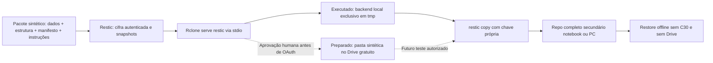

# GG-02C — integração Restic + Rclone e preparação do Google Drive

**06/11/2026 — Fase A sintética local; Fase B PREPARADA, NÃO EXECUTADA.** Responsável pela próxima decisão: mantenedor humano. **Google OAuth/conta não acessados. C30, ERP, Docker, PostgreSQL, Supabase e Storage existentes intocados. Piloto com dados reais e PROD NO-GO.** Esta entrega não implanta backup operacional.

## Autoridade, baseline e escopo

Pedido GG-02C do mantenedor autoriza scripts/testes de arquivos sintéticos e obtenção de Rclone portátil oficial no laboratório. O ponto de aprovação humana **antecede OAuth e qualquer operação real na conta**, inclusive consultas de quota. A disponibilidade de 15 GB foi informada na inspeção anterior do mantenedor; não é medição desta entrega.

Consulta de 06/11: `origin/main` atualizada em `1c704f84efa0650e6fbed3354fc7ab77e75fe73f`; [PR #106](https://github.com/The-Vonky/Gaucha-Gestao/pull/106) draft, aberta, sem merge, HEAD `0d8916a`; [PR #108](https://github.com/The-Vonky/Gaucha-Gestao/pull/108) draft, aberta, sem merge, HEAD `bda21d4`. Foram lidos corpos, comentários/revisão, alterações e evidências GG-02B. Nenhuma delas foi modificada ou incorporada por cherry-pick. A economia de 78,17% pertence exclusivamente ao fixture GG-02B, sem extrapolação.

Branch própria `codex/gg-02c-rclone-lab` criada da main acima. Durante a execução, outra atividade mudou o checkout compartilhado para a frente AUD-IMG. Entrega GG-02C usa índice Git separado e sua própria referência, sem criar worktree, trocar novamente a branch ou incluir o teste de Auditoria alheio. `supabase/snippets/` preservado.

Fontes obrigatórias: [AGENTS](../../AGENTS.md), [protocolo paralelo](../development/PARALLEL_AGENT_WORKFLOW.md), [BACKUP_RECOVERY](../architecture/BACKUP_RECOVERY.md), [lacunas C30](C30_BACKUP_GAPS.md), [GG-01](C30_GG01_INVENTORY_20261105.md), [decisão inicial GG-02](GG02_BACKUP_INICIAL_DRIVE_20261105.md), [restore histórico](../planning/02_RESTORE_DRILL.md), [registro de decisões](../planning/DECISION_REGISTER.md), ADR-008, ADR-006 Proposto e Plano Diretor. O texto ainda presente na main separa dados/estrutura em destinos distintos; a confirmação do mantenedor na PR #106 e neste brief exige **pacote completo no Drive**. Este documento segue o pedido atual, sem sobrescrever o arquivo sob revisão da #106 ou ratificar ADR Proposto. RPO/RTO, retenção, WAL/PITR e autorização operacional continuam pendentes.

## Arquitetura do ensaio e do próximo teste

O ensaio local comprova o protocolo e arquivos, sem reproduzir latência, falhas OAuth, API, quota ou disponibilidade do Drive. A cópia secundária executada está no **mesmo host/tmpfs**: independência lógica, não física. Pendrive de 8 GB permanece kit estrutural adicional, sem alegação de comportar o pacote completo.

## Ferramentas e reprodução executável

[Scripts, controles e sequência](../../tests/labs/gg02c/README.md). Restic 0.19.1 portátil da GG-02B é conferido contra o archive oficial e seu conteúdo descomprimido. Rclone 1.76.0 Linux amd64 é baixado do mirror oficial GitHub; SHA256SUMS e SHA-256 fixado devem coincidir **antes** de extrair/executar. Instalação somente em `/tmp/gg-02c-tools-<uuid>` privado 0700, sem sudo, pacote global, daemon ou faturamento. Checksums e versões estão na evidência; não foi feita validação GPG.

O download sem rede falhou por DNS; `downloads.rclone.org` respondeu 403 na tentativa com rede. O mirror oficial GitHub funcionou com checksum válido. Falha de checksum teria mantido a execução BLOCKED. Consulta somente leitura `docker ps` recebeu permission denied; não se elevou acesso ao Docker, pois o ensaio não o utiliza. Nenhum schema foi consultado.

## Fase B — procedimento preparado e ainda bloqueado

### 1. Aprovação anterior a qualquer contato com a conta

O mantenedor deve autorizar separadamente **OAuth interativo no seu computador e primeiro ensaio sintético na conta dedicada**, delimitando leitura de quota, criação de pasta exclusiva, três backups cifrados, restauração e cópia secundária. Até isso acontecer, **não executar os exemplos desta seção**, nem `rclone config`, `about`, `lsd` ou `mkdir` contra Google. Não solicitar e-mail, senha, código MFA, refresh token ou arquivo de configuração no chat/PR. A aprovação de merge desta PR não autoriza essa fase.

Antes da autorização: confirmar localmente que a conta é exclusivamente de backup, gratuita, recuperável, com MFA e códigos de recuperação em custódia independente. Definir quem mantém a conta e quem atua na indisponibilidade do mantenedor. Não registrar identificadores pessoais. Não ativar Google One, testes pagos, Google Cloud Storage, projeto com billing ou APIs com cobrança. Usar o client OAuth padrão do Rclone; se estiver bloqueado por política/limite do provedor, interromper e revisar com o titular, sem criar serviço pago ou ampliar escopo automaticamente.

### 2. Configuração interativa conduzida pelo mantenedor, após aprovação

1. Em computador local confiável e selecionado pelo titular, conferir binários oficiais e hashes da versão fixada, relógio, disco e ambiente; não usar C30 nem diretório sincronizado/publicado. Reservar diretório privado 0700 fora do checkout para configuração e senhas, com `umask 077`. Selecionar caminho absoluto novo e conferir que não é symlink. Nunca reutilizar configuração que contenha outros remotes.
2. Executar **manualmente**, com o binário conferido: `rclone --config <arquivo-privado> config`. Criar somente `gg02c-drive`, tipo `drive` (Google Drive), client ID/secret padrão em branco, sem service account e sem Shared Drive. Escolher inicialmente o escopo **`drive.file`**, limitado aos objetos criados pelo aplicativo, e conta correta no navegador. Login/MFA acontecem somente no navegador. Não copiar a resposta OAuth para terminal gravado, chat, issue ou relatório. Não usar `config show`, `config dump`, `-vv`, dumps HTTP ou logs de navegador.
3. O fluxo de navegador pode abrir temporariamente callback local `127.0.0.1:53682`. Isso não foi iniciado na Fase A. Preferir configuração interativa nesse mesmo computador, evitando transferência manual de tokens. Se uma política impedir esse fluxo, parar; não encaminhar tokens pelo chat nem abrir callback público.
4. Usar a opção interativa de **criptografar a configuração** no menu de `rclone config` e confirmar modo 0600. Token OAuth no arquivo é segredo; `obscure` não é cifragem suficiente. Não imprimir nem versionar conteúdo ou senha da configuração. Restic/Rclone em subprocesso precisará de desbloqueio por mecanismo local seguro (ex.: password command de cofre já adotado, conforme documentação oficial), sem senha literal no comando/script/histórico. Validar isso interativamente antes do backup; não implementar daemon, agendamento ou guardar a senha no repo.
5. Manter senha Restic forte e independente da senha Google e da configuração Rclone. Guardá-la em arquivo privado 0600 para uso por `--password-file`, com recuperação por custódia externa protegida. Nunca no pacote de origem ou no mesmo Drive como única cópia. O repo Restic contém chaves cifradas; o arquivo de senha do operador não deve ser enviado junto.

**Limites do escopo:** `drive.file` pode não enxergar arquivos criados pelo browser/outro client OAuth. Criar a pasta por Rclone, não pelo browser. `root_folder_id` restringe a navegação do cliente, não é uma fronteira de autorização equivalente a ACL. Não ampliar automaticamente para `drive` (acesso geral). Se quota ou recuperação em novo computador falhar com o escopo escolhido, registrar BLOCKED e obter decisão específica. Usar conta dedicada reduz o alcance, sem fornecer imutabilidade.

### 3. Quota e pasta exclusiva

Após autorização, consultar `rclone --config <arquivo-privado> about gg02c-drive: --json`. Conferir `total`, `used`, `free`, unidade **bytes**, lixeira e compartilhamento de quota com Gmail/Fotos. Se campos ausentes/negados, **não** presumir 15 GB; bloquear envio e revisar com titular. Não comprar espaço.

Proposta de controle **para o ensaio, sem política operacional aprovada**: avisar no terminal com ≥60% usados; bloquear novos envios com ≥80% usados **ou** espaço livre inferior ao crescimento conservador do próximo pacote + 20% de margem. Para o primeiro envio usar como teto o tamanho do repositório sintético local completo, sem assumir repetição da economia de deduplicação. Reconsultar quota após envio. Alertas automáticos/entrega a supervisor, retenção e previsão de crescimento real continuam D03/D08 pendentes; um aviso no terminal não comprova monitoramento.

Gerar UUID e criar **uma única pasta nova**, `GG02C-SYNTHETIC-<uuid>`, pelo remote dedicado. Conferir conta, nome e ausência de conteúdo antes de `rclone --config <arquivo-privado> mkdir gg02c-drive:GG02C-SYNTHETIC-<uuid>`. Se houver pasta homônima ou destino ambíguo, parar. Registrar somente nome sintético/UUID, sem link/ID privado da conta. Não compartilhar/publicar pasta. Nunca apontar o ensaio à raiz ou a um repo operacional.

### 4. Envio e restauração sintéticos

**Templates documentais, não scripts operacionais.** Substituir placeholders somente após conferir origem sintética gerada pelo laboratório, configuração privada, senha e pasta exclusiva. Não permitir argumentos genéricos do operador nem usar a CLI local `lab.py` para conta Google: ela não possui esse modo.

- Repo do ensaio: `rclone:gg02c-drive:GG02C-SYNTHETIC-<uuid>/repository`.
- Usar caminho absoluto para os dois binários conferidos, `--password-file <arquivo-privado-restic>`, `--no-cache` e opções `-o rclone.program=<binario-rclone>` e `-o 'rclone.args=serve restic --stdio --append-only --config=<arquivo-privado> --retries=1 --low-level-retries=1'`. Não habilitar logs debug/HTTP nem incluir credenciais na linha de comando.
- Inicializar repo v2 novo com `init`; conferir que `config`, `keys`, `data`, `index`, `snapshots` estão sob a pasta exclusiva. Restic cifra conteúdo/metadados antes de passá-los ao Rclone; não enviar a pasta de origem em texto claro por Rclone.
- Fazer `backup . --json --host gg02c-synthetic --tag initial` **somente dentro da origem sintética validada**, repetir inalterado e depois delta sintético conhecido. Capturar IDs, tempos, JSON Restic, quota antes/depois e bytes de upload contabilizados pelo transporte. Não inferir bytes WAN só de `data_added_packed` ou tamanho lógico.
- Executar `check --read-data` no repo Drive e restaurar pelo menos o snapshot inicial e o alterado para diretórios locais novos e privados, conferindo lista exata, tamanhos e SHA-256. Não restaurar sobre a origem ou qualquer diretório operacional. Comprovar que as versões anteriores não contêm o arquivo novo.
- Erro de OAuth, limite API, timeout, quota ou integridade deve resultar em FAIL/BLOCKED, preservar arquivos e impedir declaração de backup válido. Recuperar autorização pelo navegador/cofre, sem expor tokens. Não usar comandos de exclusão, manutenção destrutiva ou sincronização de remoções para “consertar” falhas. Restic administra seus locks transitórios; não remover locks manualmente. Falha/quota do Drive é **ainda não testada**.
- `--append-only` protege o endpoint Rclone deste processo contra remoção de objetos de backup (locks têm tratamento próprio), mas não protege contra acesso direto por outro cliente, exclusão na conta ou ransomware com credenciais. Não declarar WORM/imutabilidade. Nenhuma retenção destrutiva faz parte da entrega.

### 5. Segunda cópia independente e critério de encerramento da Fase B

1. Escolher notebook/PC autorizado, espaço suficiente para **repo completo** e restores, disco protegido e diretório local exclusivo fora de Google Drive/OneDrive/sincronizadores. Computador serve para guardar/restaurar backup, não hospedar sistema. Confirmar destino físico com o titular; não criar/formatar mídia por inferência.
2. Criar repo secundário com **senha/chave própria**, `init --copy-chunker-params --from-repo <repo-drive-sintetico> --from-password-file <senha-primaria>`, e executar `copy` entre os repos. Ambos os acessos são necessários nessa etapa; Restic lê/descriptografa e recifra para o destino. O repo secundário tem IDs/chaves próprios; mapear snapshots por tag/`original`, sem presumir igualdade de IDs. `copy` não espelha exclusões e não deve ser substituído por sincronização destrutiva. Não permite leitura sem a senha do secundário.
3. Conferir snapshots esperados e `check --read-data` no secundário. Armazenar localmente os binários oficiais, hashes, documentação, manifesto de versões e procedimento de desbloqueio; ensaio deve funcionar sem baixar dependências de C30/Drive. Custódia de senha externa **ao notebook e à C30**, acessível ao responsável/substituto, com recuperação testada sem divulgar segredo.
4. Desconectar rede, encerrar sessão de configuração Drive e usar HOME/cache novos. Tornar primário/origem/credenciais primárias indisponíveis sem apagar dados. Restaurar **todos os snapshots necessários** do secundário em diretório novo, conferir os hashes e as versões do pacote. Registrar data, equipamento sem PII, versões, tempos e PASS/FAIL. Somente essa prova em outro equipamento com senha recuperada fora do host permite superar a lacuna física desta Fase A.
5. Manter ao menos uma cópia offline ou protegida contra alteração. Após cada atualização futura da cópia, repetir integridade e restore amostral/conjunto definido; sem agendamento operacional nesta PR. Fase B não pode ser aceita só porque upload terminou.

## Recuperação em outro computador — preparado, parcialmente ensaiado localmente

O backup é o **repositório Restic íntegro**, não um arquivo isolado de snapshot. São necessários `config`, arquivos pertinentes em `keys/`, todos os packs de `data/` referenciados, `index/`, `snapshots/` e metadados correspondentes. Para cópia bruta, conservar **toda** a árvore do repo estável; não selecionar por data/último snapshot e não copiar enquanto há escritor ativo. Cache não substitui objetos do repo. O arquivo em `keys/` contém chave cifrada: também é necessária a senha correta, fora do host perdido.

O caminho preferido desta entrega é `restic copy`, que constrói outro repo completo e independente com sua própria chave. Cada snapshot referencia blocos compartilhados com outros; vários snapshots pequenos não significam arquivos de backup autossuficientes. Um pack isolado, `snapshots/<id>` ou um ZIP apenas da última captura é insuficiente.

Na perda de C30/Drive, usar o secundário **local offline** e senha do secundário recuperada em custódia externa. Conferir binário/hashes e capacidade; executar `snapshots`, `check --read-data` e `restore <id> --target <diretorio-novo>`, com `--no-cache`, `--password-file` protegido e sem variáveis herdadas. Conferir manifesto de integridade e selecionar estrutura, versões e instruções da **mesma captura** dos dados. Não apontar restore para diretório do sistema ativo.

Se só o Drive estiver disponível, configurar OAuth novamente no equipamento substituto, após autorização e com o mesmo client/escopo compatível, localizar a pasta sintética e validar acesso aos objetos; isso continua BLOCKED até prova real. Não depender da configuração guardada apenas na C30. Uma configuração com tokens não substitui a senha Restic e vice-versa.

Para um pacote empresarial futuro, além de arquivos recuperados é preciso provar reconstrução do runtime, PostgreSQL/Auth/roles e bytes/metadados de todos os buckets consistentes, segredos necessários por canal seguro, imagens/versões disponíveis e testes negativos de autorização. O fixture desta PR contém **representações fictícias**, não dumps SQL ou imagens Docker executáveis. Não valida captura de PGDATA, consistency freeze, uploads concorrentes, WAL/PITR ou reconstrução operacional. Nenhum gate GG-03/O3/O4 é fechado.

## Resultados, riscos e próxima decisão

Resultados reais, comandos, hashes dos scripts e matriz estão no [relatório de execução](GG02C_LAB_RESULTS_20261106.md) e na [evidência JSON](../../tests/labs/gg02c/results/20261106-execution.json). Procedimentos da Fase B acima não são provas. Não há segunda revisão humana formal declarada; mantenedor único decide merge após diff/CI, preservando riscos.

Próxima autorização: **permitir ao mantenedor iniciar OAuth e ensaio sintético delimitado nesta conta dedicada, incluindo quota/pasta/upload/restore/cópia secundária**, sem dados reais, custos, C30, retenção destrutiva ou agendamento. Nenhum e-mail/credencial precisa ser enviado ao agente. Se OAuth for autorizado isoladamente, upload continuará dependendo do escopo dessa autorização. C30/implementação operacional, dados reais e PROD exigem decisões posteriores próprias.

Reversão da entrega: commit futuro removendo somente os arquivos/referências GG-02C. Não há serviço para desligar nem alteração de infraestrutura persistente. Recursos de laboratório são preservados; limpeza não foi executada nem autorizada por este guia.

## Fontes oficiais consultadas em 06/11/2026

- [Restic — backend Rclone e opções program/args](https://restic.readthedocs.io/en/stable/030_preparing_a_new_repo.html#other-services-via-rclone): integração e cifragem local antes do transporte.
- [Rclone serve restic](https://rclone.org/commands/rclone_serve_restic/): stdio e append-only.
- [Rclone — downloads e mirror oficial](https://rclone.org/downloads/) e [release 1.76.0](https://github.com/rclone/rclone/releases/tag/v1.76.0): obtenção portátil e checksums.
- [Rclone Google Drive](https://rclone.org/drive/): OAuth, escopos, callback, pasta e limitações; [configuração cifrada](https://rclone.org/docs/#configuration-encryption).
- [Rclone about](https://rclone.org/commands/rclone_about/): quota; [Restic copy](https://restic.readthedocs.io/en/stable/045_working_with_repos.html#copying-snapshots-between-repositories): cópia com chaves próprias, transferência de objetos e chunker.
