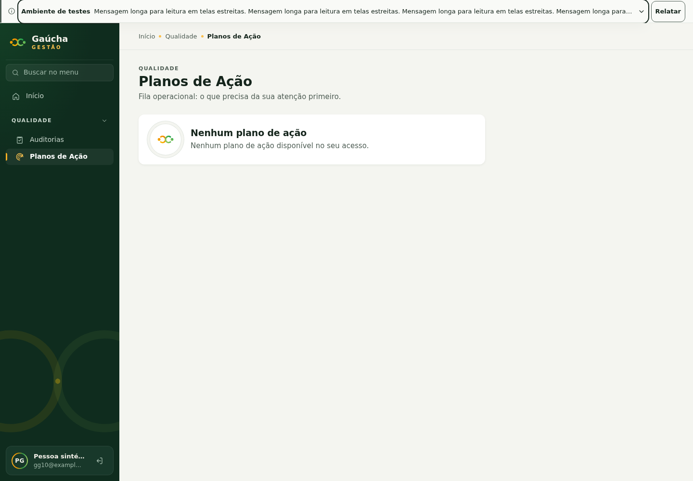
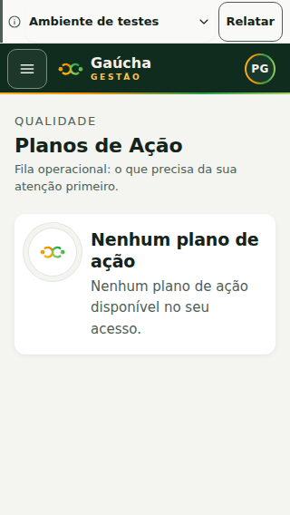
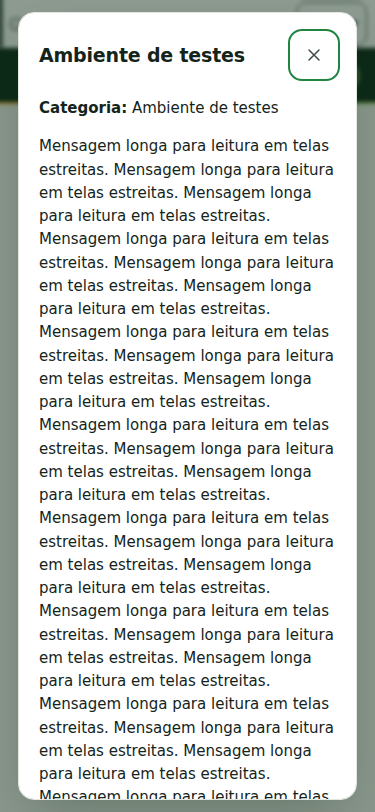
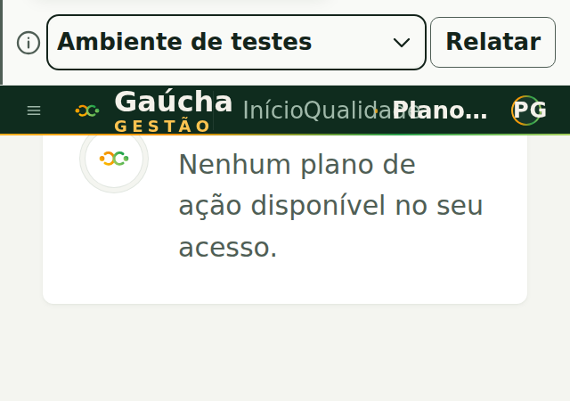

# GG-10 — Refinamento compacto, 05/11/2026

## Estado e escopo

Baseline `9e2860157399673bc4631e746bbb4acba0a4448b`, branch da PR #102.
PR #101 separada no SHA `27a8293`; sem edição de Auditoria, Core, banco ou migrations.
`supabase/snippets/` não rastreado preservado. Sem merge ou deploy.

A barra mede 48 px nas larguras normais, com alvos de 44 px. Desktop tem título,
resumo truncado, expansão e Relatar; mobile oculta o resumo. Título/expansão abrem
modal Shared com texto integral, categoria e datas; CTA independente, configurável
e indisponível sem callback GG-11. A explicação fica acessível e no modal.
Presets usam tokens semânticos Elo; vermelho crítico, âmbar manutenção, azul
informação, neutro testes; verde/neutro preparados sem mudar o JSON v1.

## Evidência executada

- PASS: `npm run typecheck`, `npm run lint`.
- PASS: `npm test -- tests/announcements.test.tsx`: 40 testes.
- PASS: build com URL local/chave pública fictícia e `npm run verify:build`;
  aviso preexistente de chunk >500 kB.
- PASS: `npm audit --audit-level=moderate`, zero vulnerabilidades.
- PASS: `node tests/integration/announcements-browser.mjs`, Chromium com Auth/REST
  interceptados, sem banco e zero pageerrors. Vite existente em 5173 preservado.
- Browser: 1440/1024/768/360/375/320, mensagem extensa, modal na top layer,
  Escape e foco devolvido ao título, drawer, navegação SPA, sticky, sidebar,
  breadcrumbs/topbar, controles CSS sticky de Auditoria, refresh, falha/recuperação,
  desativação e logout. Barra entre 44–56 px em todas essas larguras.
- Contraste computado texto/CTA: neutro/manutenção/informação 15,44:1;
  crítico 9,25:1. Categoria também textual no painel. Foco usa token de texto.
- Reflow 640×450 e tamanho de texto 200%: PASS. Zoom nativo e leitores de tela:
  NOT EXECUTED; aparelhos físicos Android/iOS: NOT EXECUTED.
- Docker: inspeção inicial negada pelo socket; sem operação de banco. Integração
  real de Auth/REST/Storage: NOT EXECUTED nesta entrega visual.

A primeira tentativa Chromium foi bloqueada por libs ausentes; dependências foram
extraídas somente em `/tmp/gg10-browser-libs`, sem instalar pacotes no sistema.
O ensaio encontrou altura indevida por classe de acessibilidade incorreta e falta
de retorno de foco no modal Shared; corrigidos no componente e revalidados.
Resultados completos e capturas adicionais: `tmp/gg10/results.json` (sintéticos).

## Capturas sintéticas

## Limites e reversão

JSON continua público, sem dados internos. Relógio do browser e propagação/cache do
hosting têm os limites do contrato original. GG-11 não envia dados. Reversão:
revert dos commits desta entrega; não há dados a remover. Aceite visual e merge
cabem ao mantenedor único; não houve segunda revisão humana. GG-10 permanece em
revisão, sem encerramento de gates ou declaração de prontidão produtiva.
