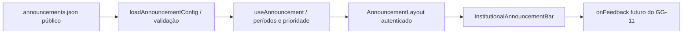

# GG-10 — Avisos institucionais

Implementação local autorizada em 04/11/2026. Responsável por revisão e merge:
mantenedor único. Fonte do escopo: brief GG-10 fornecido pelo mantenedor nesta tarefa;
nenhuma issue GG-10 encontrada na consulta inicial. **PROD NO-GO; sem implantação.**

## Diagnóstico e arquitetura

A baseline `origin/main` `422a51fe91843824013ad337122f6954c954e59c`
possui sidebar e topbar sticky, navegação SPA, drawer e modais Shared com
`dialog.showModal()` na top layer. Login/loading ficam fora do shell.
`Notice` é um aviso contextual; não existia fonte central de comunicados.
A PR #101 de Auditoria permanece separada, sem incorporação dos seus commits.

`AnnouncementLayout` envolve somente a fronteira autenticada em `App.tsx`,
incluindo estados de perfil indisponível/erro de acesso. Não muda `AuthProvider`,
permissões ou proteção das rotas. Shared não importa Core nem módulos.

A barra ocupa espaço no fluxo e fica sticky em `top: 0`, persistente ao rolar.
`ResizeObserver` mede sua altura antes da pintura inicial e em mudanças de largura,
texto e zoom. `--announcement-height` desloca topbar/sidebar e reduz a altura
útil da sidebar. Os ajustes em `app/styles.css` acrescentam esse deslocamento
à barra de seção mobile e ao índice de seções desktop de Auditoria, incluindo a
altura útil do índice; não mudam regras ou arquivos do módulo.
`--app-sticky-height` inclui o cabeçalho medido no `scroll-padding-top` do documento,
para focos/âncoras; a variável é removida na desmontagem.

Safe area superior pertence à barra quando ativa; sem aviso volta ao cabeçalho
mobile. Safe areas laterais são preservadas. A barra usa `--z-header` (30), abaixo
de drawers (40), modais (50), toast (60) e skip link (70). Dialogs nativos ficam
na top layer. Não há toast global no Shared atual; o aviso de erro do logout usa
`--z-toast`. A barra não cria novo contexto acima desses controles.

Refinamento de 05/11: barra recolhida de referência 48 px (alvos ≥44 px), com
resumo truncado no desktop e somente título, expansão e «Relatar» no mobile.
Título/expansão formam um botão próprio; o CTA é outro controle. Textos completos
ficam no `Modal` Shared (`dialog.showModal`): assunto, categoria, mensagem, datas,
feedback e explicação de indisponibilidade. Escape, fechar e backdrop fecham;
o navegador mantém foco preso e devolve-o ao acionador. A abertura não muda a
altura do Shell. Sem CTA quando `action` está ausente. Região live polite contém
texto inerte; não há carrossel nem animação. Zoom/reflow pode ampliar a altura.

Presets Elo usam superfície sutil com acento: manutenção âmbar, informação azul,
crítico vermelho (também superfície de perigo), testes neutro. Classes semânticas
success/neutral preparam verde/neutro para a próxima entrega; o JSON v1 mantém
suas quatro categorias, prioridade e validação. Não há cor/CSS livre. Texto,
foco e controles usam tokens existentes. Ausência/desativação não reserva altura.

## Configuração e operação local

Editar `apps/web/public/announcements.json`. O Vite o serve em
`/announcements.json` e o build o copia para `apps/web/dist/announcements.json`
(ou sob o `BASE_URL` do build). O arquivo entregue contém **somente um aviso de
testes**, ativo para sessão autenticada; não contém manutenção agendada.

| Campo | Regra |
| --- | --- |
| `version` | Obrigatório, `1` |
| `enabled` da raiz | `false` oculta todos os avisos |
| `announcements` | Lista de até 20 itens; vazia oculta a barra |
| `id` | Único, até 80 caracteres, letras minúsculas/números/hífen |
| `enabled` do item | `false` retira somente esse item |
| `type` | `testing`, `maintenance`, `information`, `critical` |
| `title` / `message` | Texto obrigatório, até 120 / 1600 caracteres |
| `startsAt` / `endsAt` | Obrigatórios; `null` ou ISO 8601 com segundos e timezone |
| `audience` | Somente `authenticated`; `public` é rejeitado nesta versão |
| `priority` | Inteiro entre −10000 e 10000 |
| `showIcon` | Opcional, `true` por padrão |
| `action` | Omitido/`null` oculta o CTA; objeto somente do tipo `feedback` |
| `action.label` / `action.enabled` | Texto até 100 caracteres / booleano |

Para trocar a mensagem, editar `title`/`message`; não é necessário editar TSX/CSS.
Para desativar globalmente, manter a lista e definir `enabled: false` na raiz.
Para remover um item, definir seu `enabled: false` ou removê-lo da lista.
`action.enabled: false` exibe CTA desabilitado com explicação acessível.

Períodos usam início inclusivo e término exclusivo. Exemplo **fictício**, sem
agendamento operacional: `startsAt: "2026-11-15T18:00:00-03:00"`,
`endsAt: "2026-11-15T20:00:00-03:00"`. Informar explicitamente o offset de
`America/Sao_Paulo` para a data desejada; `Z` é UTC. Não usar data local sem offset,
`15/11/2026`, ou o identificador IANA dentro da string ISO. Datas impossíveis,
fim anterior/igual ao início, IDs duplicados e categorias desconhecidas invalidam
o documento inteiro. Sem início/fim, usar `null`; fim ausente não é inferido.

Seleção determinística: **critical > maintenance > information > testing**.
Dentro da mesma categoria, maior `priority`; empate: menor `id` por ordem ASCII.
A ordem dos itens no JSON não altera o resultado. Exibe apenas um aviso.
Um timer recalcula a seleção nas fronteiras dos períodos; polling/foco corrigem
mudanças de relógio e retomada de aba. O relógio é do navegador: **não serve como
controle operacional de disponibilidade ou bloqueio de acesso**.

## Publicação, cache, falhas e limites reais

`fetch` usa caminho fixo da mesma origem, `cache: "no-store"`, sem credenciais e
sem redirecionamentos. Consulta inicial, a cada 60 segundos em aba visível, ao
foco e ao evento de visibilidade; intervalo mínimo de 5 segundos agrupa eventos.
Uma consulta por vez, abortada após 10 segundos e ao desmontar/logout.
Aba oculta não faz novas consultas; a seleção dos períodos é recalculada ao voltar.
Conteúdo equivalente não altera o estado nem repete o texto na região live.

HTTP não OK, JSON ausente/inválido, modelo inválido, resposta com mais de 65536
caracteres ou falha de rede **ocultam a barra, inclusive o último aviso válido**.
A próxima consulta pode recuperá-la. A decisão evita manter manutenção/urgência
obsoleta indefinidamente, mas pode retirar a sinalização de testes durante uma falha.
Não há fallback embutido, armazenamento local, dependência de Supabase ou bloqueio
da aplicação. O limite de tamanho é verificado depois da leitura; não é um limite
rígido de tráfego de rede.

No DEV Vite, editar o arquivo público permite servir conteúdo novo. No build
estático, o JSON é um arquivo separado do JavaScript: um host que permita substituí-lo
pode publicar só o arquivo, sem recompilar JS. **Isso não comprova esse procedimento
no hosting real.** Uma alteração apenas no repositório não muda arquivo já publicado;
a publicação normal do bundle continua passando pelo build/release autorizado.
Workers Static Assets ou imagem imutável podem exigir nova publicação/empacotamento.
`no-store` controla o cache do navegador; cache/regras de CDN, origem, proxy ou futuro
service worker precisam de verificação operacional e eventual purge/revalidação
autorizada. Não foram alterados Caddy/Cloudflare/C30/STAGING. Não há garantia de
propagação em um minuto se a origem/CDN continuar fornecendo conteúdo antigo.

Nenhum dado interno, autor, e-mail, segredo, JWT, URL assinada ou texto empresarial
deve entrar no JSON: **é público mesmo que a UI só o mostre após login**.
Textos são renderizados por React sem HTML arbitrário. Não há `href`, URL de ação,
script, imagem remota nem destino externo no contrato executável. Campos extras
são ignorados; URLs adicionadas não se tornam ações. A autenticidade depende da
origem HTTPS e do controle de publicação, sem assinatura criptográfica própria.

## GG-11 e administração futura

O ponto explícito é `AnnouncementFeedback = (announcement: Announcement) => void`,
recebido pelo componente e por `AnnouncementLayout`. GG-11 deverá fornecer o
callback oficial no nível da aplicação, capturando rota/módulo conforme sua política.
Só é funcional com **ambos** `action.enabled: true` e callback implementado.
A aplicação atual não fornece callback; mudar só o JSON não habilita o botão.
Não há formulário, envio, armazenamento, notificação ou rota fictícia.

Proposta separada para evolução administrativa, sujeita ao mantenedor:

1. Aprovar domínio/proprietário dos avisos, audiência pública versus interna,
   papéis/permissões de gerenciamento e semântica de publicação/revisão.
2. Projetar persistência, RLS/RPC, validação no servidor e trilha de autor/alterações
   com Core como dono de identidade/autorização; decidir retenção e concorrência.
3. Criar adaptador que entregue `AnnouncementConfig` validado no lugar da fonte
   JSON, conservando seleção e componente visual; separar conteúdo público de
   conteúdo restrito no backend, sem confiar no campo `audience` do cliente.
4. Só então implementar criar/editar, ativar/desativar, agendar/priorizar e auditar,
   com testes negativos de escopo/perfil/concorrência. Nenhum grant novo nesta PR.

## Validação e reversão

[Registro de validação GG-10](GG10_VALIDATION_20261104.md) contém comandos,
SHA, resultados, screenshots sintéticos e pendências. Testes de contrato/hook:
`tests/announcements.test.tsx`. Prova Chromium:
`node tests/integration/announcements-browser.mjs` (reutiliza Vite local em 5173;
Auth/REST interceptados, sem banco). O helper só inicia Vite nessa mesma porta
se nenhum serviço estiver ativo e preserva processo existente.

Reversão local antes de integração: revert da PR. Desativação operacional futura:
publicação controlada de `enabled: false`; se a configuração estiver indisponível,
a barra também some. Não afeta Auth, RLS, RPCs, migrations ou dados. Nenhum teste
encerra P1–P9/O1–O8 ou autoriza deploy. Merge exige decisão do mantenedor;
segunda revisão humana não ocorreu.

Refinamento compacto e novas evidências: [validação de 05/11](GG10_COMPACT_VALIDATION_20261105.md).
